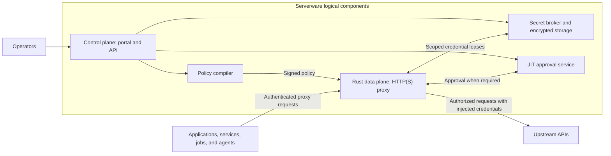
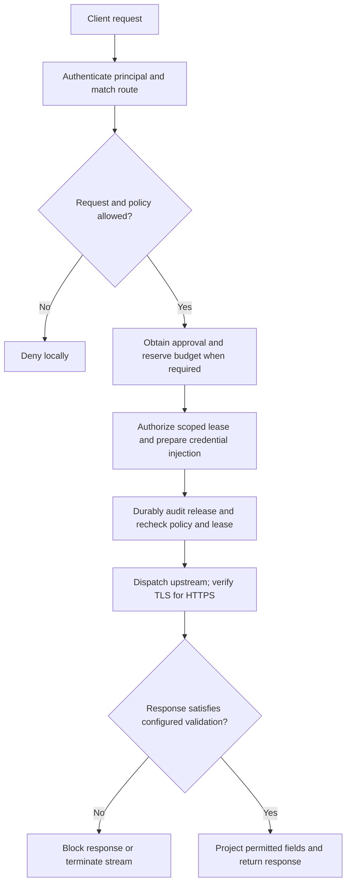

> Publication note: deployment-specific addresses, identities and paths in this document are example placeholders, not a public service or release-verification evidence.

# Serverware

Keep upstream credentials out of your applications. Control how they are used.

Serverware is a credential-control HTTP(S) proxy for applications, backend
services, scheduled jobs, CI pipelines, and AI agents. Instead of distributing
provider API keys and OAuth tokens to every workload, you store them centrally
and give each workload a scoped Serverware identity. Serverware checks policy,
injects the authorized upstream credential, and validates the response.

This is for ordinary application authentication as well as agentic workflows.
The application asks to use an API; it does not need possession of that API's
long-lived credential.

## Production status

Checkpoint: **2026-09-27 — pre-production, source-only.**

**34 of 46 tracked source checkpoints landed · 12 open, including F08 in progress.**
**Production acceptance: 0/6 verified.** Current source is unbuilt and unexecuted.

**Active workflow: OIDC session activation — 12/16 detailed source steps landed.**
Each numbered segment below maps to a named task: ✓ landed, NEXT open, — open.
This counts the smallest currently named steps, so progress is visible before a
larger milestone closes. Grouping parents are not counted again; these 16 steps
all belong to F08, not the whole product. Counts are not effort percentages or an ETA.

[![OIDC session activation: 12 of 16 detailed source steps landed; four remain. Completed: retained finalization checks, assertion verification, existing-cookie login, read proofs, encrypted originals, business effects, capacity adapter, signed originals, indexed writes, configured owner, root bootstrap, and private planner service. Next: fresh latest-head admission. Still open: custody and execution, public activation and recovery, and integrated portal flow. Source-only, not production verification.](docs/images/activation-progress.svg)](docs/production-status.md#active-workflow-granular-source-steps)

Latest landed: [root-authenticated configuration and the private planner service](https://github.com/example/private-deployment).
**Next:** independently fresh state admission before planning. **After that:**
protected execution/token delivery, separately authorized public actions/recovery,
and the integrated portal flow. Signed launch snapshots do not prove fresh state;
planning does not authorize execution.

The [numbered checklist and commit evidence](docs/production-status.md#active-workflow-granular-source-steps)
explain every segment. Broader work remains visible below:

| Workstream | Landed source | Still to do |
| --- | --- | --- |
| Evidence handoff · 10/10 | Reserve, protected SQL, signed completion, retained originals | Current-release verification remains separate |
| Historical recovery · 4/5 | Original-signature replay and recovery within the configured cohort | Resolve historical authority across source/configuration/key changes |
| Permissions and grants · 10/10 | Separate permissions, grant issuance, retention and portal actions | Current-release verification remains separate |
| Finalization and sessions · 7/8 | Reservation, one-use SQL, signed completion/recovery and activation prerequisites | Protected OIDC activation, token delivery and integrated portal workflow |
| Workloads and native · 3/6 | TLS-bound attestation, identity authoring, signed-handoff client | Provision service identities, finish native enrollment and enclave integration |
| Providers and operations · 0/7 | Lower-level adapters and tooling exist; these integration closures remain open | OAuth ownership/custody, revocation, protected side effects, publication recovery, RBAC rollback protection, telemetry |

All 46 source checkpoints and the nested milestone bars

Full verification follows source freeze. Immutable dependencies and independently
operated signing, Nitro/KMS and witness services remain prerequisites; the
services are not provisioned.

[Open the full tracker →](docs/production-status.md) for every checkpoint, committed
evidence, a [breakdown of all 12 open milestones](docs/production-status.md#remaining-work-breakdown)
and the separate production release gates.

<!-- Update README counts/descriptions, production-status.md evidence/checklists, activation-progress.svg and implementation-progress.svg together. The active bar counts deepest named F08 leaves exactly once, excluding grouping parents; document any inventory/denominator change. Every segment needs a visible number, named status and linked evidence. NEXT is open, not an active or completed claim. Child counts do not change parent totals. Keep source progress separate from exact-release evidence; reopen invalidated gates. -->

## Why Serverware?

A typical secret manager delivers a secret to an application. Serverware moves
the credential's use into the proxy instead: the calling service receives the
permitted API response, not a credential lease. This reduces the places where
upstream credentials need to be stored and the number of workloads that need
access to them.

For example:

- A backend service can call an approved API without keeping the provider key in
  its environment, container image, or application configuration.
- A user can connect a Google or X account through the operator portal; workers
  use the permitted provider operations without receiving the refresh token.
- A CI job can be restricted to a particular package-publishing operation, with
  human approval required before the credential is used.
- An automation or AI agent can receive narrowly scoped access to the same APIs
  without being given the underlying account credentials.

The workload still needs to authenticate to Serverware. This is reduced
credential distribution, not a claim that all clients become secretless.

## Architecture

These are five logical roles, not a claim that five independently deployed
services are already available. The Python/FastAPI control plane manages
configuration and operator workflows. The Rust data plane is the production
implementation track for credential-bearing traffic; the legacy Python
mitmproxy path is development-only and rejects credential-bearing routes.

Clients use proxy-capable HTTP libraries and normal upstream URLs, configured
with Serverware proxy authentication and its verified CA for HTTPS interception.
SDK-specific configuration may still be needed. Workload egress controls must
prevent bypassing the proxy where enforcement is required.

## Three separate authentication relationships

| Relationship | Purpose | Credential boundary |
| --- | --- | --- |
| Workload → Serverware | Identify the calling service, job, or agent and its allowed routes. | A scoped Serverware identity, not the provider's API key. |
| Operator → control plane | Manage credentials, policies, approvals, and audit. | Operator OIDC, role-based access, and WebAuthn controls. |
| Serverware → upstream API | Perform the approved operation as the connected provider account. | Centrally stored API credentials or OAuth tokens, used by the trusted credential path. |

Operator OIDC login and provider OAuth account connection are different flows.
Serverware is not a general-purpose identity provider or a replacement for every
application's end-user login system.

## Policies govern credential use

A signed policy binds a principal, route, credential reference, and API adapter.
An unrecognized or unauthorized request is denied by default. Policies can
constrain:

- **Where:** destination host and port, HTTP method, and path.
- **What:** recognized API operations, allowed request fields, and value bounds.
- **When and how much:** time windows, request counts, and shared budgets.
- **Who approves:** optional short-lived, request-bound human approval.
- **What comes back:** response shape, permitted fields, date bounds, and
  request-to-response bindings supported by the selected adapter.

For example, a credential can be assigned to a read-only integration with a
bounded date window, or to a publishing workflow that requires approval. The
upstream account's broad permissions do not have to become the caller's policy.
Enforcement depends on a supported, explicitly configured operation; merely
rewriting a request does not prove the response satisfies the policy.

The source includes generic REST, Gmail, X, and npm adapters, plus static
credential injection and Google/X OAuth onboarding. See the
[constraint reference and examples](docs/credential-constraints.md) and
[example policy bundle](policies/demo.policy.json) for exact supported behavior.
Policies are typed, bounded data—not arbitrary executable policy code.

## Request lifecycle

A missing approval, exhausted budget, unavailable required authority, or stale
policy/lease stops the request before upstream dispatch. Audit records bind
decisions to the relevant principal, policy, and credential version without
logging raw secrets. Response validation is adapter-specific: a blocked response
does not undo an upstream action, and already-released stream bytes cannot be
recalled. Streaming therefore has separate restrictions.

## Security and deployment boundaries

Credentials use envelope encryption at rest and short-lived, recipient-bound
leases for the data plane. Plaintext still exists in the trusted credential-use
path and is sent to the intended upstream provider. Ordinary Docker does not
protect that memory from the host administrator.

The production target places TLS termination and the complete credential-handling
proxy inside an attested enclave, with independently operated release signing,
Nitro/KMS verification, and a rollback-resistant witness. This production chain
still needs implementation, independent provisioning, and verification; the
required current dependency snapshot is also not ready. Local signatures,
development quotes, and historical test results do not establish that guarantee.

One deployment currently represents one administrative trust domain, not an
isolated multi-tenant vault. Support is HTTP(S)- and adapter-specific: arbitrary
database/SSH authentication, client TLS credentials, and request-signing schemes
are not automatically supported. See the [security review](docs/security-review.md)
for the threat model and production acceptance gates.

## Development and documentation

There is no working production quickstart for the current source. Read the
[development reference](docs/development-reference.md) for the intended local
Compose workflow, configuration, and diagnostic recipes. It uses development
credentials and is not a production deployment. Before running builds or tests,
follow the [source-freeze and verification workflow](goal.md#resource-conscious-engineering-workflow).

| Read next | Covers |
| --- | --- |
| [Operator and OAuth guide](docs/portal-oauth-agent-guide.md) | Portal login, provider connection, credential assignment, approvals, and client enrollment. |
| [Credential constraints](docs/credential-constraints.md) | Policy language, supported authentication modes, adapters, and response restrictions. |
| [Rust data plane](data-plane/README.md) | Proxy implementation and transport contracts. |
| [Project requirements](goal.md) | Architecture, implementation roadmap, and acceptance criteria. |
| [Successor implementation status](docs/webauthn-successor-transitions.md) | Current authentication integration and execution gaps; links to the historical startup diagnosis. |
| [Release stages](docs/release-stages.md) | Separate build, publish, sign, deploy, and independent verification responsibilities. |
| [Dependency snapshot](docs/production-dependency-snapshot.md) | Immutable offline dependency preparation and its remaining release boundary. |
