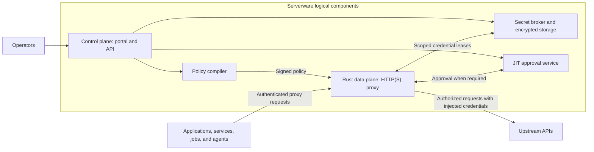
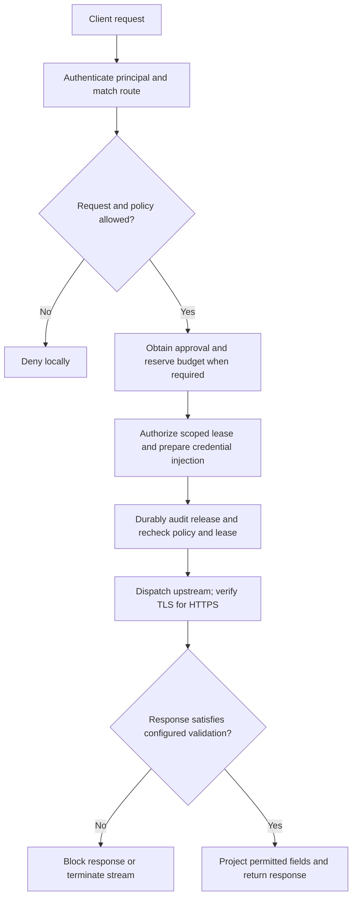

> Publication note: deployment-specific addresses, identities and paths in this document are example placeholders, not a public service or release-verification evidence.

# Serverware

Keep upstream credentials out of your applications. Control how they are used.

Serverware is a credential-control HTTP(S) proxy for applications, backend
services, scheduled jobs, CI pipelines, and AI agents. Instead of distributing
provider API keys and OAuth tokens to every workload, you store them centrally
and give each workload a scoped Serverware identity. Serverware checks policy,
injects the authorized upstream credential, and validates the response.

This is for ordinary application authentication as well as agentic workflows.
The application asks to use an API; it does not need possession of that API's
long-lived credential.

## Production status

Checkpoint: **2026-09-27 — pre-production, source-only.**

**34/46 source checkpoints landed · 1 in progress · 11 todo.**
**Production acceptance: 0/6 verified.** Current source is unbuilt and unexecuted.

### Current work: token release and private handoff

**15/16 token-release units landed; the final unit is in progress.**
The bar below expands units 15 and 16 into their **11 existing substeps**:
**10 landed · 0 active · 1 todo**. Each segment has a name and status.

| Status | Substep | What it delivers |
| --- | --- | --- |
| Landed | 16.1 · Root bootstrap and key delivery | Authenticated configuration, dedicated delivery key and isolated startup — [e6fa55c](https://github.com/example/private-deployment) |
| Landed | 16.2 · Isolated cold service | Packaged, finite release worker with resource cleanup — [4097896](https://github.com/example/private-deployment) |
| Landed | 16.3 · Bounded private transport | Peer-checked requests and guarded responses under the original deadline — [4097896](https://github.com/example/private-deployment) |
| Landed | 16.4 · Independent response verifier | Root-authorized checks of original proofs, exact response and token commitment — [abce0bb](https://github.com/example/private-deployment) |
| Next / todo | 16.5 · Authorized private handoff | Connect the configured authorized caller to transport and verification; handle uncertainty without automatic retry |

**Latest landed:** [16.4 · independent response verification (`abce0bb`)](https://github.com/example/private-deployment).
Still to do: connect the authorized private caller to the transport and verifier.
Source verification is not observed delivery, durable storage or a confirmed session.

Each substep turns green only when its implementation is committed and linked
in the [completion-criteria ledger](docs/production-status.md#exact-release-and-handoff-detail).
These nested counts are **not additive**, effort percentages, or an ETA.

### Still to finish across the project

| ID | Remaining checkpoint | Source status |
| --- | --- | --- |
| H05 | Historical authority across configuration/key changes | Todo |
| F08 | Session activation: finish token handoff, then public permissions, activation/recovery and portal/session flow | In progress |
| N04 | Workload identity provisioning and authenticated channels | Todo |
| N05 | Native enrollment, verified CA installation and proxy setup | Todo |
| N06 | Enclave TLS/proxy execution and credential custody | Todo |
| O01 | OAuth ownership across deployments and applications | Todo |
| O02 | Measured provider issuance and interrupted-exchange recovery | Todo |
| O03 | Public revocation and authenticated recovery | Todo |
| O04 | Protected provider and filesystem side effects | Todo |
| O05 | Interrupted policy-publication recovery | Todo |
| O06 | Independent RBAC rollback witness | Todo |
| O07 | Authenticated, signed and sequenced telemetry | Todo |

**Legend:** green/check = landed source; amber = in progress, including uncommitted
work; gray = todo; blue = next/todo, not yet active. Open checkpoints may contain
partial code. Landed does not mean tested, deployed, or production-ready.

Deeper checkpoints and completed-work evidence

- [All 46 project checkpoints and their evidence](docs/production-status.md#next-source-milestones)
- [Session activation: 19/26 steps landed](docs/production-status.md#active-workflow-granular-source-steps)
- [Token release: 15/16 units landed](docs/production-status.md#token-release-implementation-detail)
- [Release and handoff: 10/11 substeps landed](docs/production-status.md#exact-release-and-handoff-detail)
- [Completion/recovery: 6/6](docs/production-status.md#consume-completion-and-recovery-detail), [reservation/SQL: 6/6](docs/production-status.md#consume-reservation-and-sql-detail), [consume authorization: 12/12](docs/production-status.md#consume-authorization-substeps), [grant issuance: 5/5](docs/production-status.md#consume-grant-issuance-detail)

**Production gates stay separate: 0/6 verified.** Integration is unfinished;
immutable dependencies, frozen verification and independent release evidence
are pending. Signing, Nitro/KMS and witness services are not provisioned;
live operator/hardware/provider acceptance awaits deployment.
Full verification follows source freeze.

[Full tracker and remaining-work criteria →](docs/production-status.md#remaining-work-breakdown)
· [Six production acceptance gates →](docs/production-status.md#remaining-production-gates)

<!-- Keep README, docs/production-status.md and affected progress SVGs synchronized. Use the existing 46 project / 26 activation / 16 token-release inventories; release-handoff-progress.svg expands units 15/16 into 15.1–15.6 and 16.1–16.5, not new milestones. Every segment needs a visible ID, name, status and linked criterion/evidence. Mark active uncommitted work amber, queued work blue, todo gray; green requires its actual implementation commit. Never add children to parents, infer an ETA from counts, or combine source progress with production acceptance. -->

## Why Serverware?

A typical secret manager delivers a secret to an application. Serverware moves
the credential's use into the proxy instead: the calling service receives the
permitted API response, not a credential lease. This reduces the places where
upstream credentials need to be stored and the number of workloads that need
access to them.

For example:

- A backend service can call an approved API without keeping the provider key in
  its environment, container image, or application configuration.
- A user can connect a Google or X account through the operator portal; workers
  use the permitted provider operations without receiving the refresh token.
- A CI job can be restricted to a particular package-publishing operation, with
  human approval required before the credential is used.
- An automation or AI agent can receive narrowly scoped access to the same APIs
  without being given the underlying account credentials.

The workload still needs to authenticate to Serverware. This is reduced
credential distribution, not a claim that all clients become secretless.

## Architecture

These are five logical roles, not a claim that five independently deployed
services are already available. The Python/FastAPI control plane manages
configuration and operator workflows. The Rust data plane is the production
implementation track for credential-bearing traffic; the legacy Python
mitmproxy path is development-only and rejects credential-bearing routes.

Clients use proxy-capable HTTP libraries and normal upstream URLs, configured
with Serverware proxy authentication and its verified CA for HTTPS interception.
SDK-specific configuration may still be needed. Workload egress controls must
prevent bypassing the proxy where enforcement is required.

## Three separate authentication relationships

| Relationship | Purpose | Credential boundary |
| --- | --- | --- |
| Workload → Serverware | Identify the calling service, job, or agent and its allowed routes. | A scoped Serverware identity, not the provider's API key. |
| Operator → control plane | Manage credentials, policies, approvals, and audit. | Operator OIDC, role-based access, and WebAuthn controls. |
| Serverware → upstream API | Perform the approved operation as the connected provider account. | Centrally stored API credentials or OAuth tokens, used by the trusted credential path. |

Operator OIDC login and provider OAuth account connection are different flows.
Serverware is not a general-purpose identity provider or a replacement for every
application's end-user login system.

## Policies govern credential use

A signed policy binds a principal, route, credential reference, and API adapter.
An unrecognized or unauthorized request is denied by default. Policies can
constrain:

- **Where:** destination host and port, HTTP method, and path.
- **What:** recognized API operations, allowed request fields, and value bounds.
- **When and how much:** time windows, request counts, and shared budgets.
- **Who approves:** optional short-lived, request-bound human approval.
- **What comes back:** response shape, permitted fields, date bounds, and
  request-to-response bindings supported by the selected adapter.

For example, a credential can be assigned to a read-only integration with a
bounded date window, or to a publishing workflow that requires approval. The
upstream account's broad permissions do not have to become the caller's policy.
Enforcement depends on a supported, explicitly configured operation; merely
rewriting a request does not prove the response satisfies the policy.

The source includes generic REST, Gmail, X, and npm adapters, plus static
credential injection and Google/X OAuth onboarding. See the
[constraint reference and examples](docs/credential-constraints.md) and
[example policy bundle](policies/demo.policy.json) for exact supported behavior.
Policies are typed, bounded data—not arbitrary executable policy code.

## Request lifecycle

A missing approval, exhausted budget, unavailable required authority, or stale
policy/lease stops the request before upstream dispatch. Audit records bind
decisions to the relevant principal, policy, and credential version without
logging raw secrets. Response validation is adapter-specific: a blocked response
does not undo an upstream action, and already-released stream bytes cannot be
recalled. Streaming therefore has separate restrictions.

## Security and deployment boundaries

Credentials use envelope encryption at rest and short-lived, recipient-bound
leases for the data plane. Plaintext still exists in the trusted credential-use
path and is sent to the intended upstream provider. Ordinary Docker does not
protect that memory from the host administrator.

The production target places TLS termination and the complete credential-handling
proxy inside an attested enclave, with independently operated release signing,
Nitro/KMS verification, and a rollback-resistant witness. This production chain
still needs implementation, independent provisioning, and verification; the
required current dependency snapshot is also not ready. Local signatures,
development quotes, and historical test results do not establish that guarantee.

One deployment currently represents one administrative trust domain, not an
isolated multi-tenant vault. Support is HTTP(S)- and adapter-specific: arbitrary
database/SSH authentication, client TLS credentials, and request-signing schemes
are not automatically supported. See the [security review](docs/security-review.md)
for the threat model and production acceptance gates.

## Development and documentation

There is no working production quickstart for the current source. Read the
[development reference](docs/development-reference.md) for the intended local
Compose workflow, configuration, and diagnostic recipes. It uses development
credentials and is not a production deployment. Before running builds or tests,
follow the [source-freeze and verification workflow](goal.md#resource-conscious-engineering-workflow).

| Read next | Covers |
| --- | --- |
| [Operator and OAuth guide](docs/portal-oauth-agent-guide.md) | Portal login, provider connection, credential assignment, approvals, and client enrollment. |
| [Credential constraints](docs/credential-constraints.md) | Policy language, supported authentication modes, adapters, and response restrictions. |
| [Rust data plane](data-plane/README.md) | Proxy implementation and transport contracts. |
| [Project requirements](goal.md) | Architecture, implementation roadmap, and acceptance criteria. |
| [Successor implementation status](docs/webauthn-successor-transitions.md) | Current authentication integration and execution gaps; links to the historical startup diagnosis. |
| [Release stages](docs/release-stages.md) | Separate build, publish, sign, deploy, and independent verification responsibilities. |
| [Dependency snapshot](docs/production-dependency-snapshot.md) | Immutable offline dependency preparation and its remaining release boundary. |
