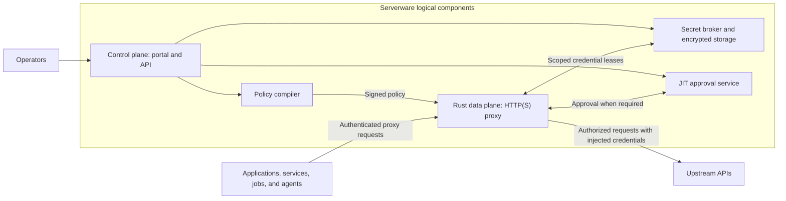
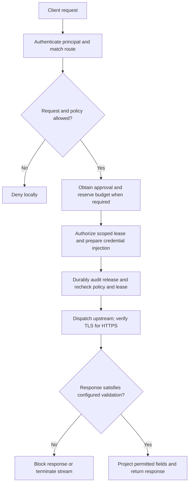

> Publication note: deployment-specific addresses, identities and paths in this document are example placeholders, not a public service or release-verification evidence.

# Serverware

Keep upstream credentials out of your applications. Control how they are used.

Serverware is a credential-control HTTP(S) proxy for applications, backend
services, scheduled jobs, CI pipelines, and AI agents. Instead of distributing
provider API keys and OAuth tokens to every workload, you store them centrally
and give each workload a scoped Serverware identity. Serverware checks policy,
injects the authorized upstream credential, and validates the response.

This is for ordinary application authentication as well as agentic workflows.
The application asks to use an API; it does not need possession of that API's
long-lived credential.

## Use Serverware

Open the running [Serverware instance](https://serverware.example.com/)
with the homelab login. This is the product instance to use and demonstrate,
not a separate disposable demo. Opening it does not start a native pilot,
compile the proxy or require a verification ceremony. Use the **Set up access**
action to choose a credential, select a client and review its permission.
Opening client setup does not execute a request or renew a token.

The [operator wiki](https://github.com/AndrewMohawk/serverware/wiki) covers
first-time setup, provider credentials, client/SDK examples, permissions, proxy
configuration, notifications and maintenance. Its [versioned source pages](docs/wiki/Home.md)
are kept with the application so the guide can be reviewed alongside changes.

The canonical entrypoint serves this persistent instance directly. The old
demo hostname is authenticated navigation compatibility, not another app.
The UI has one connection workflow, with synthetic checks only under optional
**Diagnostics**. These checks are not real provider integrations; use made-up
keys only for the diagnostic fixture. The October 12 cutover preserved existing
saved resources, policy, CA and custody; see the [deployment record](docs/operator-canonical-origin.md).

There are three separate things to configure:

- **Credentials:** provider accounts and keys, including GitHub App installations.
  Their secrets stay in Serverware. Saving one alone grants no client access.
- **Clients:** your scripts, agents and CI jobs. Each gets its own expiring
  Serverware proxy token, not the provider secret. Save it when shown once.
- **Permissions:** choose what a client may do with a credential. For
  example, “Issue triage may read issues and comments in this GitHub repository.”

**Set up access** is an action, not another navigation section. **Credentials →
Add credential** uses the same provider editor in save-only mode: it creates no
client, proxy token or permission. On a saved credential, **Use with a client**
continues setup with that exact credential selected, without asking for its
secret again. A GitHub App is a provider credential, not a Serverware client.
This flow is deployed in `35817cf5` and passed the actual read-only desktop/mobile
check; the separate isolated journey verified saving, reuse, proxy access and
revocation. See the [walkthrough checkpoint](docs/operator-demo.md#navigation-update--deployed-october-13).
**Proxy setup** provides
the proxy address, public CA download and client instructions; **Audit log**
shows recorded changes and request outcomes. New supported JSON permissions need
no request/response field lists unless you want optional content restrictions.
Existing restricted permissions retain their restrictions. An optional dummy
header is a public replacement marker, not either of the two secrets above.

Follow the [instance walkthrough](docs/operator-demo.md). The October 13
[public proxy verification](docs/operator-public-proxy-verification.md) records
the completed DNS repair and authenticated synthetic-route allow/revoke check
from outside the homelab. This does not establish real provider-account access.
The console and forward
proxy are different endpoints; listener settings and approved destinations are
deployment-managed. The new [destination review workflow](docs/operator-proxy-destinations.md)
prepares retained configuration for a controlled restart; it does not apply live
settings or grant application access. See [verification and current limits](docs/ordinary-client-verification.md)
and the [operator workflow requirements](docs/operator-workspace-requirements.md).
The [whole-project acceptance tracker](docs/project-completion.md) separates
immediate ordinary-app work, requested provider features and the six independent
production gates; none is silently dropped by presentation changes.
Historical sandbox and pilot deployments are not alternative product entrypoints.
The current instance uses local encrypted custody and a development security
profile, not verified hardware-backed production custody. One product does not
mean a weaker approval substitute: protected approval features must use their
required authority. Existing production gates and historical evidence remain.

### Connect the services your applications use

Provider examples describe useful jobs, not preconnected accounts. Availability
depends on the deployment's advertised capabilities and approved destinations.

| Job | Current operator-workspace boundary |
| --- | --- |
| Read or create GitHub issues and comments | Deployed PAT and GitHub App connections, exact repository/Issues permissions and automatic App installation-token renewal. Isolated Node/Python/Go App-through-Rust reads passed across token renewal, scope denials and revocation. Real GitHub acceptance remains open. [Contract](docs/operator-github-client-compatibility.md). |
| Read Gmail for a connected account | Configured Google OAuth and the Gmail read-only permission. Actual Node/Python and updated-Go jobs passed isolated proxy verification across expiry, automatic refresh and denials. Real Google consent and the deployed inbox job remain unverified. [Verification](docs/operator-gmail-job-verification.md#current-node-python-and-go-sdk-acceptance--isolated-jobs-passed). |
| Call a custom JSON API | Static Bearer/custom-header key, approved HTTPS destination and exact path; bounded request/response modes, not arbitrary API compatibility. |
| Read npm package metadata | Exact named-package metadata permission only; it does not grant tarball downloads, installation, audit or publication. [Contract](docs/operator-npm-metadata.md). |
| Publish an npm package | Named-package publishing preset and downloadable stock npm example; historical isolated cases passed. The upgraded npm 11.20.0 graph still needs joined proxy verification. Real registry credentials and publication are separate. [Contract](docs/operator-npm-client-compatibility.md). |
| Install npm dependencies or run a cold `npm ci` | Separate metadata/tarball/bulk-audit permission with every dependency explicitly listed. Stock npm 11.8.0 passed isolated install, cold `ci` and default-audit checks; npm 11.20.0 has separate CLI/component checks but still needs its own joined proxy run. Public proxy reachability is verified separately; real registry access is not. [Verification](docs/operator-npm-install.md). |
| Look up an X username | App-bearer preset for one exact username; Node/Python/Go examples passed against an isolated provider. This is not account-authorized posting. [Verification](docs/operator-x-username-verification.md). |
| Post text to X using a connected account | Managed OAuth, automatic refresh, protective disconnect and optional shared account-wide UTC-day posting-attempt limits are implemented and deployed. Actual SDK/shared-limit/fault controls passed against an isolated TLS provider. Posting requires configured app/gate readiness; limits also require the durable store. X remains unconfigured in the deployment record, and real-X acceptance is open. [Posting](docs/operator-x-posting.md), [limits](docs/operator-x-posting-quotas.md). |
| Read an Ethereum chain through Alchemy | Only `eth_chainId` and `eth_blockNumber` on selected mainnet/Sepolia, with Node/Python/Go examples. Historical isolated proxy acceptance does not cover later dependency repairs; real-provider entitlement remains unverified. Blockchain writes are outside this preset. [Verification](docs/operator-alchemy-verification.md). |
| Store AWS keys or publish an image to ECR | Long-term/session credentials can be stored, replaced and revoked locally. AWS signing, automatic renewal and ECR publication are not available operator permissions. [Boundary](docs/operator-aws-client-compatibility.md). |
| Send a Slack message or arbitrary webhook | Illustrative use case, not a verified provider preset. A custom-header JSON API is not support for every webhook authentication or response format. |

The files under `policies/` are policy examples and engineering fixtures. They
are not ready-to-use provider accounts or safe defaults to import wholesale.
Serverware's own [action alerts and audit delivery](docs/operator-notifications.md)
are independently configurable: action alerts ask someone to act (such as using
a YubiKey); audit alerts record what happened. Each has its own Slack and HTTPS
webhook settings, encrypted URL and explicit synthetic test. The optional,
default-off operator-development source now includes a read-only native phase
bridge with exact owner/source and original-expiry checks; legacy approval/JIT
alerts remain suppressed. The isolated browser-to-application-to-TLS workflow
passes, including independent saves, explicit tests and selected audit delivery.
The running instance enables the feature with four unconfigured destinations. The latest
paired rollout verified its read-only browser flow, retained data and empty
app-only custody; outbound TLS was verified at the earlier notification rollout.
Real receiver delivery and deployed save/test remain unverified.
The native relay is not running: configuration does not establish a live YubiKey
action or physical-key acceptance, or grant proxied webhook permissions.

## Example workflows

The following diagrams explain intended production workflows. The npm preset
supports named-package publishing with optional daily UTC publishing hours in
the guided operator form. Hours restrict publication only; prerequisite package
metadata reads remain allowed at any time. AWS/ECR image approval remains
unimplemented in the running instance; its signing helper alone is not a working
integration.

For example, an application or CI job can publish an updated version of
`@acme/widgets` with `npm publish`, while policy permits that package's releases
only **09:00–17:00 UTC daily**. The workload authenticates to Serverware, not with
the upstream npm token. The illustrative proxy login in both diagrams is
`username:password`; it is not a built-in login or a value to copy. Real
deployments use an explicitly provisioned, scoped identity. Serverware
consumes that credential at ingress and uses the protected provider credential
on the upstream request only after authorization succeeds. The credential swap
does not forward the workload credential to the provider.

### Example: time-limited npm publishing


<details>
<summary>Equivalent Mermaid sequence (editable)</summary>

```mermaid
sequenceDiagram
    participant APP as Application / CI
    box Serverware trust boundary
        participant SW as Serverware proxy
        participant STORE as Protected credential store
    end
    participant NPM as npm registry
    Note over APP: Illustrative proxy login only: username:password
    APP->>SW: Publish @acme/widgets via npm + username:password
    SW->>SW: Authenticate and consume workload credential; never forward it
    SW->>SW: Check package and 09:00–17:00 UTC
    alt Wrong package or outside allowed hours
        SW-->>APP: Deny; no request to npm
    else Authorized
        SW->>STORE: Select authorized npm token
        STORE-->>SW: npm token (inside Serverware only)
        SW->>NPM: Publish request with protected npm token
        NPM-->>SW: Registry response
        SW->>SW: Validate response
        SW-->>APP: Publish result; no npm token
    end
```

</details>

The time window authorizes requests; it does not schedule or queue releases.
`npm publish` releases a new package version; `npm update` updates installed dependencies.

### Example: YubiKey-approved AWS TEE image update

A build pipeline publishes an updated TEE container image to
[Amazon ECR](https://docs.aws.amazon.com/AmazonECR/latest/userguide/docker-push-ecr-image.html),
but the pipeline **attempts the action first**. Serverware holds that action
and only then asks an authorized developer to approve it using a
**YubiKey with FIDO2/WebAuthn**. Once the fresh, one-use approval is verified,
Serverware replaces the workload credential with its protected AWS/ECR
credential and resumes that exact publication. Rejection, timeout or a mismatch
blocks it. Approval is bound to the AWS account, region, repository and image
digest—not blanket permission to push arbitrary images. The pipeline never
receives the upstream AWS/ECR credential.


<details>
<summary>Equivalent Mermaid sequence (editable)</summary>

```mermaid
sequenceDiagram
    participant CI as Build pipeline
    box Serverware trust boundary
        participant SW as Serverware proxy
        participant STORE as Protected credential store
    end
    participant DEV as Developer / approval UI
    participant KEY as YubiKey
    participant ECR as Amazon ECR
    Note over CI: Illustrative proxy login only: username:password
    CI->>SW: Attempt TEE image publication + username:password
    SW->>SW: Authenticate and consume workload credential; never forward it
    SW->>SW: Check policy; bind exact publication intent
    alt Policy denies this action
        SW-->>CI: Deny; no publication to ECR
    else Policy requires human approval
        Note over CI,SW: Action is held; no upstream credential injected yet
        SW-->>DEV: Request approval now for account, region, repository, image digest
        DEV->>KEY: Review action; authenticate with YubiKey
        KEY-->>DEV: WebAuthn assertion
        DEV->>SW: Return request-bound approval
        alt Fresh matching one-use approval verified
            SW->>SW: Consume one-use approval for this exact action
            SW->>STORE: Select scoped AWS/ECR credential
            STORE-->>SW: Upstream credential (inside Serverware only)
            SW->>ECR: Resume this image publication with upstream authentication
            ECR-->>SW: Publication result
            SW->>SW: Validate response
            SW-->>CI: Result; no AWS/ECR credential
        else Rejected, timed out, stale or mismatched
            SW-->>CI: Block; no image publication
        end
    end
```

</details>

ECR publication is not enclave deployment or attestation: Nitro separately
[builds an enclave image file (EIF) from a container image](https://docs.aws.amazon.com/enclaves/latest/user/cmd-nitro-build-enclave.html).
The YubiKey approves the publication; it does not replace enclave measurements,
KMS policy or deployment authorization. This ECR-specific approval integration
still needs implementation and end-to-end verification.

## Production status

Checkpoint: **2026-10-02 — pre-production, pilot assembly.**

**36/46 source checkpoints landed · 10 active · 0 todo.**

**Production acceptance: 0/6 verified.** Focused checks and engineering builds are recorded in [production progress](docs/production-status.md) and [build results](docs/native-pilot-build.md#current-engineering-assembly). Those builds use an unpublished dependency candidate; they are not approved release packages or a deployed pilot.

[](docs/production-status.md#next-source-milestones)

**Homelab browser address:** [serverware.example.com](https://serverware.example.com/),
behind the usual homelab login. [Deployment details](docs/homelab-deployment.md)
separate HTTPS ingress from application readiness. No browser SSH tunnel is needed;
first commissioning still needs your physical YubiKey.

**Development pilot — current focus:** a local control UI, Rust proxy and
synthetic upstream, with a [one-command allow/deny walkthrough](docs/development-pilot.md).
The unsigned `33140e27` package builds successfully with all seven authority
roles. The retained Rust proxy, measured guest runtime, 41 signing keys and six
distinct scoped proxy credentials are prepared. PostgreSQL TLS transport is
verified; the local witness and synthetic upstream are provisioned. The current
consolidated [isolated guest launcher](docs/pilot-commissioning.md) is assembled
for real hardware approvals, the normal app and credential-bearing proxy.
Live startup is still being repaired. Script permissions, the host lock call,
enrollment login cookies, virtual-device ordering and a BusyBox route-filter
check are corrected. An isolated guest passed all pre-application checks.
The host task-limit and OCI input fixes passed actual startup. The fifth launch
completed package signing, then hit a file-open error during installation.
Its signed checkpoint and partial installation are preserved; recovery must
retain that history. A separately keyed local pilot is being prepared; the
failed pilot's ledger and approvals will not be reset or reused.
No hardware enrollment or database bootstrap has run.
Earlier candidates remain preserved. These are build/input results, not signed
installation, running authorities, schema commissioning or an end-to-end pilot.

**There is not yet a working pilot.** All four slots focus on the remaining
critical path: [signed package installation](docs/trusted-host-local-package-assembly.md),
[service admission](docs/trusted-host-local-admission.md) and schema setup,
first hardware-key registration and [policy commissioning](docs/pilot-commissioning.md),
then the UI/Rust credential replacement, denial and redaction walkthrough.
The local walkthrough is non-TEE, non-production and uses no real provider
credentials. Broad testing and production-only work are deferred until that
core flow is assembled; focused results are in [progress](docs/production-status.md).

**Protected native production:** the [full goal](goal.md) remains unchanged.
The [native lifecycle](docs/native-pilot-lifecycle.md) still requires approved
matching packages, independent authority provisioning and a complete live run.
The development demo cannot establish enclave custody or production acceptance.
[Production progress](docs/production-status.md) retains the implementation and
verification history; [AWS access](docs/aws-test-access.md) remains a separate
deployment prerequisite, not a requirement for the local demo.

The bar shows **committed source, not tested readiness or remaining effort**.
Green means source-landed; amber means partial implementation. No current pilot
release has passed end-to-end verification.

<details>
<summary>All 10 unfinished project checkpoints</summary>

| ID | Remaining checkpoint | Source status |
| --- | --- | --- |
| H05 | Historical authority across source, configuration and key changes | In progress |
| N04 | Workload identity provisioning and authenticated service channels | In progress |
| N05 | Native enrollment, verified CA installation and proxy setup | In progress |
| N06 | Enclave TLS/proxy execution and credential custody | In progress |
| O01 | OAuth ownership across deployments and applications | In progress |
| O02 | Measured provider issuance and interrupted-exchange recovery | In progress |
| O03 | Public revocation and authenticated recovery | In progress |
| O04 | Protected provider and filesystem side effects | In progress |
| O05 | Interrupted policy-publication recovery | In progress |
| O06 | Independent RBAC rollback witness | In progress |

These are open parent checkpoints; each can contain landed implementation.
The [detailed ledger](docs/production-status.md#remaining-work-breakdown) records
exact remaining work, completion criteria and commit evidence.

</details>

[Full 46-checkpoint ledger](docs/production-status.md#next-source-milestones)
· [Completed session-activation source, 26/26](docs/production-status.md#active-workflow-granular-source-steps)
· [Six independent production gates](docs/production-status.md#remaining-production-gates)

<!-- Keep current counts and the project SVG synchronized. Detailed subworkflow
history lives in docs/production-status.md. Source landing is not runtime proof. -->

## Why Serverware?

A typical secret manager delivers a secret to an application. Serverware moves
the credential's use into the proxy instead: the calling service receives the
permitted API response, not a credential lease. This reduces the places where
upstream credentials need to be stored and the number of workloads that need
access to them.

The full product model includes these use cases; the operator-workspace support
boundaries above still apply:

- A backend service can call an approved API without keeping the provider key in
  its environment, container image, or application configuration.
- A user can connect a Google or X account through the operator portal; workers
  use the permitted provider operations without receiving the refresh token.
- A CI job can be restricted to a particular package-publishing operation, with
  human approval required before the credential is used.
- An automation or AI agent can receive narrowly scoped access to the same APIs
  without being given the underlying account credentials.

The workload still needs to authenticate to Serverware. This is reduced
credential distribution, not a claim that all clients become secretless.

## Architecture



These are five logical roles, not a claim that five independently deployed
services are already available. The Python/FastAPI control plane manages
configuration and operator workflows. The Rust data plane is the production
implementation track for credential-bearing traffic; the legacy Python
mitmproxy path is development-only and rejects credential-bearing routes.

Clients use proxy-capable HTTP libraries and normal upstream URLs, configured
with Serverware proxy authentication and its verified CA for HTTPS interception.
SDK-specific configuration may still be needed. Workload egress controls must
prevent bypassing the proxy where enforcement is required.

For libraries without HTTPS-proxy mTLS support, the [workload sidecar](docs/native-workload-sidecar.md)
accepts authenticated CONNECT requests only on loopback inside an explicitly
selected workload network namespace. It owns the native mTLS connection; the
application retains its scoped local token and verified interception CA, not
the upstream provider credential. Namespace provisioning and egress restrictions
are separate deployment requirements.

## Three separate authentication relationships

| Relationship | Purpose | Credential boundary |
| --- | --- | --- |
| Workload → Serverware | Identify the calling service, job, or agent and its allowed routes. | A scoped Serverware identity, not the provider's API key. |
| Operator → control plane | Manage credentials, policies, approvals, and audit. | Operator OIDC, role-based access, and WebAuthn controls. |
| Serverware → upstream API | Perform the approved operation as the connected provider account. | Centrally stored API credentials or OAuth tokens, used by the trusted credential path. |

Operator OIDC login and provider OAuth account connection are different flows.
Serverware is not a general-purpose identity provider or a replacement for every
application's end-user login system.

## Policies govern credential use

A signed policy binds a principal, route, credential reference, and API adapter.
An unrecognized or unauthorized request is denied by default. Policies can
constrain:

- **Where:** destination host and port, HTTP method, and path.
- **What:** recognized API operations, allowed request fields, and value bounds.
- **When and how much:** time windows, request counts, and shared budgets.
- **Who approves:** optional short-lived, request-bound human approval.
- **What comes back:** response shape, permitted fields, date bounds, and
  request-to-response bindings supported by the selected adapter.

For example, a credential can be assigned to a read-only integration with a
bounded date window, or to a publishing workflow that requires approval. The
upstream account's broad permissions do not have to become the caller's policy.
Enforcement depends on a supported, explicitly configured operation; merely
rewriting a request does not prove the response satisfies the policy.

The source includes generic REST, Gmail, X, and npm adapters, plus static
credential injection and Google/X OAuth onboarding. See the
[constraint reference and examples](docs/credential-constraints.md) and
[example policy bundle](policies/demo.policy.json) for exact supported behavior.
These source components are not all exposed or accepted in the operator demo.
Policies are typed, bounded data—not arbitrary executable policy code.

## Request lifecycle



A missing approval, exhausted budget, unavailable required authority, or stale
policy/lease stops the request before upstream dispatch. Audit records bind
decisions to the relevant principal, policy, and credential version without
logging raw secrets. Response validation is adapter-specific: a blocked response
does not undo an upstream action, and already-released stream bytes cannot be
recalled. Streaming therefore has separate restrictions.

## Security and deployment boundaries

Credentials use envelope encryption at rest and short-lived, recipient-bound
leases for the data plane. Plaintext still exists in the trusted credential-use
path and is sent to the intended upstream provider. Ordinary Docker does not
protect that memory from the host administrator.

The production target places TLS termination and the complete credential-handling
proxy inside an attested enclave, with independently operated release signing,
Nitro/KMS verification, and a rollback-resistant witness. This production chain
still needs implementation, independent provisioning, and verification; the
required current dependency snapshot is also not ready. Local signatures,
development quotes, and historical test results do not establish that guarantee.

One deployment currently represents one administrative trust domain, not an
isolated multi-tenant vault. Support is HTTP(S)- and adapter-specific: arbitrary
database/SSH authentication, client TLS credentials, and request-signing schemes
are not automatically supported. See the [security review](docs/security-review.md)
for the threat model and production acceptance gates.

## Development and documentation

There is no working production quickstart for the current source. Read the
[development reference](docs/development-reference.md) for the intended local
Compose workflow, configuration, and diagnostic recipes. It uses development
credentials and is not a production deployment. Before running builds or tests,
follow the [source-freeze and verification workflow](goal.md#resource-conscious-engineering-workflow).

| Read next | Covers |
| --- | --- |
| [Operator and OAuth guide](docs/portal-oauth-agent-guide.md) | Portal login, provider connection, credential assignment, approvals, and client enrollment. |
| [Credential constraints](docs/credential-constraints.md) | Policy language, supported authentication modes, adapters, and response restrictions. |
| [Rust data plane](data-plane/README.md) | Proxy implementation and transport contracts. |
| [Project requirements](goal.md) | Architecture, implementation roadmap, and acceptance criteria. |
| [Successor implementation status](docs/webauthn-successor-transitions.md) | Current authentication integration and execution gaps; links to the historical startup diagnosis. |
| [Release stages](docs/release-stages.md) | Separate build, publish, sign, deploy, and independent verification responsibilities. |
| [Dependency snapshot](docs/production-dependency-snapshot.md) | Immutable offline dependency preparation and its remaining release boundary. |
