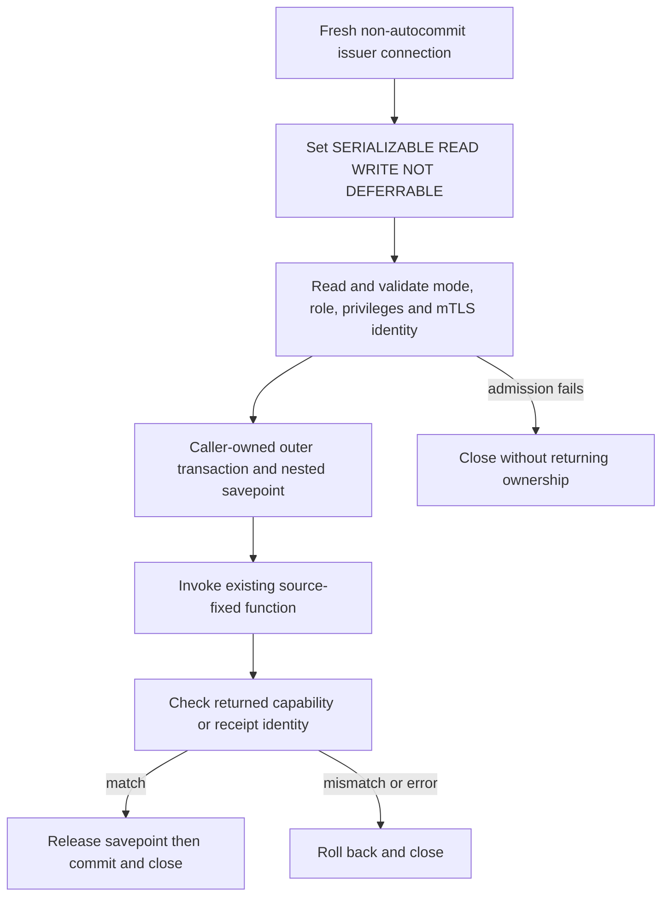

# Issuer database boundary

## Status

Source `.46` corrects the existing issuer's function-grant identities and
transaction setup. These are changes to the actual installer, catalog checks,
connector and service handlers, not a new v4 issuance route. The source remains
**unbuilt and unexecuted**. No live grants, mTLS admission, database commit or
production deployment have been verified.

Source `.48` extends the exact inventory with two private revocation functions
and an original-byte owner; see [private issuer custody](authority-revocation-issuance.md).
This does not activate a configured successor service route or a public gate.

## One exact function inventory

The existing immutable contract declares these three functions:

| Function under `catchplate_metadata` | Argument types | Existing purpose |
| --- | --- | --- |
| `catchplate_policy_authority_issue_capability` | Four `text` arguments | Legacy capability issuer |
| `catchplate_policy_authority_issue_writer_capability` | Five `text` arguments | Current v3 writer capability issuer |
| `catchplate_policy_authority_record_witness_receipt` | Four `text` arguments | Existing terminal witness receipt recorder |

The writer issuer's fifth argument is the credential-issuance digest. Its final
installer removes the old four-argument overload. Previously the grant loop and
issuer catalog check assumed four arguments for every function, disagreeing
with that installed definition.

The database facade now derives one sorted immutable signature tuple from the
original contract and the separate six/eight-argument revocation contract.
The original three function signatures remain unchanged. The schema sealer requires exact shape, names,
types, order and contents before database callbacks. Metadata and expected-v9
schemas cannot omit it; unrelated schema sealers retain their empty default.
Bootstrap, expected-schema replay, reviewed completed-v9 repair and v8-to-v9
migration pass the same signature inventory. Source-contract hashing binds
that actual inventory and checks both disjoint source contract maps.

GRANT statements use each function's real argument types. Issuer and executor
grant checks compare type-only identities using `oidvectortypes(proargtypes)`;
argument names from `pg_get_function_identity_arguments` are not compared to
type-only strings. Both shared unexpected-grant queries require exact role,
identity and EXECUTE permission with no grant option. Unknown/NULL role matches
fail closed. Issuer catalog validation additionally requires SECURITY DEFINER,
non-STRICT, VOLATILE and the exact source search path. Existing owner, language,
object and implementation-manifest validation remains in force.

The `.46` correction added no callable function; `.48` adds only the two narrow
revocation functions. No role, table grant or public operation is added. An issuer
must still have no direct table/sequence privileges or inherited role authority.

## Transaction ownership



The connector explicitly disables autocommit. Its first application SQL
statement is:

```sql
SET TRANSACTION ISOLATION LEVEL SERIALIZABLE READ WRITE NOT DEFERRABLE
```

This precedes even the search-path command and every admission SELECT. The
driver may send its implicit BEGIN first; no admission snapshot is taken before
the mode is established. The identity query checks `serializable`, `off`, `off`
alongside the existing exact session, role, mTLS and privilege checks.

Success returns an open transaction owned by the caller's connection context.
The service's `connection.transaction()` is a nested savepoint, not a new outer
transaction. Both issuance and witness-recording handlers now check the returned
identity inside that savepoint and before the outer context commits. Missing or
incorrect identity therefore raises while rollback is still possible.

Before return, any failure triggers best-effort connection close and re-raises
the original exception, including cancellation-like base exceptions. Cleanup
does not replace the failure, commit partial admission, change roles or attempt
an automatic recovery transaction.

## Authored verification scope

The dedicated issuer source fixture inspects actual SQL producers, immutable
signature maps, grant/catalog checks, source binding, all four call sites,
connector ordering/readback/cleanup and both service transaction scopes. It
does not import active database/service/registry code or manufacture a positive
ACL verdict.

Three native components extract the connector's exact first statement and use
real PostgreSQL transaction behavior: overriding different initial connection
defaults, rejecting an isolation change after a read, and rolling back a nested
result-denial write while leaving the outer transaction uncommitted. Their
random schema and rows disappear on rollback. The denial is a fixture-owned
savepoint control, not a call to the actual service handler. These do not prove
the full connector, mTLS, effective grants, committed issuance or deployment.
All fixtures are authored and unexecuted.

The native inventory is 289 methods, with 54 in the root-transition suite;
all prior 286 IDs, fourteen suites, sixteen children and deadlines remain.
The freeze and independent preparation prerequisites in [goal.md](../goal.md)
still apply; fixture counts are not passing evidence.

## Successor work still required

The private [signed capability/v4 verifier and custody schema](authority-revocation-capability.md)
now have original-byte load/store source integration in `.48`. Planner-writer
readers are not relabeled as issuer access, and stored context cannot supply its
own independent authority. The new owner explicitly compares mutable execution
bindings and planner capability identity; native concurrency/admission and
configured service composition remain unverified and required.

Source `.47` adds [private capability signing and original witness-request
preservation](authority-revocation-signing.md). That checkpoint did not add issuer
database functions or grants. A produced signature remains input to independent issuer
verification and transactional custody, not a successful storage observation.

The post-plan witness event, current-state/one-use execution, atomic terminal
publication and missing WebAuthn kernel/public gates remain separate required
work. Fixing the existing issuer connection and grant recipe does not activate
them or provision Nitro/KMS, signing or independently operated witness services.
