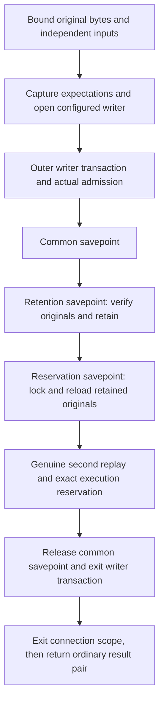

# Atomic original-byte retention and execution reservation

## Source boundary

Source `.61` adds
[`RevocationPlannerPersistence.persist_and_reserve_execution`](../catchplate/authority_revocation_persistence.py).
It composes the existing genuine retention and reservation operations under
one configured writer transaction. It is **unbuilt and unexecuted**: no real
PostgreSQL durability, serving integration or production admission is proved.

The result is ordinary retained-receipt and reservation data, not a capability
or permission to execute. The separate `persist`, `read` and
`reserve_execution` methods are unchanged; two separate calls do not become
atomic merely because they use the same configured owner.

## Inputs and ownership

The method snapshots the exact seven-item configured owner first. That snapshot
pins both verification keys, their signing identities, and the independent
writer database role/TLS identity described in
[writer connection admission](authority-revocation-writer-connection.md).
Measured service construction remains the private
[configuration factory](authority-revocation-writer-configuration.md).

Before opening a database connection, the method requires:

- Original immutable envelope bytes, from 2 bytes through 64 MiB, and original
  evaluation-context bytes, from 2 bytes through 512 KiB.
- An exact positive-int64 proposed planned timestamp and two canonical digest
  identifiers: the execution envelope and planner transaction.
- Exactly fifteen external expectations with exact string keys. These cannot
  replace configured public keys or signing identities.
- A metered canonical comparison joining the explicit planner transaction ID
  to its independently supplied expected ID.

The existing runner then owns the external expectation graph before connection
callbacks. It retains the real keys and exact UTC database clock through their
existing non-JSON paths. This component does not authenticate the provenance of
caller expectations or enroll a configuration. The stored context, first
receipt and reservation row cannot supply their own independent admission.

## One transaction, two genuine replays

The fixed private operation requires the actual active PostgreSQL facade and
writer role/mode gate. It opens a real common savepoint around both existing
store calls, preserving each store's own savepoint. The successful path thus
uses four transaction scopes: outer writer, common pair, retention and
reservation. All use the same connection, work object and owned independent
expectations; original-connection checks bracket both stores and the common
scope exit.

Reservation uses the independently supplied identifiers, never fields from the
first receipt. It locks and rereads the stored original envelope and context,
then performs their genuine verification again. It requires an unconsumed
planned parent and a new or byte-identical reserved execution row, including
its null terminal fields. Retention success cannot substitute for this replay.

A failure in either store rolls back the common pair. In particular, a second
stage failure cannot leave a newly retained plan behind, even when a caller of
the private operation catches that store failure inside a still-open outer
transaction. The configured owner propagates failures and also aborts its
outer transaction. Cleanup uses the original handles without suppressing the
first error.

This does not promise undo after a completed release or commit. A rejection
after common-savepoint release relies on the configured outer transaction's
abort. An error after the outer commit may leave the operation committed but
return no result; reconciliation needs the original identifiers and bytes.
Driver observations cannot detect a hostile driver's hidden commit-and-BEGIN.

## Retry, limits and work

An identical retry preserves the original stored bytes and planned timestamp.
The proposed retry timestamp must still satisfy existing retention bounds but
does not replace the stored timestamp. Both custody operations retain their
live freshness checks; historical record validity does not extend a deadline.
A consumed parent or changed/terminal execution row is rejected.

The 64 MiB envelope and 512 KiB context input bounds do not widen the existing
4 MiB execution-request bound. A reservation that exceeds that bound fails
inside the shared rollback scope. A future authenticated transport needs an
explicit whole-message size contract; this method creates none.

One cumulative allowance pays for the independent-ID join, configured input
capture, genuine retention and genuine reservation. The reservation retains
its own captures and stored-original replay; no successful-proof cache or new
outer allowance is introduced. The canonical digest-ID join adds 0 hashes,
438 defined byte-work units and 4 nodes. Admission must cover both the final
total and each replay's held peak with prior work included. Driver, gate and
savepoint metadata are outside H/B/N but guarded against changing the meter.

## Verification and remaining integration

Authored fixtures cover genuine double replay, shared rollback, byte-identical
retry, independent-input ownership and cumulative work. They use synthetic
driver observations; source-linkage assertions do not establish real PG16,
TLS/ACL admission or transaction durability. No fixture has been executed for
this source. The [source-freeze workflow](../goal.md) still applies.

Source `.62` adds a private [measured writer action](authority-revocation-writer-action.md)
that owns caller inputs and joins historical age/skew policy to the same held
configuration before invoking this owner. It adds no serving purpose, peer
permission, public transport or capability issuance path. Authenticated
verifier-to-planner-to-writer custody remains unfinished; source `.63` adds only
the pure [detached commitment contract](authority-revocation-writer-commitment.md).
Source `.64` adds a private [authenticated writer composition](authority-revocation-writer-composition.md)
and factors this owner's existing body into a fixed-configuration helper. The
public API still snapshots once; the authenticated path holds the same tuple
through signature checks and the atomic suffix, without a post-callback resnapshot.
Source `.65` adds a separate fixed request suffix sharing the actual two-replay
inner helper. It retains original controls/history and links in an immutable
request row, with exact comparison and insertion inside the common savepoint.
The legacy public atomic API and its retry timestamp behavior above remain
unchanged; the request suffix additionally requires signed/stored timestamp
equality. See [request custody](authority-revocation-writer-request-storage.md).
Source `.67` adds [signed ACK custody](authority-revocation-writer-acknowledgment.md)
and operation-bound response signing to that separate request suffix, after
both real replays and the complete request readback in the same common scope.
It returns exact stored ACK bytes only after normal outer/connection exit;
the older public atomic API above keeps its original result pair. Source `.68`
adds [detached-body transfer](authority-revocation-writer-transport.md) to the
writer-only server branch. Configured producer/client integration and
authenticated historical recovery remain unfinished. The separate `.66`
[startup key loader](authority-revocation-writer-signer.md) neither signs an ACK
nor changes this atomic API. Registry closure and
the four WebAuthn authority gates remain incomplete. Production Nitro/KMS, signing and independent
witness services are still unprovisioned.
