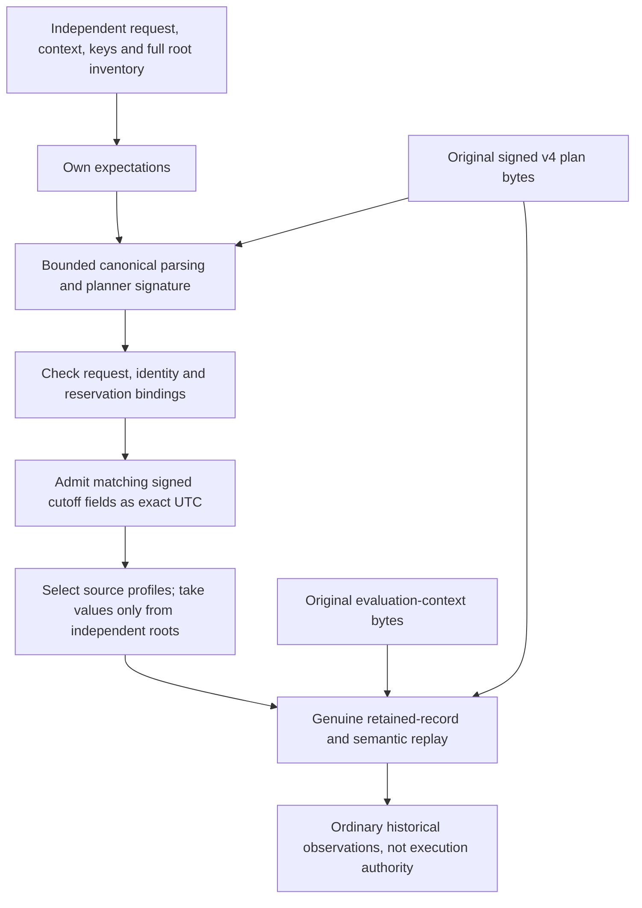

# Authenticated revocation-plan handoff

## Status

Source `.54` adds a private verifier-side admission helper for original v4
plan and evaluation-context bytes. It is **unbuilt and unexecuted**. It does
not enable a service route, attest a running planner, demonstrate persistence
or authorize credential revocation. The public registry gates remain closed.

The existing planner signature already covers both database-cutoff fields.
This helper uses that signature; it introduces no new envelope, signature
format or response purpose.

Source `.55` adds configured verifier ownership and the private
`AuthorityProcess._verify_revocation_plan_handoff` composition described below.
It remains unbuilt, unexecuted and separate from network dispatch.

## Authenticate first, then replay

The caller supplies its independently admitted planner/verifier public keys,
original typed request, fourteen non-root context fields and the complete
[verifier root inventory](authority-revocation-root-observation.md). The helper
owns mutable inputs before any key callback. It never accepts a successful
verification object in place of original bytes.

The signed bundle cutoff and root-transition cutoff must agree and round-trip
through integer UTC arithmetic. No float timestamp or replacement clock sample
is used. This authenticates the admitted planner's historical clock claim;
the signature alone cannot prove that a physical database clock was sampled
truthfully or that this historical snapshot remains current.

The source's six read roles plus every claimed mutation table determine the
candidate counted-profile union. Those claims only select identifiers: all
root values, revisions and counts come from the caller's owned inventory.
The genuine replay must then prove the actual reads, effects and exact profile
union. A signed mutation list cannot substitute for recomputation.

The selected plan does not contain unused heads. This receiver therefore does
not claim a second full-nine-head acquisition or comparison. The actual
[observed planner](authority-revocation-observed-planning.md) performs its full
comparison before signing the selected subset.

Original context bytes remain claims until the retained-record verifier
compares them with independently constructed expectations and the authenticated
cutoff. Keys, identities, request, reservation, policy, evaluation clocks and
root values are not adopted from returned context or signed-plan claims.

## Work and authority boundaries

Every capture, canonical encoding, comparison, signature and proof replay
uses the same remaining work allowance. Success performs two actual planner
signature verifications: bootstrap authentication and the unchanged retained
replay. That replay also verifies the assertion receipt and performs the
genuine semantic/proof work once. Failed work is not refunded. Fixed source
metadata and native cryptographic internals are not whole-process accounting.

Returned records, cutoff, context and metrics are ordinary local observations.
Neither a dataclass nor the computed retained-record digest proves that a
database committed the record. Original durable custody, retry identity,
current-root checks and one-use execution remain separate requirements.

## Still required

The private configured composition now calls this helper with independently
owned inputs; original-byte serving integration is still required. Source `.56`
adds a [planner-only observed producer](authority-revocation-planning.md) using
the shared genuine read body. The existing combined planning coordinator still
cannot be installed in the planner role: it holds both a planner read DSN and
writer persistence, while process admission deliberately separates them.
Preserve that separation in the eventual authenticated persistence and
reservation RPCs.

Durable original invocation retries, reserve-before-capability ordering,
post-plan witness binding, current-root execution and atomic terminal
publication remain incomplete. The four unfinished WebAuthn kernels,
immutable dependency/coverage approvals, sealed verification prerequisites
and independent production Nitro/KMS/signing/witness services remain required.
Follow the frozen-source preparation and sequential no-build workflow in
[goal.md](../goal.md); authored fixtures and source review are not runtime proof.

## Configured verifier ownership

The `.55` process method requires the verifier role/process mode, the actual
root-admitted measured configuration and an active verifier launch. It captures
the original request, caller context and full inventory, then owns the entire
configuration before launch or key callbacks. A constructed dataclass or a
synthetic configuration fixture does not establish that admission chain.

The mapper recomputes the complete configuration commitment and checks the
launch generation, predecessor, rollback floor, operation manifest and sorted
configuration membership. It checks the source query manifest, both raw public
keys against their SPKI and response-signing pins, and derives the verifier
session identity from the configuration digest and measured role identity.
It neither reuses the issuer factory nor obtains database or private keys.

| Context boundary | Fields supplied here |
| --- | --- |
| Caller: 9 fields | Original request-associated IDs, fence, reservation/evaluation clocks, deadlines and approver-policy digest |
| Configured owner: adds 5 | Planner/verifier identities, assertion age, plan age and clock skew |
| Genuine handoff: adds 1 | Expected root subset, with values only from the independent inventory |

Assertion age is exactly the measured WebAuthn challenge-age policy, including
windows longer than thirty seconds. Plan age is the minimum of the verifier's
measured internal-message age and the source thirty-second bound; clock skew
is the source five-second value. Callers cannot supply or override these five
configured fields. No current clock is sampled or substituted for history.

One exact ten-field settings tuple is held for each invocation. Its config and
generation pins describe the admitted mapper input; they are not new fields
in the signed v4 plan. The plan is joined through its existing identity/source
bindings and genuine replay, not a fabricated explicit generation claim.

The factory performs four charged hashes: full configuration, two SPKIs and the
verifier session. The process, configured owner and handoff each perform their
real ownership boundary on the same remaining allowance. The existing issuer
uses the shared configuration-capture prefix with its original five-hash
schedule unchanged. Fixed settings/source metadata, native crypto internals
and existing launch-guard internals are not whole-process H/B/N accounting.
