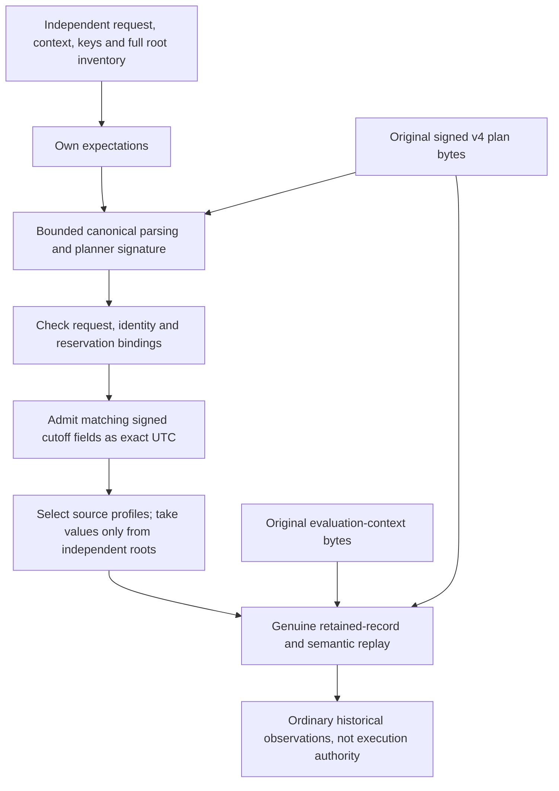

# Authenticated revocation-plan handoff

## Status

Source `.54` adds a private verifier-side admission helper for original v4
plan and evaluation-context bytes. It is **unbuilt and unexecuted**. It does
not enable a service route, attest a running planner, demonstrate persistence
or authorize credential revocation. The public registry gates remain closed.

The existing planner signature already covers both database-cutoff fields.
This helper uses that signature; it introduces no new envelope, signature
format or response purpose.

## Authenticate first, then replay

The caller supplies its independently admitted planner/verifier public keys,
original typed request, fourteen non-root context fields and the complete
[verifier root inventory](authority-revocation-root-observation.md). The helper
owns mutable inputs before any key callback. It never accepts a successful
verification object in place of original bytes.

The signed bundle cutoff and root-transition cutoff must agree and round-trip
through integer UTC arithmetic. No float timestamp or replacement clock sample
is used. This authenticates the admitted planner's historical clock claim;
the signature alone cannot prove that a physical database clock was sampled
truthfully or that this historical snapshot remains current.

The source's six read roles plus every claimed mutation table determine the
candidate counted-profile union. Those claims only select identifiers: all
root values, revisions and counts come from the caller's owned inventory.
The genuine replay must then prove the actual reads, effects and exact profile
union. A signed mutation list cannot substitute for recomputation.

The selected plan does not contain unused heads. This receiver therefore does
not claim a second full-nine-head acquisition or comparison. The actual
[observed planner](authority-revocation-observed-planning.md) performs its full
comparison before signing the selected subset.

Original context bytes remain claims until the retained-record verifier
compares them with independently constructed expectations and the authenticated
cutoff. Keys, identities, request, reservation, policy, evaluation clocks and
root values are not adopted from returned context or signed-plan claims.

## Work and authority boundaries

Every capture, canonical encoding, comparison, signature and proof replay
uses the same remaining work allowance. Success performs two actual planner
signature verifications: bootstrap authentication and the unchanged retained
replay. That replay also verifies the assertion receipt and performs the
genuine semantic/proof work once. Failed work is not refunded. Fixed source
metadata and native cryptographic internals are not whole-process accounting.

Returned records, cutoff, context and metrics are ordinary local observations.
Neither a dataclass nor the computed retained-record digest proves that a
database committed the record. Original durable custody, retry identity,
current-root checks and one-use execution remain separate requirements.

## Still required

Measured verifier configuration and serving integration must call this helper
with independently owned inputs. The existing combined planning coordinator
cannot simply be installed in the planner role: it requires both a planner
read DSN and writer persistence, while actual process admission deliberately
separates planner and planner-writer credentials. Preserve that separation in
the eventual authenticated persistence and reservation RPCs.

Durable original invocation retries, reserve-before-capability ordering,
post-plan witness binding, current-root execution and atomic terminal
publication remain incomplete. The four unfinished WebAuthn kernels,
immutable dependency/coverage approvals, sealed verification prerequisites
and independent production Nitro/KMS/signing/witness services remain required.
Follow the frozen-source preparation and sequential no-build workflow in
[goal.md](../goal.md); authored fixtures and source review are not runtime proof.
