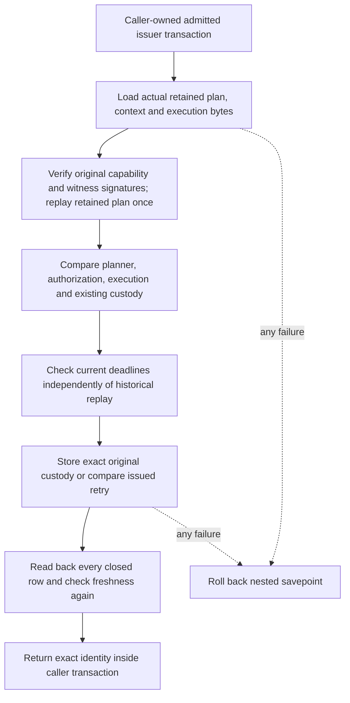

# Private revocation issuer custody

## Status

Source `.48` adds private issuer load/store definitions and an original-byte
Python owner. The source is **unbuilt and unexecuted**. No live SQL installation,
mTLS admission, committed issuance or deployment has been verified. The source
contract's `installedSuccessorIssuer` describes what the schema installer
defines, not a successful installation observation. `configuredServiceRoute`
and `publicExecutionEnabled` remain false.

Source `.49` adds a configured private owner using the existing real issuer
connector, original witness-response transport custody, and a planning return
path that preserves the acquired database instant. These components are still
unbuilt and unexecuted. They do not add a service dispatch route or authenticate
a cross-role invocation.

Source `.50` adds [private authenticated invocation admission](authority-revocation-invocation.md)
and `issue_authenticated`, binding original verifier-signed handoff bytes before
opening the same issuer path. Service dispatch, independent root/cutoff origin
and durable restart custody remain separate requirements.

## Narrow database authority

The original three issuer function contracts retain their four/five/four `text`
arguments. Two separate functions extend the closed EXECUTE inventory:

| Function | Arguments | Result |
| --- | --- | --- |
| `serverware_policy_authority_load_revocation_issuance` | Six `text` arguments: three identities and three configured issuer pins | Eight closed row projections |
| `serverware_policy_authority_issue_revocation_capability` | Eight `text` arguments: two original transports, record digest, two key fingerprints and three configured issuer pins | Exact capability ID, digest and record digest |

The issuer receives no direct table or sequence privileges. The schema sealer,
owner catalog checks and source-contract hash bind the combined exact function
inventory. Each new SECURITY DEFINER function repeats source-pinned role,
owner, PostgreSQL major version, mTLS identity, issuer pins and serializable
read-write non-deferrable transaction admission.

SQL does not verify Ed25519 signatures. The measured issuer process must run the
genuine Python verifier before calling the store function. Possession of the
issuer database credentials remains a privileged boundary; the schema cannot
force an arbitrary holder to execute that Python code. Production credential
release and independent service operation remain required.

## Original evidence and transaction ownership

The private owner accepts original signed capability and signed witness-request
bytes, independently admitted keys and expectations, current configured issuer
pins, one cumulative work allowance, and an already admitted raw connection.
It does not borrow a planner-writer reader or derive approval from stored
context. Historical verification never substitutes for current clock checks.

The loader returns planner, retained-plan, execution, assertion, authorization
projection, writer capability, retained-capability and witness rows. The owner
compares their full closed projections against genuinely reconstructed evidence,
including planner capability identity and mutable execution bindings beyond the
foreign keys. SQL separately checks terminal state not included in the planner
projection. Both first issuance and exact issued retry perform genuine replay.

A fresh capability may reuse an independently stored preliminary reservation
only when all fifteen witness fields match. Existing capability and sidecar
must form a complete pair with their original witness custody; missing pieces
are errors, not repair opportunities. The original signed bytes remain durable
custody, not reconstructed substitutes.

The owner uses a nested savepoint and never commits the outer transaction.
Returned identities and the complete second readback are checked before the
savepoint exits. Driver/clock callbacks are checked for observed connection,
transaction-status and work-meter changes. This is not protection against a
hostile in-process driver that secretly commits and begins another transaction;
the driver and process own that trust boundary.

## Configured owner and original transport

[`RevocationCapabilityIssuer`](../serverware/authority_revocation_issuance.py)
owns one exact configuration snapshot: planner, verifier and witness public
keys; planner/verifier identities; issuer session and current admission pins;
configuration, witness and generation commitments. The existing verifier key
and identity also authenticate the capability and witness request. The issuer
receives no signing key. Constructor pins must be independently admitted;
freezing their handles does not enroll keys or freeze arbitrary key internals.

Each call supplies original capability/request bytes, independently accepted
execution and preliminary receipt identities, fifteen historical replay inputs
and the existing cumulative work object. The historical inputs include the
actual acquisition cutoff; they cannot replace configured keys or identities.
The owner captures them before opening the real
`_policy_authority_capability_issuer_pg_connect_raw` connection. There is no DSN
override or planner-writer fallback. That connector begins and admits its real
serializable read-write non-deferrable transaction before returning it.

The configured owner holds the outer connection context around the genuine
store worker and its nested savepoint. A detached closed identity result and
the original active connection are checked before normal outer commit/close.
The worker's capture/replay and the owner's additional capture/result checks
all spend the same remaining allowance. Pre-commit body failures normally use
rollback/close; a post-open work rejection closes the returned handle. A commit
or connection-exit failure can leave the outcome indeterminate, and a work
guard after exit cannot undo an already committed transaction. Context-entry
failures and a hostile driver's hidden transaction history are not stronger
guarantees.
The private explicit-opener fixture seam models an already admitted connection;
it is not evidence of positive PostgreSQL ACL or mTLS admission.

The service's private `_witness_transition_with_originals` now retains the
actual framed response before parsing, then returns original request bytes,
original response bytes and the receipt only after the existing canonical,
binding and signature checks. Receipt-only and request-pair callers retain
their old return shapes. No bytes are reconstructed, re-signed or cached, and
no phase or operation is newly admitted. The separate
[`produce_and_persist_with_cutoff`](authority-revocation-production.md#configured-read-to-persist-owner)
path similarly preserves the planner's local database instant. Neither return
path supplies authenticated cross-role or durable retry authority.

## Locks, compatibility and remaining work

The new path requires an existing controlled-writer fence, then takes capability
`NOWAIT`, planner and execution locks. Missing fence authority is not created.
Bounded lock waits and monotonic fence comparison fail closed on conflicts.
This is not a claim that every legacy lock order is deadlock-free: absent-row
and unique-insert races can still abort the transaction. A function-local
statement-timeout setting alone is not proof of a whole-request CPU deadline.

Legacy writer retries, terminal witness recording, execution and failure paths
explicitly reject successor capability custody before proceeding into their
v3-only work. The historical receipt-only retry still permits an absent legacy
parent, but rejects an observed successor parent. No public operation opens.

The authored fixtures use genuine local cryptography plus a clearly labelled
statement/savepoint recorder and source inspection. They are not positive
PostgreSQL ACL, mTLS or commit evidence, and have not run. Authenticated service
composition and durable independent retry expectations, post-plan witness
binding, current-state one-use execution and
atomic terminal publication remain required. Production Nitro/KMS, signing and
independent witness services are still unprovisioned. Follow [goal.md](../goal.md)
for the source-freeze and verification prerequisites.
