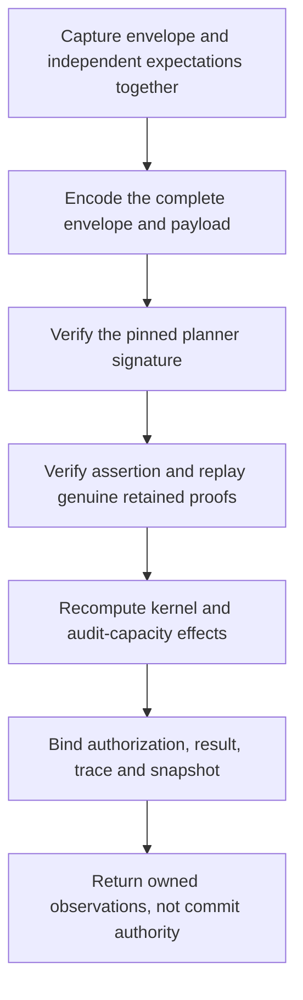

# Signed revocation plans

## Status

Source `.32` adds an inactive, revoke-only v4 verifier in
[`authority_revocation_plan.py`](../serverware/authority_revocation_plan.py).
It verifies a complete signed envelope and recomputes its retained proofs,
assertion, business effects, authorization projection and commitments.
The source is **unbuilt and unexecuted**. This is not production protocol
activation, a startup repair, SQL persistence or a successful deployment.
Source `.34` additionally binds the complete writer acquisition marker block
to the actual proved OLD/NEW mutations.
Source `.36` adds [original-byte admission](authority-revocation-wire.md) and
a private same-work verification entry while preserving the public graph API.

The existing v3 schemas and consumers stay closed to complete-query plans.
The new verifier cannot be substituted for admission of current roots,
enrolled signing keys, a capability reservation or a terminal witness.

## What the verifier binds

The signed envelope has three fields: schema, payload and canonical unpadded
Ed25519 signature. The payload has sixteen fields: the existing plan, request,
rows, mutations, primary proofs, trace, authorization projection, assertion,
result and identity commitments, plus the raw `revocationProofBundle`.
Its `rootTransition` is the fourteen-field mixed transition containing the
primary transition and counted heads; a primary-only transition is rejected.
The measured plan retains twenty-two fields. Snapshot/v4 binds the mixed
transition digest as its ninth frame. This is not a v3 extension or downgrade.

Both public keys, both three-digest identities, the expected request,
capability, planner transaction, fence, reservation time, deadlines, clocks,
maximum ages/skew, database cutoff, before-root vectors and approver-policy
digest are mandatory external inputs. None is filled from a signed claim.
Matching those values does not establish their independent provenance.

The planner signature covers the actual canonical payload. The assertion
receipt uses the separate pinned verifier key. Both are real Ed25519
verifications, not acceptance of a successful-verifier object. The semantic
worker evaluates the genuine retained proof and kernel once, then the outer
worker compares full rows, proofs, mutations and result with that computation.

## Authorization query coverage

Revocation needs both read-only trust-authorization relations. Its source
program must select the fixed `webauthn-metadata` high-water key, resolve the
published bundle from that proved row, and prove the pending-publication range
empty. The publication lookup uses the high-water's bundle/payload digests,
rollback epoch and sequence, not a caller-supplied publication ID.

The sixth complete role, `pending_trust_publications`, has constant status
`pending` and bound one, with no caller hint. A nonempty result cannot authorize
revocation. This adds the publication-status head to the previous read/write
head union: six complete roles, five read heads and nine potential heads.
At most forty-five declarations include the two trust lookups, pending range
and the existing capacity query. The operation ceilings remain
**193 selected rows, 137 mutations and 2050 signed work units**.

The shared trust helper preserves the live verifier's high-water commitment.
Trust/current-credential binding is part of semantic admission; a table head,
an unproved extra selected row or a syntactically valid receipt cannot replace
the required source observations. The global query-read union remains exact.

## One cumulative budget

Envelope and expectation graphs are detached before hashing or signatures.
The complete signed envelope and its payload are each bounded by 64 MiB;
a separately bounded proof bundle is not enough. Their real encodings happen
before proof replay, so no final outer output allocation escapes the meter.

One ledger spans capture, transport, both signatures, proof replay, actual
kernel/capacity work and binding. Its ceilings are eight million SHA operations,
64 MiB of defined byte work, one million JSON-node visits and depth 128.
These are cumulative work units, not a process-memory or network-allocation
guarantee. Earlier work is not reset when a private worker is entered.
Only the existing compact-proof finalization hold is released.

Repeated canonical encodings, copies and comparisons are charged. Framed
authorization/key hashes include their actual payload lengths. The fixed
86-character planner signature reserves its padding, ASCII conversion,
URL translation, decode pass and 64-byte result before those allocations.
Source-only digest pins computed at import are explicitly outside invocation
work. Returned phase metrics are exclusive deltas; retained packaging metrics
are cumulative snapshots and must not be added again.

Present read-phase trace markers must match source query identities, proved heads,
derived intervals/limits and canonical outside-cover batches. Exact selected
keys must appear in reads; writes must be the exact mutation suffix. This
checks consistency of signed metadata, not whether physical SQL was executed.

The writer block has a stronger exact-inventory requirement: every target-leaf
and sibling-node batch, in source-sorted profile order, must appear contiguously
immediately before the writes. The verifier derives these identities from the
actual OLD/NEW row images and genuine primary after roots after semantic
verification. NEW-only targets and nonmember profiles with sixteen depth-one
siblings are included; the before frontier alone cannot establish the required
query schedule. The same indexed preparation and geometry body is reused,
without another primary or sparse proof evaluation. NEW-row, profile and
projection hash preparation, marker copies and canonical comparisons spend
the same ledger. Pure target/sibling geometry and other fixed scaffolding,
along with existing indexed-projection allocation internals, remain outside
the defined allocation accounting. This does not upgrade the preceding
read-marker consistency check into proof of a complete physical read transcript.

## Remaining production integration

Source `.34` extends the [private producer](authority-complete-acquisition.md)
through genuine request/receipt verification, a single-cutoff source read
program, actual kernel/capacity effects and write-frontier acquisition. It
retains original roots and merged primary proofs, shares read/write work and
physical acquisition spending, and emits the exact writer block. It returns
raw observations and does not yet package or sign a v4 plan.

Source `.35` adds the [private signed producer](authority-revocation-production.md)
on top of that acquisition path. It normalizes the actual raw evidence, repeats
the genuine mixed proof computation on the same remaining work, and returns the
original signed v4 bytes. This implements the private producer in source, not
public protocol admission or durable replay.

Source `.38` appends original `evaluation_context_bytes` as the producer's
fourth output, preserving `signed`, `database_now` and `metrics`. After packaging
it checks the acquisition cutoff and encodes the same owned fifteen-field
context as canonical eighteen-field bytes before signing. The existing meter
pays `0H/2L/2N`, within 512 KiB, 4,096 nodes and depth 8. That context-encoding
change alone did not connect the producer to retention or public service.

Source `.39` fixes the private acquisition path's missing genuine global
audit-capacity root read, which otherwise fails trace closure. After verifying
the assertion, the actual root reader observes business and authorization
vectors on the same cursor/trace/work and canonically binds both to independent
expected vectors before the single original database-clock sample. Real SQL
produces the required framework trace entry; no synthetic marker or larger
budget is introduced. The observations do not establish independent currentness
or activate a public planner, service or executor path.

Source `.40` adds the configured
[read-to-persist owner](authority-revocation-production.md): actual database
identity/manifest admission in a serializable read-only deferrable transaction,
one manifest-prefix trace through the genuine producer, and separate persistence
only after every read scope exits. It forwards original bytes and cutoff with
captured independent expectations on the same work; metadata admission precedes
receipt verification and remains outside H/B/N. The receipt still precedes
business SQL. This source integration is unexecuted and does not open legacy
v3, registry, service or execution admission.

Source `.41` extends that private persistence transaction with the actual
assertion/projection row materializers and exact SQL readback before parent completion.
New reserved records also pass current configured-verifier and age/skew checks;
planned retries and historical reads require existing exact rows without
repair or reloading the current verifier key. Retries still pass the live
deadline check using current configured maximum age and skew; historical reads
do not refresh clocks. Payload work stays on the original meter,
while configured-key/SPKI metadata admission remains explicitly excluded.
The existing tables/grants are unchanged, and no parent/projection/evidence
foreign-key chain is claimed. This storage prerequisite does not admit v4 to
the legacy SQL executor or permit service replay to reconstruct and re-sign it.

Source `.42` adds a [private SQL retained-byte binder](authority-revocation-retention.md#private-sql-integrity-binder)
for the original payload/envelope/context and their versioned commitments.
It requires a caller-locked parent, strictly reads the immutable sidecar and
exposes ordinary JSON/data only. It neither verifies Ed25519 signatures or
complete semantic proofs nor reads current heads. Independently admitted
keys/context, current-root binding and the writer reservation remain required
before a real v4 execution consumer can be activated. The existing v3 loader,
reservation and service replay/re-signing paths are unchanged.

Source `.43` adds a separate private
[execution-envelope reservation](authority-revocation-retention.md#private-execution-envelope-reservation)
after genuine original-byte signature and complete semantic replay. The replay
and reservation share one serializable writer transaction/savepoint and locked
`planned` parent, not a caller-supplied success object. A closed five-field
successor request commits the original typed request, `revocation-v4`, retained
record and root transition within the unchanged request-byte ceiling. A retry
requires every reserved-row column and NULL terminal field to match, preserves
timestamps and still passes current deadline/age/skew checks. Consumed/failed
parents and terminal execution envelopes are denied. This adds no immutable
execution-row/FK schema guarantee and no current-root, capability, business
execution or terminal authority; the legacy v3 and public service gates remain
unchanged.

Source `.44` adds [private counted-head SQL fragments](authority-revocation-retention.md#private-counted-head-fresh-apply-fragments).
The source complete-read/actual-mutation union and real OLD/NEW projector
determine required indices and count/revision deltas. Locked full source heads
must match exact compact before/after vectors, including read-only indices.
An actual consumer still owes genuine independently pinned replay, sorted
primary locks before counted locks and one fresh-apply transaction; historical
retry must bypass live-head reads. There is no new schema/ACL, installed
executor, capability or witness activation, Python SQL-work accounting or
general deadlock/current-root-authority claim.

Source `.45` adds [original signed capability verification and immutable
custody](authority-revocation-capability.md). The capability binds genuine
retained replay, the exact execution wrapper and the original preliminary
witness reservation; a separate future witness step must bind the actual
capability digest before execution. No successor issuer, executor or public
operation gate is activated.

Source `.37` implements private original-byte storage and historical replay.
Public verifier-response admission and service persistence still require
coordinated v4 admission and consumer changes. They need
independently admitted roots and the original evaluation cutoff. The private
[`.54` handoff admission](authority-revocation-handoff.md) authenticates the
existing v4 planner signature before admitting its signed cutoff claim and
passing it into the unchanged retained verifier. It never derives independent
root values or other caller expectations from that envelope or samples a new
cutoff.
Database Snapshot/persistence, one-use consumption, executor and terminal
witness semantics must move together before activation. Registry admission and
the other three missing WebAuthn kernels remain outstanding.

The [retention implementation](authority-revocation-retention.md) adds versioned
storage for original v4 envelope/context bytes alongside canonical payloads,
identical retry semantics and conflicting-record denial. It leaves legacy v3
consumers closed and does not silently upgrade installed data. Stored
context is historical data, not independent root/key/time authority. Replaying
the original cutoff must not authorize execution against stale current state.

The active v9 SQL credential-policy reconstruction now uses the fixed
[`webauthn_credential_policy_sql`](../serverware/authority_store/webauthn_trust_sql.py)
expression, including `aaguid` in the sixteen-field service/shared-helper policy.
[`executor_v9.py`](../serverware/authority_store/executor_v9.py) retains its
existing wire/domain digest and locked full-row CAS checks. The expression
preserves JSON null/string values; it is not row admission. Existing databases
with the older function definition still require a reviewed repair rather than
an automatic upgrade. SQL/Python component parity controls are authored, not run.

The similar historical policy bodies in
[`db.py`](../serverware/db.py) are replaced by unconditional v9 denial stubs.
Its standalone SQL challenge issuer stores `credentialPolicyDigest` instead of
`credentialId`, but remains an ungranted legacy path, not the current service
producer. The current [`authority_service.py`](../serverware/authority_service.py)
challenge preparation already emits the exact `credentialId` payload required
by its receipt admission. The SQL policy correction does not activate v4 or
legacy helpers; no live ceremony, full executor or commit success is claimed.

The authored shape, signed-plan and semantic-handoff fixtures use synthetic
external identities and real fixture signatures/proofs. They are not passing
test evidence or provisioned production authority. The immutable dependencies,
sealed verification boundary, complete source freeze and sequential prepared
verification remain required by [the project workflow](../goal.md).
