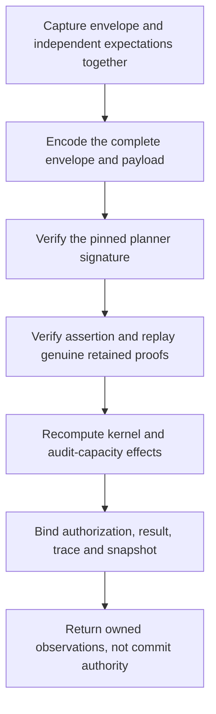

# Signed revocation plans

## Status

Source `.32` adds an inactive, revoke-only v4 verifier in
[`authority_revocation_plan.py`](../serverware/authority_revocation_plan.py).
It verifies a complete signed envelope and recomputes its retained proofs,
assertion, business effects, authorization projection and commitments.
The source is **unbuilt and unexecuted**. This is not production protocol
activation, a startup repair, SQL persistence or a successful deployment.
Source `.34` additionally binds the complete writer acquisition marker block
to the actual proved OLD/NEW mutations.

The existing v3 schemas and consumers stay closed to complete-query plans.
The new verifier cannot be substituted for admission of current roots,
enrolled signing keys, a capability reservation or a terminal witness.

## What the verifier binds

The signed envelope has three fields: schema, payload and canonical unpadded
Ed25519 signature. The payload has sixteen fields: the existing plan, request,
rows, mutations, primary proofs, trace, authorization projection, assertion,
result and identity commitments, plus the raw `revocationProofBundle`.
Its `rootTransition` is the fourteen-field mixed transition containing the
primary transition and counted heads; a primary-only transition is rejected.
The measured plan retains twenty-two fields. Snapshot/v4 binds the mixed
transition digest as its ninth frame. This is not a v3 extension or downgrade.

Both public keys, both three-digest identities, the expected request,
capability, planner transaction, fence, reservation time, deadlines, clocks,
maximum ages/skew, database cutoff, before-root vectors and approver-policy
digest are mandatory external inputs. None is filled from a signed claim.
Matching those values does not establish their independent provenance.

The planner signature covers the actual canonical payload. The assertion
receipt uses the separate pinned verifier key. Both are real Ed25519
verifications, not acceptance of a successful-verifier object. The semantic
worker evaluates the genuine retained proof and kernel once, then the outer
worker compares full rows, proofs, mutations and result with that computation.

## Authorization query coverage

Revocation needs both read-only trust-authorization relations. Its source
program must select the fixed `webauthn-metadata` high-water key, resolve the
published bundle from that proved row, and prove the pending-publication range
empty. The publication lookup uses the high-water's bundle/payload digests,
rollback epoch and sequence, not a caller-supplied publication ID.

The sixth complete role, `pending_trust_publications`, has constant status
`pending` and bound one, with no caller hint. A nonempty result cannot authorize
revocation. This adds the publication-status head to the previous read/write
head union: six complete roles, five read heads and nine potential heads.
At most forty-five declarations include the two trust lookups, pending range
and the existing capacity query. The operation ceilings remain
**193 selected rows, 137 mutations and 2050 signed work units**.

The shared trust helper preserves the live verifier's high-water commitment.
Trust/current-credential binding is part of semantic admission; a table head,
an unproved extra selected row or a syntactically valid receipt cannot replace
the required source observations. The global query-read union remains exact.

## One cumulative budget

Envelope and expectation graphs are detached before hashing or signatures.
The complete signed envelope and its payload are each bounded by 64 MiB;
a separately bounded proof bundle is not enough. Their real encodings happen
before proof replay, so no final outer output allocation escapes the meter.

One ledger spans capture, transport, both signatures, proof replay, actual
kernel/capacity work and binding. Its ceilings are eight million SHA operations,
64 MiB of defined byte work, one million JSON-node visits and depth 128.
These are cumulative work units, not a process-memory or network-allocation
guarantee. Earlier work is not reset when a private worker is entered.
Only the existing compact-proof finalization hold is released.

Repeated canonical encodings, copies and comparisons are charged. Framed
authorization/key hashes include their actual payload lengths. The fixed
86-character planner signature reserves its padding, ASCII conversion,
URL translation, decode pass and 64-byte result before those allocations.
Source-only digest pins computed at import are explicitly outside invocation
work. Returned phase metrics are exclusive deltas; retained packaging metrics
are cumulative snapshots and must not be added again.

Present read-phase trace markers must match source query identities, proved heads,
derived intervals/limits and canonical outside-cover batches. Exact selected
keys must appear in reads; writes must be the exact mutation suffix. This
checks consistency of signed metadata, not whether physical SQL was executed.

The writer block has a stronger exact-inventory requirement: every target-leaf
and sibling-node batch, in source-sorted profile order, must appear contiguously
immediately before the writes. The verifier derives these identities from the
actual OLD/NEW row images and genuine primary after roots after semantic
verification. NEW-only targets and nonmember profiles with sixteen depth-one
siblings are included; the before frontier alone cannot establish the required
query schedule. The same indexed preparation and geometry body is reused,
without another primary or sparse proof evaluation. NEW-row, profile and
projection hash preparation, marker copies and canonical comparisons spend
the same ledger. Pure target/sibling geometry and other fixed scaffolding,
along with existing indexed-projection allocation internals, remain outside
the defined allocation accounting. This does not upgrade the preceding
read-marker consistency check into proof of a complete physical read transcript.

## Remaining production integration

Source `.34` extends the [private producer](authority-complete-acquisition.md)
through genuine request/receipt verification, a single-cutoff source read
program, actual kernel/capacity effects and write-frontier acquisition. It
retains original roots and merged primary proofs, shares read/write work and
physical acquisition spending, and emits the exact writer block. It returns
raw observations and does not yet package or sign a v4 plan.

Source `.35` adds the [private signed producer](authority-revocation-production.md)
on top of that acquisition path. It normalizes the actual raw evidence, repeats
the genuine mixed proof computation on the same remaining work, and returns the
original signed v4 bytes. This implements the private producer in source, not
public protocol admission or durable replay.

The actual verifier-response admission, durable planner replay and persistence
paths still require coordinated v4 admission and consumer changes. They need
independently admitted roots and the original evaluation cutoff; replay cannot
derive those expectations from its retained envelope or sample a new cutoff.
Database Snapshot/persistence, one-use consumption, executor and terminal
witness semantics must move together before activation. Registry admission and
the other three missing WebAuthn kernels remain outstanding.

Current `exact_plan` storage retains a closed v3 payload, not the original v4
signed envelope or independent evaluation context. The successor needs explicit
versioned storage binding those original bytes and their digests, identical
retry semantics, and rejection of conflicting envelopes or context. Stored
context is historical data, not independent root/key/time authority. Replaying
the original cutoff must not authorize execution against stale current state.

The active v9 SQL credential-policy reconstruction now uses the fixed
[`webauthn_credential_policy_sql`](../serverware/authority_store/webauthn_trust_sql.py)
expression, including `aaguid` in the sixteen-field service/shared-helper policy.
[`executor_v9.py`](../serverware/authority_store/executor_v9.py) retains its
existing wire/domain digest and locked full-row CAS checks. The expression
preserves JSON null/string values; it is not row admission. Existing databases
with the older function definition still require a reviewed repair rather than
an automatic upgrade. SQL/Python component parity controls are authored, not run.

The similar historical policy bodies in
[`db.py`](../serverware/db.py) are replaced by unconditional v9 denial stubs.
Its standalone SQL challenge issuer stores `credentialPolicyDigest` instead of
`credentialId`, but remains an ungranted legacy path, not the current service
producer. The current [`authority_service.py`](../serverware/authority_service.py)
challenge preparation already emits the exact `credentialId` payload required
by its receipt admission. The SQL policy correction does not activate v4 or
legacy helpers; no live ceremony, full executor or commit success is claimed.

The authored shape, signed-plan and semantic-handoff fixtures use synthetic
external identities and real fixture signatures/proofs. They are not passing
test evidence or provisioned production authority. The immutable dependencies,
sealed verification boundary, complete source freeze and sequential prepared
verification remain required by [the project workflow](../goal.md).
