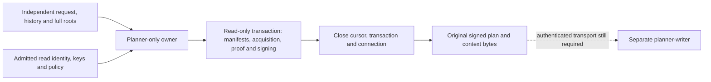

# Planner-only observed revocation production

Source `.56` separates the genuine read transaction from writer persistence.
It is unbuilt and unexecuted. The new private `RevocationObservedPlanner` does
not enable a service purpose or any of the unfinished WebAuthn registry gates.

## Credential and ownership boundaries

The new owner holds only the planner read DSN, bounded connection timeout,
seven planner database/measurement identity scalars, planner signing key,
two public keys, verifier identity and historical age/skew policy. These ten
settings are snapshotted before invocation callbacks. A constructor is not key,
configuration, database or launch admission.

Callers supply the original request, assertion evidence, nine historical
context fields and full independently obtained root inventory. They cannot
replace configured identities or age policy, inject an expected-root subset,
or supply a successful producer result. Real copies precede connection/key
callbacks. The configured fields form the fourteen-field planner context;
actual acquisition and effects determine the final independent root subset.

The actual read body is shared with the previous combined coordinator. It uses
the real planner identity check, source manifests, one complete trace, genuine
observed acquisition, proof packaging and signing. It does not call the legacy
`MeasuredPlanner.derive`, create a fresh work allowance, or construct a dummy
persistence owner. The combined coordinator retains its outer input copies,
writer suffix and original exact-context branch.

## Transaction and result contract

One PostgreSQL connection owns three real context scopes: connection,
transaction and cursor. The transaction is set to `SERIALIZABLE READ ONLY
DEFERRABLE`. Inert lifecycle guards check the original raw connection identity,
idle/active transaction states and unchanged work around callbacks. The cursor
requires an already-active transaction, including during the initial `SET`;
it is not the verifier root reader's idle-to-active cursor.

The expected context is copied and checked against held independent pins before
read-scope cleanup. The owner returns the original immutable envelope bytes,
original evaluation-context bytes, acquisition cutoff and detached expected
context only after every scope closes. None is a persistence receipt or an
authority token. A cleanup failure denies the result. The old coordinator maps
only the dedicated lifecycle guard error back to its existing store error;
planner and proof exceptions retain their original types.

New owner timeouts are exact integers from 2 through 300 seconds. The previous
coordinator still accepts its historical one-second value. Assertion age is
the configured challenge policy, plan age cannot exceed thirty seconds, and
skew is the source five-second policy. Metadata admission, driver work and
fixed configuration checks are not whole-process H/B/N accounting. A hostile
driver's hidden commit-and-BEGIN is not disproved by observed status equality.

## Serving and verification work still required

The new owner still needs measured-service construction and authenticated
original-byte transport. The writer socket is pinned to the planner UID/GID.
The legacy verifier's direct reservation call does not match that topology;
a successor needs a planner relay that preserves the verifier's authenticated
originals, or an explicitly reviewed endpoint design. Do not widen DSNs or
socket peers to make the old call work.

Legacy replay stores a payload and re-signs it. It cannot substitute for the
original signed-plan/context custody required here. The writer must also retain
independently authenticated request/history/root expectations; supplied context
bytes cannot authenticate themselves. Writer role/transaction checks and schema
ACL installation are not a per-connection TLS, PostgreSQL-version or complete
privilege-admission proof. That remaining connector work is separate from this
read-only extraction.

Component fixtures cover inert ownership/accounting and explicitly synthetic
driver guards. The real planner-to-handoff tests remain in the registry-gated
startup suite, with actual proof/signature workers and no registry substitute.
Neither suite has been executed for this source. Follow the preparation and
sequential frozen no-build requirements in [goal.md](../goal.md).
