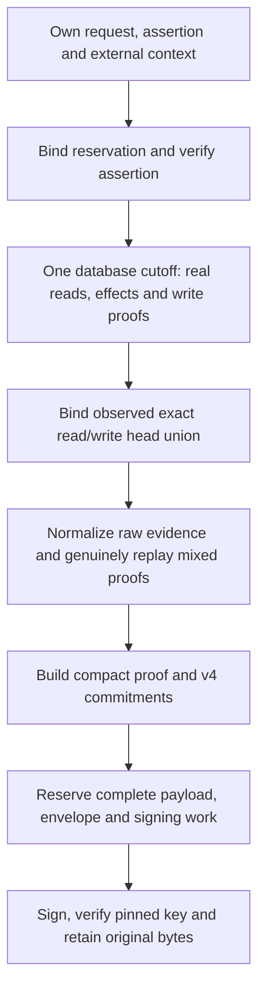

# Private signed revocation production

## Status and authority boundary

Source `.35` adds a private revoke-only producer that connects actual database
acquisition to the original signed v4 envelope. It is **unbuilt and unexecuted**.
It is not a public endpoint, registered kernel, durable replay implementation,
SQL commit or deployed release.

[`TypedTransitionPlanningProgram._produce_revocation_plan`](../serverware/authority_planner.py)
accepts a raw typed request, manifest and assertion, fifteen explicit evaluation
context fields, a caller-owned read-only MVCC cursor, actual signing and pinned
verification keys, and the existing invocation work object. There is no
`verified_result` input or alternate successful-proof route. All caller graphs
are captured together before signature or database callbacks.

The context binds planner/verifier identities, capability, planner transaction,
fence, reservation time, epoch and monotonic deadlines, evaluation clocks,
assertion/plan age limits, clock skew, expected before vectors and optional
approver-policy digest. Closed shapes, matching values and freshness arithmetic
do not establish key enrollment, current roots, trusted clocks or a real
reservation. The caller must independently admit those authorities and own the
transaction. The producer's observed database instant is retained unchanged;
it is not promoted into independently trusted current time.

## Actual pipeline

The producer calls the existing [read/effect/write coordinator](authority-complete-acquisition.md)
once. It does not resample the database clock or accept a caller's mutation
recipe. The collector's nine potential heads are narrowed to the exact union
of six-role read indexes and genuinely written indexes. The observed vector is
compared canonically with the independent expected vector before packaging.
Unused potential heads cannot be smuggled into the closed proof document.

The [proof packager](../serverware/authority_revocation_proof_bundle.py) receives
the original roots, merged primary proofs, QueryReads, range frontiers, actual
mutations and acquired write frontiers. Its private `_derive_on_work` attaches
the existing work object and runs the genuine mixed proof engine. This is
intentional repeated proof work: the compact document commits six replay-phase
deltas, which cannot be invented from acquisition metrics. The actual normalized
bundle and compact graphs are retained beside their canonical bytes, without
parsing those bytes or constructing a substitute result token.

The [production helper](../serverware/authority_revocation_plan_production.py)
uses the existing authorization, framing and commitment bodies to assemble the
exact sixteen-field payload and twenty-two-field measured plan. It preserves
Snapshot/v4 and the v4 signature domain. The actual Ed25519 signature is checked
with the separately pinned planner public key before any output is returned.

The return value contains original payload/envelope bytes, the corresponding
owned graphs, the original database instant and cumulative work. Nested graphs
are mutable observations, not deeply immutable authority; retained bytes remain
the original signed representation. Consumers must not re-sign a stored payload
and call it original-envelope replay.

## One remaining allowance

Context ownership, acquisition, genuine effects, repeated mixed proof replay,
packaging, commitments and final transport use the same work object. The source
ceilings remain eight million hashes, 64 MiB of defined byte work, one million
JSON-node visits and depth 128. A standalone component's success under those
ceilings does not imply the combined producer fits them.

The private packaging attachment reserves compact output against the entering
ceiling and all earlier spending. Caught nested attachment poisons the active
owner. Normal unwind restores the entering limit object, including an outer
hold, without refunding counters. External mutation of its scalar limits is
detected and denied, not silently repaired; failed work must be discarded.
Public proof-packaging APIs preserve their
existing behavior and return types; their private two-result worker remains
compatible with the semantic verifier.

Compact output reservation does not cover the final signed envelope. The
production helper separately measures the full actual payload and envelope,
using only a fixed-length signature placeholder for preflight. All three
encoder passes, the post-sign payload measurement/comparison and bounded
signature/base64 output work are admitted before signing. The helper rejects
changed work limits/counters during key callbacks and compares the current
payload with the exact signed bytes, including equal-length mutations. Only
the genuine signature is encoded or returned. Budget failure
cannot yield a placeholder or a partial signed plan.

Packaging totals and root-level metrics are cumulative snapshots, while the
signing helper's metrics are its own invocation delta. Do not sum cumulative
snapshots as if they were exclusive phases. These are defined work limits, not
a whole-process memory, SQL-cost or wall-clock deadline guarantee. The existing
acquisition exclusions remain: clock/ordinary/primary-proof SQL are outside
shared physical counters; staged proof/stamp work, acquisition trace encoding,
driver/process allocation, indexed projection internals and fixed scaffolding
have separate or explicitly excluded accounting.

## Remaining integration

The immutable production descriptor remains `private-producer-only`, with
public v3 and production v4 admission disabled. Public planner, service,
persistence and registry consumers are not switched to v4 by this component.
All four missing registered WebAuthn kernels remain production gates.

The next required step is coordinated [original-envelope and independent-context
retention](authority-revocation-retention.md): versioned storage, digest binding,
identical retries, conflict denial,
independent replay expectations, current-state admission, one-use consumption,
SQL/executor checks and terminal witness binding. Historical evaluation context
must remain separate from current execution authority and deadline enforcement.

Authored controls use independent synthetic roots and identities, genuine
fixture signatures/proof engines, and deterministic SQL responders. They are
not PostgreSQL transaction evidence, passing test results or provisioned trust.
The immutable dependency/coverage snapshot, sealed controller/browser boundary,
complete source freeze and sequential prepared verification still precede any
execution under [the project workflow](../goal.md).
