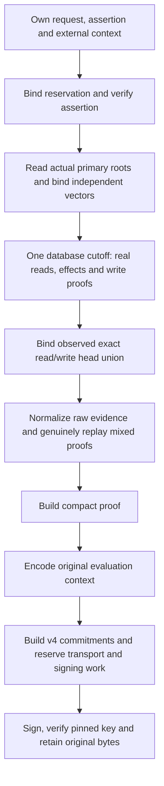

# Private signed revocation production

## Status and authority boundary

Source `.35` adds a private revoke-only producer that connects actual database
acquisition to the original signed v4 envelope. Source `.38` also returns its
original canonical evaluation-context bytes. Source `.39` binds actual primary
root-table reads to independent expectations before the original database clock.
Source `.40` connects this primitive to a configured read-transaction owner and
separate original-byte persistence. Source `.41` adds the assertion/projection
custody required by the executor to that same private write transaction.
Source `.42` adds a private SQL retained-byte integrity binder, without
connecting it to this producer or activating any execution route.
Source `.43` adds a separately invoked private execution-envelope reservation
after genuine stored replay, without activating business execution.
Source `.44` adds private source-derived counted before/after SQL fragments;
they remain separate from this producer and any installed executor.
Source `.53` adds an [independently observed planning successor](authority-revocation-observed-planning.md):
it compares the full verifier inventory before selecting the actual signed
subset, then retains the same independent context through persistence. The
exact-context API described below remains available.
Source `.54` adds private [verifier-side handoff admission](authority-revocation-handoff.md),
using the existing v4 signature to authenticate the cutoff before genuine
retained replay against independently owned request/context/root values.
These implementations are **unbuilt and
unexecuted**, not a public endpoint, registered kernel, observed SQL commit or
deployed release.

[`TypedTransitionPlanningProgram._produce_revocation_plan`](../serverware/authority_planner.py)
accepts a raw typed request, manifest and assertion, fifteen explicit evaluation
context fields, a caller-owned read-only MVCC cursor, actual signing and pinned
verification keys, and the existing invocation work object. There is no
`verified_result` input or alternate successful-proof route. All caller graphs
are captured together before signature or database callbacks.

The context binds planner/verifier identities, capability, planner transaction,
fence, reservation time, epoch and monotonic deadlines, evaluation clocks,
assertion/plan age limits, clock skew, expected before vectors and optional
approver-policy digest. Closed shapes, matching values and freshness arithmetic
do not establish key enrollment, current roots, trusted clocks or a real
reservation. The caller must independently admit those authorities and own the
transaction. The producer's observed database instant is retained unchanged;
it is not promoted into independently trusted current time.

## Configured read-to-persist owner

[`RevocationPlanningCoordinator`](../serverware/authority_revocation_coordinator.py)
is configured with a read DSN, actual `PlannerIdentity`, connection timeout,
planner private key and exact `RevocationPlannerPersistence`. Its
`produce_and_persist` method accepts raw request/evidence, the thirteen context
fields other than the two configured identities, a planned timestamp and
existing work. Callers cannot replace manifests, traces, public keys or identity
pins with per-call values or successful-result objects.

Source `.49` adds `produce_and_persist_with_cutoff`, returning the same retained
receipt plus the original database instant captured inside acquisition. The
existing receipt-only method delegates without another copy, clock read or
work allowance. The pair is published only after persistence and its cleanup
finish. This preserves local historical custody for later independent replay;
it is not a current-time attestation or an authenticated cross-role invocation.
Callers still supply independently retained request/context expectations.

The owner snapshots configuration and captures caller graphs before external
callbacks. The read identity's three authority digests must match the captured
planner identity. One seven-setting persistence snapshot retains its DSN, timeout,
public-key handles, signing-identity triples and independent writer role/TLS
pins across both phases; it does not enroll keys or freeze arbitrary
key-implementation internals.
It opens an actual `SERIALIZABLE READ ONLY DEFERRABLE` transaction,
checks database TLS/role privileges with the existing identity validator, and
loads both manifests through their genuine source-comparison bodies. Metadata
SQL precedes assertion verification; the genuine receipt is checked before
business root/query SQL. One actual trace retains the manifest-read prefix and
continues through acquisition, proof reads, the writer block and final closure.

Every read cursor, transaction and connection scope exits before the separate
writer is opened. The configured persistence path receives unchanged original
envelope/context bytes, the original observed cutoff, independently captured
request/context expectations and the same work. It genuinely re-verifies those
bytes; a producer result is not accepted as an authority token. This ordering
does not make the historical read snapshot current at execution time.
Both connection opens close any returned handle if the post-open work guard
rejects it, without repairing the meter or replacing the first failure. This
does not promise cleanup of a handle never returned by an opener or of a
context manager whose entry raises before completing.

After genuine raw replay, a reserved v4 parent also receives the real immutable
assertion-evidence and authorization-projection rows before its completion CAS.
The shared legacy row materializers preserve all thirty-five and twenty-one columns.
Fresh admission checks the current configured verifier and age/skew policy;
planned retries and historical reads instead require existing exact rows, with
no repair or current-verifier key reload. The unchanged live retry deadline
still uses current configured maximum age and skew; historical reads remain
clock-free. See the [retention contract](authority-revocation-retention.md)
for these boundaries and the absence of custody-chain foreign
keys. This is not mixed-root execution admission.

The [private SQL binder](authority-revocation-retention.md#private-sql-integrity-binder)
checks retained transport/record integrity using a caller-locked parent and
its immutable sidecar. Its returned JSON and commitments are not verified
authority: independent key/request/context admission, actual Ed25519 and
complete-proof verification, current locked primary/counted roots and the
writer reservation remain separate consumer requirements. Existing public
v3 execution, reservation and service replay gates are unchanged.

The separately invoked configured `reserve_execution` method genuinely replays
the stored original bytes and constructs a closed five-field successor request
binding the typed request, `revocation-v4`, retained-record digest and mixed
root-transition digest. One serializable writer transaction/savepoint retains
the parent lock through reservation and readback; it does not reuse an earlier
replay result from a closed transaction. Only a `planned` parent and a new or
exactly identical `reserved` envelope are admitted. Every reservation column
and NULL terminal field is compared on retry, preserving timestamps, and
current deadline/age/skew checks still apply. No execution-envelope database
immutability/FK, current-root, capability or terminal-authority guarantee is
added. `produce_and_persist` does not automatically reserve execution; see the
[private reservation contract](authority-revocation-retention.md#private-execution-envelope-reservation).

The [private counted-head fragments](authority-revocation-retention.md#private-counted-head-fresh-apply-fragments)
derive complete-read plus actual-write indices and real projected event deltas,
then bind locked full source heads to exact compact before/after vectors.
They require genuine independent replay, primary locks before counted locks,
and one fresh-apply transaction; historical retry must not invoke live-head
reads. They do not supply independent currentness, activate an executor, or
claim SQL H/B/N accounting or a general deadlock proof.

## Actual pipeline

The producer calls the existing [read/effect/write coordinator](authority-complete-acquisition.md)
once. It does not resample the database clock or accept a caller's mutation
recipe. After genuine assertion verification, it calls the existing
`_read_root_set` on the same cursor, trace and work, then compares both observed
business and authorization vectors canonically with the invocation-owned,
independently supplied expectations. Those observed roots feed the real reader;
the original database clock is sampled once, after these root reads.

This fixes a concrete source defect: the private acquisition path previously
omitted the genuine global audit-capacity root read required by `trace.close`.
Source `.39` performs that SQL and lets the existing trace classifier account
for its framework marker; it does not insert a synthetic marker or loosen trace
closure. A matching database observation is not independent root-currentness
authority or proof of transaction ownership.

The collector's nine potential heads are narrowed to the exact union
of six-role read indexes and genuinely written indexes. The observed vector is
compared canonically with the independent expected vector before packaging.
Unused potential heads cannot be smuggled into the closed proof document.

The [proof packager](../serverware/authority_revocation_proof_bundle.py) receives
the original roots, merged primary proofs, QueryReads, range frontiers, actual
mutations and acquired write frontiers. Its private `_derive_on_work` attaches
the existing work object and runs the genuine mixed proof engine. This is
intentional repeated proof work: the compact document commits six replay-phase
deltas, which cannot be invented from acquisition metrics. The actual normalized
bundle and compact graphs are retained beside their canonical bytes, without
parsing those bytes or constructing a substitute result token.

After packaging and before signing, the producer checks that the original
database instant still equals the acquired evidence's cutoff. It passes the
same invocation-owned fifteen-field context and that instant to
`authority_revocation_retention._encode_context_on_work`. The helper adds
schema, source revision and `databaseCutoffUs` to form canonical eighteen-field
bytes. It does not resample the clock, parse a replacement context or infer
authority from matching values.

The [production helper](../serverware/authority_revocation_plan_production.py)
uses the existing authorization, framing and commitment bodies to assemble the
exact sixteen-field payload and twenty-two-field measured plan. It preserves
Snapshot/v4 and the v4 signature domain. The actual Ed25519 signature is checked
with the separately pinned planner public key before any output is returned.

The return value preserves its first three fields, `signed`, `database_now`
and `metrics`, and appends `evaluation_context_bytes` as the fourth. `signed`
contains the original payload/envelope bytes and corresponding owned graphs.
Nested graphs are mutable observations, not deeply immutable authority; their
later mutation does not rewrite the original bytes. Consumers must not re-sign
a stored payload and call it original-envelope replay.

## One remaining allowance

Context ownership, acquisition, genuine effects, repeated mixed proof replay,
packaging, context encoding, commitments and final transport use the same work
object. Source ceilings remain eight million hashes, 64 MiB of defined byte
work, one million JSON-node visits and depth 128. A standalone component's success under those
ceilings does not imply the combined producer fits them.

Actual root-row copying, the existing canonical/framed root-set commitment and
the comparison with independent vectors debit that same remaining work. The
source descriptor includes `actual-root-read-binding`; the legacy root-reader
default and all shared ceilings are unchanged.
Root trace, execute and fetch callbacks must leave the meter's limits and
counters unchanged; callback spending, refunds or replacement limits abort.

Context measurement and canonical encoding charge `0H/2L/2N` on that existing
meter: zero hashes, twice the context byte length and twice its node count.
The separate context bounds are 512 KiB, 4,096 nodes and depth 8; its closed
shapes have maximum scalar depth four. These bounds grant no new allowance.

The private packaging attachment reserves compact output against the entering
ceiling and all earlier spending. Caught nested attachment poisons the active
owner. Normal unwind restores the entering limit object, including an outer
hold, without refunding counters. External mutation of its scalar limits is
detected and denied, not silently repaired; failed work must be discarded.
Public proof-packaging APIs preserve their
existing behavior and return types; their private two-result worker remains
compatible with the semantic verifier.

Compact output reservation does not cover the final signed envelope. The
production helper separately measures the full actual payload and envelope,
using only a fixed-length signature placeholder for preflight. All three
encoder passes, the post-sign payload measurement/comparison and bounded
signature/base64 output work are admitted before signing. The helper rejects
changed work limits/counters during key callbacks and compares the current
payload with the exact signed bytes, including equal-length mutations. Only
the genuine signature is encoded or returned. Budget failure
cannot yield a placeholder or a partial signed plan.

Packaging totals and root-level metrics are cumulative snapshots, while the
signing helper's metrics are its own invocation delta. Context encoding occurs
between packaging and that signing delta. Do not sum cumulative snapshots as
if they were exclusive phases. These are defined work limits, not
a whole-process memory, SQL-cost or wall-clock deadline guarantee. The existing
acquisition exclusions remain: clock/root-table/ordinary/primary-proof SQL are outside
shared physical counters; staged proof/stamp work, acquisition trace encoding,
driver/process allocation, indexed projection internals and fixed scaffolding
have separate or explicitly excluded accounting.
The configured owner's database identity checks and source-metadata admission,
including manifest reconstruction and hashes, are outside H/B/N accounting.
They still use the real source validators and guarded callbacks; guards are not
work metering. No allowance is reset between production and persistence, and
the production descriptor's included-phase list is unchanged by this owner.
The subsequent custody payload encodings/hashes, copies, codecs, comparisons
and signature transport use the same work. Current database verifier-key loading
and key/SPKI metadata admission remain an explicit H/B/N exclusion, alongside
SQL/driver work; the actual configured-verifier check is still mandatory for
new reserved records.

## Remaining integration

The immutable production descriptor remains `private-producer-only`, with
public v3 and production v4 admission disabled. Legacy planner, service,
persistence and registry consumers are not switched to v4 by this component.
All four missing registered WebAuthn kernels remain production gates.

Source `.37` adds private [original-envelope and independent-context
retention](authority-revocation-retention.md): versioned storage, digest binding,
identical retries, conflict denial and independent replay expectations.
Source `.38` supplies the producer's original context bytes for that private
handoff. Source `.40` connects the private configured owner to retention after
closing its read scopes; public service integration remains separate work.
Source `.41` fills the retained plan's assertion/projection custody prerequisites
without changing table shapes, grants or the closed v3 execution path.
Current-state admission, public service activation, one-use consumption,
mixed-root SQL/executor checks and terminal witness binding remain required. Historical evaluation context
must remain separate from current execution authority and deadline enforcement.

Authored controls use independent synthetic roots and identities, genuine
fixture signatures/proof engines, and deterministic SQL responders. They are
not PostgreSQL transaction evidence, passing test results or provisioned trust.
The immutable dependency/coverage snapshot, sealed controller/browser boundary,
complete source freeze and sequential prepared verification still precede any
execution under [the project workflow](../goal.md).
