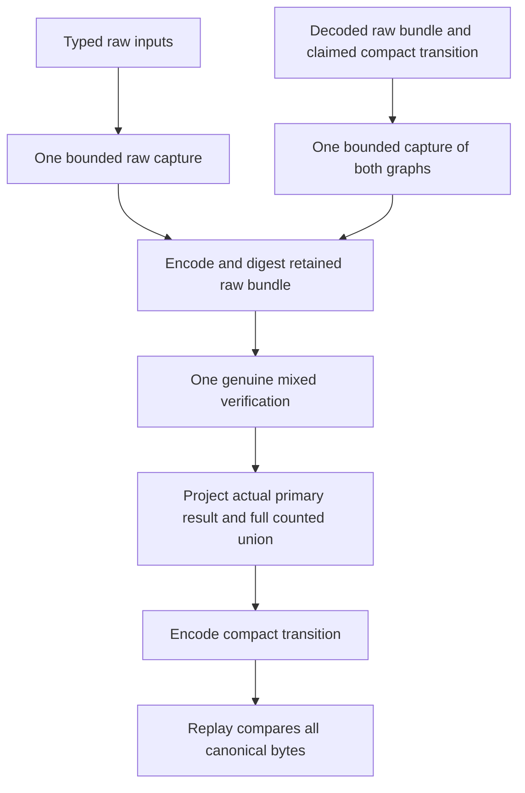

# Retained revocation evidence and genuine replay

## Scope

[`authority_revocation_proof_bundle.py`](../serverware/authority_revocation_proof_bundle.py)
retains the complete raw inputs to the [mixed revocation composer](authority-revocation-read-write.md)
and produces a compact, versioned read/write transition. Replay accepts only
the raw bundle and claimed transition, recomputes the genuine source program,
observations and proofs, then compares the entire compact document.

This is an unbuilt, unexecuted computation component. Neither a digest nor a
successful return authenticates a request, WebAuthn signature, clock, current
root vector, capacity baseline or business mutation. It does not activate the
planner, install SQL, register a kernel or widen Snapshot/v3.

Raw rows may contain sensitive credential material. Keep the raw bundle inside
the admitted semantic execution/storage boundary. Do not send it to the
external witness or include it in ordinary logs. A future independent witness
needs purpose-bound commitments and authenticated computation assurance, not
secret-bearing rows; see the [current-root integration contract](authority-current-root-witness-integration.md).

## Two closed documents

The hash-free [shape contract](../serverware/authority_revocation_bundle_contract.py)
defines the following exact objects. Shape checks return no success token and
do not replace genuine proof computation.

| Document | Schema and profile | Contents |
| --- | --- | --- |
| Raw bundle | `serverware.policyAuthorityRevocationProofBundle/v1`; `serverware.policyAuthorityRevocationProofBundleProfile/v1` | Exactly `schema`, `profile`, `sourceRevision`, `inputs`. |
| Compact transition | `serverware.policyAuthorityRevocationReadWriteTransition/v1`; `serverware.policyAuthorityRevocationReadWriteTransitionProfile/v1` | The 14 fields below, including the raw bundle digest and full read/write head union. |

The raw `inputs` object has exactly 15 fields:

```text
operation, arguments, cutoffUs, queries,
businessBeforeRoots, authorizationBeforeRoots,
selectedRows, beforeProofs, countedBeforeHeads,
queryFrontiers, mutations, writeFrontiers,
requestDigest, assertionBinding, queryReads
```

These are the mixed composer's normalized raw inputs, not serialized success
objects. Query declarations retain their four raw fields. Primary Proof/v3
retains its original 11 fields and all 64 sixteen-child sibling vectors.
Counted frontier terminals use only the closed `leaf` or `opaque` forms.
Retained declared/resolved queries and address keys are strict ASCII strings;
the verifier never parses those strings into executable declarations.

The compact transition has exactly:

```text
schema, profile, sourceRevision, operation, requestDigest, cutoffUs,
assertionBinding, countedProfile, projectionManifestDigest, proofBundleDigest,
primaryTransition, indexBeforeHeads, indexAfterHeads, metrics
```

`primaryTransition` preserves the existing seven-field primary transition
schema v1/profile v2, projected from the actual indexed writer's primary result.
Each counted head has four fields: `indexId`, `indexRevision`, `rootDigest`,
`leafCount`. Before and after arrays contain the exact sorted read/write union,
including unchanged query-only heads. The actual projection-manifest digest
binds source index/table/profile mappings; packaging does not reconstruct or
rehash that manifest, repeat profile constructors or use the write-only wrapper.

Each document is encoded as sorted compact ASCII JSON. Its digest is:

`SHA256(schema_ascii || NUL || u64be(len(document_bytes)) || document_bytes)`

The result uses the `sha256:` lowercase-hex spelling. The document schema is the
domain. This is the existing primary/core domain-NUL framing, **not** the
counted-tree family that length-frames the domain itself. The bundle has no
self-digest field; the compact transition commits the bundle digest, and its
own digest is returned separately.

## Ownership and real recomputation



`derive_revocation_proof_bundle` accepts exactly the mixed composer's 15 input
keywords plus optional whole-operation limits. It reserves raw ASCII decoding
before allocation and owns all raw evidence before the first hash.

`verify_revocation_proof_bundle` accepts already-decoded exact lossless JSON
graphs. It captures both bundle and claim together before any hash, closes
their shapes and encodes the claim, then runs the same genuine private worker
once. It never accepts a previous mixed result, primary result or retained
result as evidence. Replay includes real membership verification, all six
complete joins, indexed writes, exact point-key binding and complete read order.
The returned primary object is the actual writer result, not a reconstruction.
Depth is measured from each actual document root. The synthetic pair used for
joint capture still pays its byte/node cost but does not consume one level of
either document's 128-level limit; otherwise a valid derived bundle at the
boundary could fail replay solely because of that internal wrapper.

The transport parser is outside this API. These limits do not prove that an
upstream parser bounded duplicate keys, incoming bytes or allocations. Likewise,
canonicalizing an already-decoded graph does not authenticate original received
bytes. The caller must supply an independently admitted bounded transport.

## One cumulative work allowance

Capture, raw decoding, claim encoding, bundle encoding/hashing, genuine mixed
verification and compact finalization share the source ceilings: 8,000,000
hashes, 64 MiB of defined byte work, 1,000,000 JSON nodes and depth 128. Limits
may only be lowered. Repeated graph occurrences and traversals are charged;
these units are not network size, process memory or every CPU instruction.

For a document with canonical length `L` and `N` nodes, bounded measurement and
the actual encoder cost `2L` bytes and `2N` nodes. Each document digest costs one
hash. Raw typed-input decoding is separate; replay instead pays for its combined
bundle/claim capture. Final replay comparison charges both canonical byte
operands, including when equality would short-circuit.

Before capture, the private ledger withholds this compact-output allowance:

| Invocation | Hashes | Byte work | Nodes |
| --- | ---: | ---: | ---: |
| Derive | 1 | 131,072 | 2,048 |
| Replay | 1 | 262,144 | 2,048 |

The hold lowers the actual work object's ceilings, so direct work calls cannot
spend reserved capacity. After genuine verification, one release restores only
the saved original ceilings; spent counters never decrease. Actual finalization
is still charged and must fit the hold. Claimed and computed compact documents
are capped at 65,536 bytes and 1,024 nodes after bounded measurement but before
an encoded buffer is produced. A rejected measurement is spent work.

A conservative source derivation permits 11 heads per state, nine primary
roots per state, 128-byte source identities, 19-digit nonnegative root values,
a 20-character signed cutoff, eight-digit work values and two 1,024-byte
validated IDs (at most 3,074 ASCII JSON bytes each). With keys conservatively
bounded by 64 ASCII bytes, this totals at most 32,178 bytes / 477 nodes. The
current nine-head revoke closure remains below that eleven-head bound. Malformed
claims do not inherit that valid-source argument; the actual encoder ceiling
still applies.

Compact metrics contain only six exclusive verification-phase triples:
`generation`, `declarationBinding`, `observationValidation`, `pointBinding`,
`proofWork`, `completeBinding`, plus their `hashWork`, `inputBytes`, `jsonNodes`
sums. These remain identical between derivation and replay. Invocation-specific
capture, decoding, encoding and finalization metrics remain outside both hashed
documents. Returned packaging metrics distinguish actual spent work from peak
reserved work. Because the hold is conservative, a quota equal to final actual
spending need not admit the invocation; admission uses the peak reservation.
Derivation and replay also have different admission costs. An accepted
derivation does not promise replay under that same quota, including near the
fixed source ceilings. Persisted planner integration must reserve the needed
replay peak as well; it must not treat derivation admission as a
replay-capacity guarantee or enlarge the source limits.

## Evidence and remaining integration

The [authored fixture](../scripts/test_authority_revocation_proof_bundle.py)
uses independent raw/compact documents, primary and counted trees, phase-work
oracles and both digest framing families. Its controls include an actual JSON
round trip, first-hash ownership, delegated real verifier calls, claim and raw
proof tampering, source variants and cumulative work bounds. It is source only;
no test ran or passed for this component.

Retention now exists as a pure wire component, not persisted planner transport.
The separate [semantic verifier](authority-revocation-semantics.md) now performs
actual pinned-receipt, request, kernel and shared-capacity recomputation from raw
inputs and compares complete finalized effects with these proofs on one ledger.
Those checks are not added to the v1 compact document, and standalone retention
does not invoke them. This retained-proof fixture's three
sample updates are deliberately not the full revoke kernel's effects. An absent
counter or present audit row can be a valid observation without authorizing
revocation. Independently verified assertion/request/time, authenticated index
population and currentness, all-writer SQL maintenance, coordinated protocol
upgrade, durable retention/replay and independently provisioned release and
verification services remain mandatory. Existing startup gates stay closed.

The [measured capacity worker](authority-audit-capacity-work.md) provides genuine
shared-body accounting inside the separate semantic verifier. This retained-proof
API does not invoke it or relax its initialized-counter checks.
