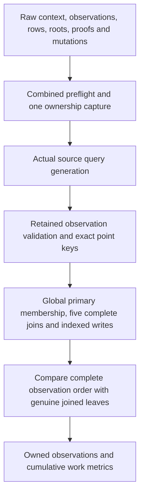

# Mixed revocation observations and read/write proofs

## Source boundary

[`verify_revocation_read_write_inputs`](../serverware/authority_revocation_read_write.py)
composes the actual `webauthn.credential.revoke` query recipe, retained query
observations and genuine [complete-read/indexed-write proof computation](authority-complete-read-write.md).
It is an unbuilt, unexecuted source component, not an activated planner path or
an authorization result.

The supplied request digest, two assertion IDs and signed-int64 cutoff are
context. Their inclusion does not authenticate a request, WebAuthn signature or
clock. Roots and populations are supplied proof inputs, not current trusted
state. Mutations must satisfy source templates and genuine indexed-write
proofs; the component does not run the business kernel to authorize their
effects, or admit the audit-capacity delta.

## One owned graph and one budget

All phases share the unchanged source ceilings: 8,000,000 hashes, 64 MiB of
defined input work and 1,000,000 JSON nodes, with depth 128. Optional
`QueryReadValidationLimits` apply to the whole composition and can only lower
these ceilings. They cannot grant additional work or supply a prior success.

Before any hash, the complete raw graph is copied once. It contains all the
existing read/write inputs plus `requestDigest`, an exact `assertionBinding`
with `credentialRecordId` and `challengeId`, and raw `queryReads` records.
Canonical query/key byte strings are represented as strict ASCII strings in
this internal graph. They are **never parsed into caller-supplied declarations**.
Actual business-intent normalization still performs its own separately metered
JSON round trip.

Preflight bounds exact types, lengths, 42 source declarations and 193 aggregate
address occurrences. It combines query-read records, addresses and *all*
read/write frontier terminals in one necessary node lower bound:

`35 + 11 * records + 9 * (addresses + frontier_terminals)`

That bound is checked against the actual remaining whole-composition allowance
before decoding observations or expanding frontier records. It is not a
promise that the full graph fits: capture charges the actual normalized graph,
including escaped quotes and backslashes and every repeated occurrence.

Every raw ASCII decode is reserved before its buffer is created. Restoring
immutable records later pays a separate ASCII encoding pass and the genuine
record constructors' scalar-frame scans. Ownership bytes do not stand in for
these subsequent traversals.

## Exact source and observation linkage

The composer calls the [genuine metered generator](authority-revocation-query-work.md),
including its actual framework-capacity query. It compares the five generated
complete declarations with the proof declarations in **source order**, using
their raw operation, role, selector and maximum-row fields. No additional
profile serializer or parallel query recipe supplies that comparison.

The actual [measured observation worker](authority-query-read-accounting.md)
then checks every retained declaration and resolution, ordered record identity,
presence, key digest and exact global selection union. No public wrapper is
called to reset the budget or recapture a partial input graph.

Two additional bindings close gaps that generic observational bookkeeping
intentionally does not prove:

- Every ordinary query must be a source-generated full-primary-key equality
  lookup. Its sole address must have that exact key whether the row is present
  or absent. A genuine proof for a different present key is insufficient.
- Every complete observation must match the genuine join's ordered primary-key
  digests and row count, with all addresses present. Empty complete queries
  still require their explicit zero-address, zero-count record.

The counter query makes its exact address mandatory in the observed union;
absence remains a valid *observation*, not initialized capacity. Similarly,
the query recipe does not require an audit address to be absent: replay and
capacity admission remain responsibilities of actual operation authorization.
Digest syntax is checked even when there are no audit queries and the recipe
does not otherwise consume the digest.

## Work and result accounting

Generation, declaration comparison, record restoration/validation and point
binding use one work object clamped to the remaining outer allowance. Its
actual counters are debited once before the genuine private proof composer
runs. The final joined-order comparisons charge the **current outer ledger**,
not a pre-proof object with stale headroom. A failed phase aborts without a
result, retry, refund or new allowance.

The flat result contains owned context, the full actual query program, checked
observations, genuine primary/count results and before/after heads. Metrics
separate raw decoding, ownership, generation, declaration binding, observation
validation, point binding, proof work and complete-order binding. Proof work is
an exclusive phase delta; the nested proof helper's cumulative total is not
exported as a separately additive cost.

Defined byte/node work is not network size, Python heap usage or a count of
every CPU instruction. Successful data objects and their mutable owned JSON
fields are not capabilities for any later verifier.

## Verification and remaining work

The [independent mixed fixture](../scripts/authority_revocation_observation_fixture.py)
builds genuine primary/count proofs over one synthetic population, with literal
query documents and independently ordered observations. Its three sample
updates exercise proof composition; they are deliberately not the complete
revocation kernel's business effects. The inherited batch fixture now supplies
its strict challenge-expiry oracle only to challenge-table joins, avoiding an
unrelated session/grant lookup in that map.

The [regression suite](../scripts/test_authority_revocation_read_write.py) has
20 authored methods, including an independent all-phase work oracle, exact and
one-unit-short whole budgets, prehash ownership controls, wrong present keys,
changed complete order and observational counter/audit presence boundaries.
These are source only: no build or test has run for this component. A separate
[retained proof bundle](authority-revocation-proof-bundle.md) now stores the raw
graph and genuinely replays this private worker under one enclosing budget; it
does not change this standalone API. Kernel and audit-capacity admission,
persisted planner transport, coordinated SQL/executor
protocol, trusted current-root witness and independently provisioned release
and verification services remain incomplete. Snapshot/v3 is unchanged; no
startup blocker or planner gate is bypassed.
