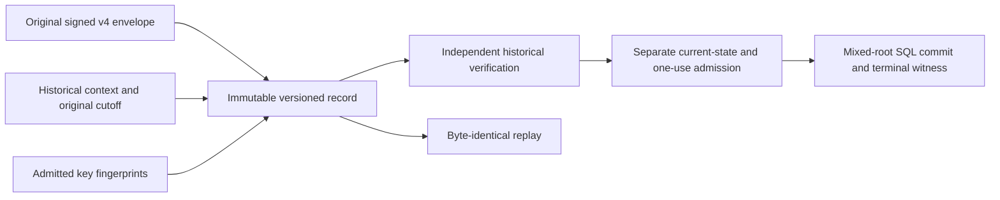

# Original signed revocation retention

## Status

Source `.37` implements private original-byte verification, PostgreSQL retention
and replay, a configured coordinator, and the versioned schema/ACL guards below.
It is **unbuilt and unexecuted**, not an installed schema, public service or
production authorization.
Source `.35` implements the [private producer](authority-revocation-production.md).
Source `.36` adds private [original-byte admission](authority-revocation-wire.md)
and verification on the same invocation work. Public service, mixed-root SQL,
one-use execution and terminal witness activation remain outstanding.

The existing `exact_plan_*` fields continue to contain canonical **payload**
bytes. Legacy v3 service replay reconstructs its envelope; private v4 replay
returns the original envelope and context from the new immutable sidecar.
Existing v3 rows cannot be upgraded into original v4 envelopes by inventing
missing signatures or evaluation context.

## Retained record and authority



Historical verification must still receive the expected typed request,
planner/verifier keys and other expectations through independent admission.
The current reservation stores operation/request digests, not request bytes.
The stored context and key fingerprints are evidence to compare with those
expectations, not key enrollment, current roots or refreshed deadlines.

### Historical context

Use a closed canonical eighteen-field document with schema
`serverware.policyAuthorityRevocationEvaluationContext/v1`:

```text
schema, sourceRevision,
expectedPlannerIdentity, expectedVerifierIdentity,
expectedCapabilityId, expectedPlannerTransactionId, expectedFence,
reservedAtEpochNs, deadlineEpochNs, deadlineMonotonicNs,
nowEpochNs, nowMonotonicNs,
maximumAssertionAgeNs, maximumPlanAgeNs, maximumClockSkewNs,
expectedBefore, expectedApproverPolicyDigest, databaseCutoffUs
```

These are the producer's fifteen context fields plus schema, source revision
and its original UTC database cutoff. Preserve the original evaluation clocks;
historical verification must not resample them. Context bounds are
512 KiB, 4,096 nodes and depth 8, within the existing shared work ceilings.
The immutable source descriptor and authored boundary controls pin these limits.

### Relational storage

Keep `exact_plan_*` meaning canonical payload bytes. Add an explicit
`plan_protocol` (`v3` or `revocation-v4`, default `v3` for legacy inserts) and
nullable `retained_record_digest` to the planner transaction. Add one immutable
`policy_authority_revocation_retained_plans` record with twelve columns:

```text
planner_transaction_id, plan_protocol,
exact_envelope_base64url, exact_envelope_bytes_digest, exact_envelope_byte_count,
evaluation_context_base64url, evaluation_context_bytes_digest,
evaluation_context_byte_count, planner_key_digest, verifier_key_digest,
retained_record_digest, source_revision
```

The envelope is the original canonical signed v4 envelope, never a freshly
signed replacement. Counts, canonical base64 and byte digests must agree.
Bound encoded lengths before decoding. Envelope bytes remain bounded by
64 MiB, without granting another 64 MiB invocation allowance.

Require v3 rows to have no retained-record digest. V4 is revoke-only;
planned/consumed v4 rows require payload bytes and the retained record. Failed
before planning may lack retention; failure after planning preserves it.
Symmetric deferred composite foreign keys over transaction ID, protocol and
record digest prevent committed orphans and missing records in PostgreSQL. The
child-to-parent link is in the table DDL; the reverse link is installed after
both tables exist. SQLite explicitly denies v4 inserts rather than pretending
to support the same deferred cycle. Freeze the
protocol/reservation identity after insertion and the retained bytes after
planning. Planner-writer access to the sidecar is SELECT/INSERT only; executor
access is read-only. Lifecycle status/terminal fields stay separately mutable.

### Record commitment and retries

Commit a canonical thirteen-field header under the new domain
`serverware.policyAuthorityRevocationRetainedPlan/v1`:

```text
schema, sourceRevision, planProtocol,
plannerTransactionId, operationId, requestDigest, capabilityId,
plannerKeyDigest, verifierKeyDigest,
envelopeDigest, envelopeByteCount, contextDigest, contextByteCount
```

Recompute both byte digests and the record commitment on write and read. A
stored digest is integrity data, not a successful-verification token.
The actual reservation lock, immutable record insert and transition to planned
must occur in one transaction. Identical retries retain the original bytes and
timestamps. Any changed envelope, context, key fingerprint or reservation
identity conflicts; it must not overwrite the record or trigger re-signing.

## Private APIs and accounting

`authority_revocation_retention._verify_record_on_work` takes original immutable
envelope/context bytes, the existing work object and all nineteen independent
expectations. It captures caller graphs before key callbacks, compares stored
context to that capture, then runs the genuine signed proof verifier once.
Key fingerprints and all record commitments are recomputed, never adopted.

`authority_store.revocation_retention.persist_revocation_planner_record` and
`read_revocation_planner_record` call that verifier from raw inputs. Both require
an actual PostgreSQL facade and an existing SERIALIZABLE, non-read-only,
non-deferrable planner-writer transaction. The write uses a nested savepoint,
locks the reservation, inserts immutable retention, and completes with a CAS.
It checks the actual current deadline before insertion and completion. Read
locks the original reservation and checks the original historical context;
it does not refresh the clock or authorize current execution.
Supplied and stored planning timestamps must fall within the original
reservation-to-deadline interval. Expired persistence retries still fail the
live freshness gate; historical reads deliberately do not use that gate.

`authority_revocation_persistence.RevocationPlannerPersistence` owns a separate
writer connection/transaction and delegates to those real store functions.
Its constructor pins both real keys and immutable identity triples; its exact
fifteen-field per-call expectation inventory cannot replace those four pins.
It captures external inputs before connecting. The legacy `PlannerPersistence`
API and service routes remain unchanged. Actual database startup still depends
on resolving the missing registered kernels; a registry-free verifier does not
repair that startup gate.

The private producer currently returns signed bytes and the original database
cutoff, not an encoded context document. Returning its invocation-owned context
as original canonical bytes and wiring that handoff through the public service
remain separate integration steps; this storage API requires those bytes and
all independent expectations explicitly.

One cumulative work object pays for context/envelope decoding, captures,
canonical comparisons, genuine signature/proof verification, raw32 key outputs,
five plain SHA digests, the framed record hash, SQL-value JSON encodings and
base64 codecs/comparisons. Parser work remains `4B/(N+O+2P)` with no hashes.
Exact admission is the larger of the genuine replay's held peak and the full
retention total, component by component. No new outer allowance is created.
SQL/driver CPU and fixed metadata scaffolding are excluded, not heap guarantees.
Driver callbacks must preserve the work. Failure cleanup still invokes actual
rollback/close if work was corrupted; this does not claim rollback of a malicious
driver that has already committed and then fails a callback guard.

## Migration at the actual consumers

| Consumer | Source `.37` status / remaining work |
| --- | --- |
| Configured retention coordinator | Separate `RevocationPlannerPersistence` implemented; configuration pins keys/identities and calls genuine raw-byte storage. |
| Transaction reserve/complete | Private v4 reservation, sidecar insert, exact comparisons and locked CAS implemented. |
| Store replay | Private original-byte replay and versioned observations implemented; no re-signing. |
| Service persist/replay | Admit the explicit successor protocol; preserve original bytes and require independent context. |
| Root-transition SQL | Legacy early protocol denial implemented; mixed-root v4 commit validation remains required. |
| Execution and terminal receipts | Bind the retained record and mixed transition; retain separate current-state, deadline and one-use checks. |
| External witness | Authenticate the terminal writer/record/mixed-transition commitments, without exposing proof rows. |

Legacy v3 reserve, completion, failure and read paths explicitly require
`v3` with a null retained digest. A differently tagged row must be denied,
not filtered into a not-found result that falls back to plan recomputation.
The legacy execution-envelope reservation now checks the parent protocol and
binding before inserting. Existing v3 payload/plan field inventories remain
closed and exact.

The source descriptor, table inventories, ACLs and build closure include this
storage. The v8 migration treats the sidecar as new, rejects premature storage,
and does not adopt it through legacy receipt repair. Incompatible installed v9
schemas fail closed; no original data is synthesized and old replacement loops
cannot drop the new cyclic store. An installed-source migration still requires
separate review. Authored synthetic transaction fixtures are not PostgreSQL
constraint/locking evidence and none has run under the current execution gate.
Public execution stays closed until SQL, capability, terminal receipt and
witness consumers agree on the successor. Historical replay alone cannot
authorize execution or make a stale plan current.
