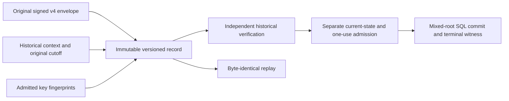

# Original signed revocation retention

## Status

Source `.37` implements private original-byte verification, PostgreSQL retention
and replay, a configured coordinator, and the versioned schema/ACL guards below.
It is **unbuilt and unexecuted**, not an installed schema, public service or
production authorization.
Source `.35` implements the [private producer](authority-revocation-production.md).
Source `.36` adds private [original-byte admission](authority-revocation-wire.md)
and verification on the same invocation work. Source `.38` returns the private
producer's original encoded context alongside its signed output. Public service,
mixed-root SQL, one-use execution and terminal witness activation remain outstanding.

Source `.54` adds an upstream [handoff admission helper](authority-revocation-handoff.md).
It authenticates the original v4 planner signature before admitting the signed
cutoff claim, then calls this unchanged retained verifier with independent
request/context/root values and the same original bytes. It does not infer
database persistence from a valid record or replace historical replay with
an authentication-result object.

Source `.39` also binds the producer's actual business/authorization root-table
reads to independent expected vectors before its one original database-clock
sample. This repairs a missing framework root-read trace entry, not retained
record authority: database observations and stored context still cannot supply
their own independent currentness expectations. See the
[private producer boundary](authority-revocation-production.md).

Source `.40` connects the private producer and this storage API through the
configured `RevocationPlanningCoordinator`. It closes its actual serializable,
read-only, deferrable scopes before the separate writer transaction and passes
unchanged original bytes with the original independent expectations and work.
This is authored source integration, not an executed transaction or public v4
service admission.

Source `.41` adds the executor's assertion-evidence and authorization-projection
custody rows to the same private v4 write transaction. Genuine raw-record replay
still precedes storage. This closes a persistence prerequisite, not the v4 SQL
executor, service or registry gates.

Source `.42` adds a private SQL retained-byte integrity binder. It is not
installed into the active executor or exposed through reservation/service
routes. Its observations do not replace independent signature, proof or
current-state admission.

Source `.43` adds a separate private execution-envelope reservation after
genuine stored-record replay under the same locked parent and writer
transaction. This is reservation custody, not capability issuance, current-root
admission, business execution or terminal authority. Public v3 routes stay closed
to v4 records.

Source `.44` adds private counted-head fresh-apply SQL fragments. They compare
the source-derived complete-read/actual-write index union before and after
real mutations; they are not installed into an executor and do not turn a
retained root vector into independent current-root authority.

Source `.45` adds [original signed capability verification and immutable
custody](authority-revocation-capability.md). The capability binds genuine
retained replay, the exact execution request and the original preliminary
witness receipt. It still requires a separate future post-plan witness bind;
there is no installed successor issuer, executor or public admission.

The existing `exact_plan_*` fields continue to contain canonical **payload**
bytes. Legacy v3 service replay reconstructs its envelope; private v4 replay
returns the original envelope and context from the new immutable sidecar.
Existing v3 rows cannot be upgraded into original v4 envelopes by inventing
missing signatures or evaluation context.

## Retained record and authority



Historical verification must still receive the expected typed request,
planner/verifier keys and other expectations through independent admission.
The planner reservation stores operation/request digests, not request bytes.
The stored context and key fingerprints are evidence to compare with those
expectations, not key enrollment, current roots or refreshed deadlines.

### Historical context

Use a closed canonical eighteen-field document with schema
`serverware.policyAuthorityRevocationEvaluationContext/v1`:

```text
schema, sourceRevision,
expectedPlannerIdentity, expectedVerifierIdentity,
expectedCapabilityId, expectedPlannerTransactionId, expectedFence,
reservedAtEpochNs, deadlineEpochNs, deadlineMonotonicNs,
nowEpochNs, nowMonotonicNs,
maximumAssertionAgeNs, maximumPlanAgeNs, maximumClockSkewNs,
expectedBefore, expectedApproverPolicyDigest, databaseCutoffUs
```

These are the producer's fifteen context fields plus schema, source revision
and its original UTC database cutoff. Preserve the original evaluation clocks;
historical verification must not resample them. Context bounds are
512 KiB, 4,096 nodes and depth 8, within the existing shared work ceilings.
The immutable source descriptor and authored boundary controls pin these limits.

The producer checks its original database instant against the acquisition
cutoff after proof packaging, then calls `_encode_context_on_work` before
signing. The same already-owned fifteen fields become the eighteen-field
document above. Actual bounded measurement and encoding spend `0H/2L/2N` on
the existing meter, without a new allowance, parser or clock sample. The
closed context shapes fit depth 8. The result appends `evaluation_context_bytes`
as its fourth field; `signed`, `database_now` and `metrics` retain their positions.

### Relational storage

Keep `exact_plan_*` meaning canonical payload bytes. Add an explicit
`plan_protocol` (`v3` or `revocation-v4`, default `v3` for legacy inserts) and
nullable `retained_record_digest` to the planner transaction. Add one immutable
`policy_authority_revocation_retained_plans` record with twelve columns:

```text
planner_transaction_id, plan_protocol,
exact_envelope_base64url, exact_envelope_bytes_digest, exact_envelope_byte_count,
evaluation_context_base64url, evaluation_context_bytes_digest,
evaluation_context_byte_count, planner_key_digest, verifier_key_digest,
retained_record_digest, source_revision
```

The envelope is the original canonical signed v4 envelope, never a freshly
signed replacement. Counts, canonical base64 and byte digests must agree.
Bound encoded lengths before decoding. Envelope bytes remain bounded by
64 MiB, without granting another 64 MiB invocation allowance.

Require v3 rows to have no retained-record digest. V4 is revoke-only;
planned/consumed v4 rows require payload bytes and the retained record. Failed
before planning may lack retention; failure after planning preserves it.
Symmetric deferred composite foreign keys over transaction ID, protocol and
record digest prevent committed orphans and missing records in PostgreSQL. The
child-to-parent link is in the table DDL; the reverse link is installed after
both tables exist. SQLite explicitly denies v4 inserts rather than pretending
to support the same deferred cycle. Freeze the
protocol/reservation identity after insertion and the retained bytes after
planning. Planner-writer access to the sidecar is SELECT/INSERT only; executor
access is read-only. Lifecycle status/terminal fields stay separately mutable.

The existing `policy_authority_webauthn_assertion_evidence` and
`policy_authority_authorization_projections` tables keep their thirty-five and
twenty-one columns, respectively. Their exact row identities, uniqueness,
immutable UPDATE/DELETE guards and planner SELECT/INSERT grants are unchanged.
They do not gain a protocol column or additional privileges. There is no
parent-to-projection or projection-to-evidence foreign key: the real storage
body must join their exact digests and identities to the verified record. The
deferred foreign-key guarantee above covers only the parent/sidecar pair.

### Record commitment and retries

Commit a canonical thirteen-field header under the new domain
`serverware.policyAuthorityRevocationRetainedPlan/v1`:

```text
schema, sourceRevision, planProtocol,
plannerTransactionId, operationId, requestDigest, capabilityId,
plannerKeyDigest, verifierKeyDigest,
envelopeDigest, envelopeByteCount, contextDigest, contextByteCount
```

Recompute both byte digests and the record commitment on write and read. A
stored digest is integrity data, not a successful-verification token.
The actual reservation lock, immutable record insert and transition to planned
must occur in one transaction. Identical retries retain the original bytes and
timestamps. Any changed envelope, context, key fingerprint or reservation
identity conflicts; it must not overwrite the record or trigger re-signing.

## Private APIs and accounting

`authority_revocation_retention._verify_record_on_work` takes original immutable
envelope/context bytes, the existing work object and all nineteen independent
expectations. It captures caller graphs before key callbacks, compares stored
context to that capture, then runs the genuine signed proof verifier once.
Key fingerprints and all record commitments are recomputed, never adopted.

`authority_store.revocation_retention.persist_revocation_planner_record` and
`read_revocation_planner_record` call that verifier from raw inputs. Both require
an actual PostgreSQL facade and an existing SERIALIZABLE, non-read-only,
non-deferrable planner-writer transaction. The write uses a nested savepoint,
locks the reservation, inserts immutable custody records, and completes with a CAS.
It checks the actual current deadline before insertion and completion. Read
locks the original reservation and checks the original historical context;
it does not refresh the clock or authorize current execution.
Supplied and stored planning timestamps must fall within the original
reservation-to-deadline interval. Expired persistence retries still fail the
live freshness gate; historical reads deliberately do not use that gate.

For a reserved parent, source `.41` uses the shared actual legacy row-materialization
bodies in `authority_store.authorization_records`, then inserts and reads back
all assertion/projection columns before parent completion. The assertion digest
must match the projection, and the projection digest must match the signed
plan. Custody readback uses plain SELECT, not FOR UPDATE; only the parent
reservation is locked, preserving the custody tables' SELECT/INSERT grants.
Admission also checks the current clock, configured age/skew limits and
the receipt against the database-configured verifier. A later failure rolls
back newly inserted custody rows with the sidecar and parent changes in that
same savepoint; conflicting existing rows are never overwritten.

Planned/consumed retries and historical reads require both existing custody
rows to match exactly. They do not insert missing rows, refresh historical
clocks or reload the current verifier key. The existing live persistence
freshness check, including current configured maximum age and skew, still
applies to retries; historical reads do not use that check. Shared legacy public
helpers retain their own admission behavior; this does not widen v3 acceptance.

`authority_revocation_persistence.RevocationPlannerPersistence` owns a separate
writer connection/transaction and delegates to those real store functions.
Its constructor pins both real keys and immutable signing-identity triples,
plus a separate mandatory writer database role/TLS identity tuple. Its exact
fifteen-field per-call expectation inventory cannot replace those pins.
It captures external inputs before connecting. The configured v4 connection
owner checks PG16, exact current/session role, server-reported TLS identity,
writer transaction mode and the fixed catalog privilege query before real store
invocation. Guarded driver handles retain physical connection identity and active
transaction observations through custody; this is not independent database
enrollment or proof against a hostile driver's hidden commit-and-BEGIN. See
[writer connection admission](authority-revocation-writer-connection.md).
The legacy `PlannerPersistence`
API and service routes remain unchanged. Actual database startup still depends
on resolving the missing registered kernels; a registry-free verifier does not
repair that startup gate.

The low-level producer supplies original context bytes without writing. Source
`.40` adds a configured owner that calls this persistence coordinator only after
closing all read scopes. Its thirteen per-call context fields cannot replace
the persistence configuration's two identity triples or pinned public keys.
The same captured configuration is reused; revision `.59` appends independent
writer role/TLS pins as the seventh item without moving public-key or signing-
identity indices. Callback changes to the coordinator's slots do not redirect
the writer or replace its captured key/identity pins.
Storage still requires both original byte strings and all independent
expectations; the owner forwards captured request/root/context expectations,
not values recovered from its signed payload. No service route is opened and
the producer observation is not an accepted authority token.

One cumulative work object pays for context/envelope decoding, captures,
canonical comparisons, genuine signature/proof verification, raw32 key outputs,
five plain SHA digests, the framed record hash, SQL-value JSON encodings and
base64 codecs/comparisons. Source `.41` additionally charges actual custody
payload canonicalization/hashes, copies, codecs, row comparisons and signature
transport on that same work. Parser work remains `4B/(N+O+2P)` with no hashes.
Exact admission is the larger of the genuine replay's held peak and the full
retention total, component by component. No new outer allowance is created.
SQL/driver CPU and fixed metadata scaffolding are excluded, not heap guarantees.
The read owner's database-identity and source-manifest admission, including its
source reconstruction/hashes, is also outside H/B/N; callback guards do not
turn that work into metered work. The same allowance continues into persistence.
Loading the current database-configured verifier and admitting its key/SPKI
metadata is also explicitly outside H/B/N. That exclusion is not permission to
skip its actual admission checks or to reset the remaining allowance.
Driver callbacks must preserve the work. Failure cleanup still invokes actual
rollback/close if work was corrupted; this does not claim rollback of a malicious
driver that has already committed and then fails a callback guard.
Both phases also close a returned connection when its post-open guard fails,
preserving the first error and leaving corrupted work untouched. An opener
that never returns a handle, or an unfinished context entry, still depends on
the actual driver's cleanup behavior.

## Private SQL integrity binder

[`authority_store.revocation_retained_sql`](../serverware/authority_store/revocation_retained_sql.py)
provides `revocation_retained_declarations_sql()` and
`load_revocation_retained_sql(namespace)`. The latter requires an actual
caller-locked `planner` record and reads its immutable sidecar with a strict
plain SELECT. It binds the original payload, signed-envelope and historical
context transports to their stored byte commitments and versioned record.
It does not overwrite the original bytes or change `exact_plan_*` semantics.

The fragment exposes `rv_payload`, `rv_plan`, `rv_context`, `rv_transition`,
`rv_primary`, `rv_record_digest` and `rv_snapshot_digest` as ordinary JSON/data.
Canonical rendering and matching commitments are integrity checks, not
Ed25519 verification, genuine complete-proof replay or an authority token.
Stored key fingerprints, context clocks and before-root vectors cannot enroll
keys or provide independent currentness. A future consumer must independently
admit those authorities, verify the actual signatures and complete semantic
proofs, bind current locked primary/counted roots, and own the separate
writer reservation, deadline and one-use checks.

The SQL component does not read live heads or sample a new evaluation clock.
It checks transport byte bounds before PostgreSQL parsing, then uses the
existing bounded wire walk and whole-byte canonical equality. Those post-parse
walks do not replace the strict Python decoder's pre-parse depth checks or
arbitrary-JSON integer ceiling. Its SQL parsing/rendering is outside the Python
H/B/N meter and does not claim whole-process or pre-parse allocation bounds.
Even a canonical replacement signature with consistently refreshed hashes can
pass this integrity component; only genuine independent signature verification
can reject its cryptographic invalidity. Source and native controls are
authored but unexecuted. The existing v3 loader, execution reservation and
service replay paths remain unchanged and continue to reject v4 records.

## Private execution-envelope reservation

The configured `RevocationPlannerPersistence.reserve_execution` path uses
[`authority_store.revocation_execution`](../serverware/authority_store/revocation_execution.py).
It owns a `SERIALIZABLE READ WRITE NOT DEFERRABLE` transaction and reuses the
actual stored-record replay body inside one savepoint, retaining the parent
row lock through reservation and exact readback. The reader pins the same raw
connection after actual role admission and before the parent SELECT; guarded
checks retain the facade/raw identity and active transaction after replay,
around reservation writes and before savepoint exit. This pin is a private
internal argument, not an accepted external verification expectation.
Independent request, keys,
historical context and roots remain inputs to genuine signature and complete
semantic replay; a stored digest, SQL binder observation or successful-result
object cannot substitute for that replay. The same invocation work continues
through byte encoding, commitments and comparisons.

Only after genuine replay does the store construct this closed request:

```text
schema = serverware.policyAuthorityRevocationExecutionRequest/v1
planProtocol = revocation-v4
retainedRecordDigest
rootTransitionDigest
typedRequest
```

The existing execution-envelope `purpose` remains `execute-v9`, identifying
the executor family rather than admitting this successor through its legacy
request decoder. The semantic `request_digest` still commits the original
typed request; `exact_request_bytes_digest` commits the entire canonical
five-field wrapper, including both versioned record/transition bindings.
The existing 4 MiB request ceiling includes the wrapper overhead.

The parent must be exactly `planned`. A missing envelope can become `reserved`;
an existing `reserved` envelope must match every reservation column and retain
NULL in every terminal column. Identical retries preserve original timestamps,
deadlines and fence. A consumed/failed parent, committed/failed envelope, drift,
partial terminal data or expired current deadline is rejected, not repaired or
reset. Live freshness checks use current deadline/maximum-age/skew policy
before insertion and before returning even an identical retry; historical
replay itself does not refresh its original clocks or cutoff.

There is no new table, grant, execution-to-parent foreign key or execution-row
immutability trigger. The parent and retained sidecar have their existing
database immutability guards; the execution row is protected here by locked
parent ownership and exact API comparisons, not a newly claimed immutable
database identity. A future consumer must rebind the original retained record
and request, then independently admit current locked roots, capability/fence
authority, one-use execution and terminal witness commitments. This private
method is not called automatically by `produce_and_persist` and does not open
the legacy executor or public service. Its fixtures are authored and unexecuted.

## Private counted-head fresh-apply fragments

[`authority_store.revocation_counted_sql`](../serverware/authority_store/revocation_counted_sql.py)
provides `revocation_counted_declarations_sql()`,
`prepare_revocation_counted_transition_sql(namespace)`,
`lock_and_assert_revocation_counted_before_sql(namespace)` and
`assert_revocation_counted_after_sql(namespace)`. They consume the actual
`planner`, `rv_payload`, `rv_transition` and `rv_primary` bindings. Their
`rvc_` locals are ordinary phase observations, not a successful-verification
token or a caller-selected index subset.

Preparation derives the exact union of source complete-query role indices and
profiles of actual mutation tables, not every potential write head captured
by the producer. It uses the real source projector for OLD/NEW membership and
normalized-event count/revision deltas. Preparation does not read current
heads. The before fragment locks the required full eight-field head rows in
C-sorted index order with bounded sentinel reads, validates their source
profile/manifest and empty-root conventions, and compares the exact four-field
compact before vector. After actual mutations and their real tree triggers,
the after fragment checks the same union against the captured compact after
vector, including unchanged read-only indices.

The consumer must first genuinely replay the original signed v4 record with
independently admitted expectations, bind and lock primary roots in their
existing sorted order, and keep those locks through counted before-checks,
mutations and after-checks in one fresh-apply transaction. Historical committed
retry must return through its separately verified original-byte path before
any live-head fragment. These are caller sequencing prerequisites, not proof
that a standalone fragment establishes authority or a deadlock-free executor.

No table shape, ACL, public route or installed executor expands. SQL
hash/projection/driver work is not claimed under the Python H/B/N meter.
Capability/fence admission, one-use consumption, successor terminal receipts
and witness bindings remain separate required consumers. The source and native
component controls are authored and unexecuted.

## Migration at the actual consumers

| Consumer | Source `.44` status / remaining work |
| --- | --- |
| Configured retention coordinator | Separate `RevocationPlannerPersistence` implemented; configuration pins keys/identities and calls genuine raw-byte storage. |
| Configured read-to-persist owner | Private `RevocationPlanningCoordinator` closes read scopes before separate persistence, preserving original bytes, expectations and work. |
| Transaction reserve/complete | Private v4 reservation, assertion/projection and sidecar custody, exact comparisons and locked CAS implemented. |
| Store replay | Private original-byte replay requires existing exact assertion/projection custody; no repair or re-signing. |
| Execution-envelope reservation | Private genuine replay and exact reserved-row custody under one parent lock implemented; current-root, capability and terminal authority remain separate. |
| Service persist/replay | Admit the explicit successor protocol; preserve original bytes and require independent context. |
| Root-transition SQL | Private retained-byte binder and source-derived counted before/after fragments added; legacy early protocol denial unchanged. Actual independently admitted mixed-root v4 executor integration remains required. |
| Execution and terminal receipts | Bind the retained record and mixed transition; retain separate current-state, deadline and one-use checks. |
| External witness | Authenticate the terminal writer/record/mixed-transition commitments, without exposing proof rows. |

Legacy v3 reserve, completion, failure and read paths explicitly require
`v3` with a null retained digest. A differently tagged row must be denied,
not filtered into a not-found result that falls back to plan recomputation.
The legacy execution-envelope reservation now checks the parent protocol and
binding before inserting. Existing v3 payload/plan field inventories remain
closed and exact.

The source descriptor, table inventories, ACLs and build closure include this
storage. The v8 migration treats the sidecar as new, rejects premature storage,
and does not adopt it through legacy receipt repair. Incompatible installed v9
schemas fail closed; no original data is synthesized and old replacement loops
cannot drop the new cyclic store. An installed-source migration still requires
separate review. Authored synthetic transaction fixtures are not PostgreSQL
constraint/locking evidence and none has run under the current execution gate.
Public execution stays closed until SQL, capability, terminal receipt and
witness consumers agree on the successor. Historical replay alone cannot
authorize execution or make a stale plan current.
