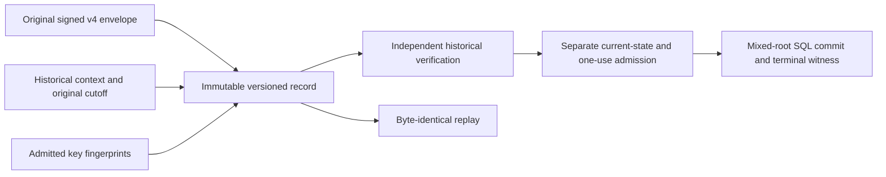

# Original signed revocation retention

## Status

This is the coordinated persistence migration design, not an installed schema,
implemented persistence API, public service or production authorization.
Source `.35` implements the [private producer](authority-revocation-production.md).
Source `.36` adds private [original-byte admission](authority-revocation-wire.md)
and verification on the same invocation work. Actual versioned storage and its
downstream consumers remain to be implemented together. The current tree is
unbuilt and unexecuted.

The existing `exact_plan_*` fields contain canonical **v3 payload** bytes. The
service reconstructs a signed envelope when replaying them. They do not retain
the original signature or independent evaluation context. Existing rows cannot
be upgraded into original v4 envelopes by inventing those missing values.

## Retained record and authority



Historical verification must still receive the expected typed request,
planner/verifier keys and other expectations through independent admission.
The current reservation stores operation/request digests, not request bytes.
The stored context and key fingerprints are evidence to compare with those
expectations, not key enrollment, current roots or refreshed deadlines.

### Historical context

Use a closed canonical eighteen-field document with schema
`serverware.policyAuthorityRevocationEvaluationContext/v1`:

```text
schema, sourceRevision,
expectedPlannerIdentity, expectedVerifierIdentity,
expectedCapabilityId, expectedPlannerTransactionId, expectedFence,
reservedAtEpochNs, deadlineEpochNs, deadlineMonotonicNs,
nowEpochNs, nowMonotonicNs,
maximumAssertionAgeNs, maximumPlanAgeNs, maximumClockSkewNs,
expectedBefore, expectedApproverPolicyDigest, databaseCutoffUs
```

These are the producer's fifteen context fields plus schema, source revision
and its original UTC database cutoff. Preserve the original evaluation clocks;
historical verification must not resample them. Proposed context bounds are
512 KiB, 4,096 nodes and depth 8, within the existing shared work ceilings.
They must be pinned and independently covered when the storage contract lands.

### Relational storage

Keep `exact_plan_*` meaning canonical payload bytes. Add an explicit
`plan_protocol` (`v3` or `revocation-v4`, defaulting existing rows to `v3`) and
nullable `retained_record_digest` to the planner transaction. Add one immutable
`policy_authority_revocation_retained_plans` record with twelve columns:

```text
planner_transaction_id, plan_protocol,
exact_envelope_base64url, exact_envelope_bytes_digest, exact_envelope_byte_count,
evaluation_context_base64url, evaluation_context_bytes_digest,
evaluation_context_byte_count, planner_key_digest, verifier_key_digest,
retained_record_digest, source_revision
```

The envelope is the original canonical signed v4 envelope, never a freshly
signed replacement. Counts, canonical base64 and byte digests must agree.
Bound encoded lengths before decoding. Envelope bytes remain bounded by
64 MiB, without granting another 64 MiB invocation allowance.

Require v3 rows to have no retained-record digest. V4 is revoke-only;
planned/consumed v4 rows require payload bytes and the retained record. Failed
before planning may lack retention; failure after planning preserves it.
Symmetric deferred composite foreign keys over transaction ID, protocol and
record digest must prevent committed orphans and missing records. Freeze the
protocol/reservation identity after insertion and the retained bytes after
planning. Planner-writer access to the sidecar is SELECT/INSERT only; executor
access is read-only. Lifecycle status/terminal fields stay separately mutable.

### Record commitment and retries

Commit a canonical thirteen-field header under the new domain
`serverware.policyAuthorityRevocationRetainedPlan/v1`:

```text
schema, sourceRevision, planProtocol,
plannerTransactionId, operationId, requestDigest, capabilityId,
plannerKeyDigest, verifierKeyDigest,
envelopeDigest, envelopeByteCount, contextDigest, contextByteCount
```

Recompute both byte digests and the record commitment on write and read. A
stored digest is integrity data, not a successful-verification token.
The actual reservation lock, immutable record insert and transition to planned
must occur in one transaction. Identical retries retain the original bytes and
timestamps. Any changed envelope, context, key fingerprint or reservation
identity conflicts; it must not overwrite the record or trigger re-signing.

## Migration at the actual consumers

| Consumer | Required successor change |
| --- | --- |
| `PlannerPersistence` | Accept original bytes plus mandatory independently admitted request, keys and expectations; parse, capture and genuinely verify on one invocation budget before storage. |
| Transaction reserve/complete | Version-specific reserve and completion; exact binding comparisons, sidecar insert and locked CAS in the same transaction. |
| Store replay | Return the original envelope/context bytes with recomputed count/digest/identity checks; versioned receipts, no re-signing. |
| Service persist/replay | Admit the explicit successor protocol; preserve original bytes and require independent context. |
| Root-transition SQL | Check protocol before decoding and before committed-retry handling; genuinely validate mixed roots and counted maintenance. |
| Execution and terminal receipts | Bind the retained record and mixed transition; retain separate current-state, deadline and one-use checks. |
| External witness | Authenticate the terminal writer/record/mixed-transition commitments, without exposing proof rows. |

Legacy v3 reserve, completion, failure and read paths must explicitly require
`v3` with a null retained digest. A differently tagged row must be denied,
not filtered into a not-found result that falls back to plan recomputation.
The legacy execution-envelope reservation currently does not read the parent
planner row: it needs a same-transaction parent protocol/binding check before
inserting. Existing v3 payload/plan field inventories remain closed and exact.

The schema migration, immutable source descriptor, table inventories, ACLs,
source closure and genuine conflict/replay controls must land coherently.
Public execution stays closed until SQL, capability, terminal receipt and
witness consumers agree on the successor. Historical replay alone cannot
authorize execution or make a stale plan current.
