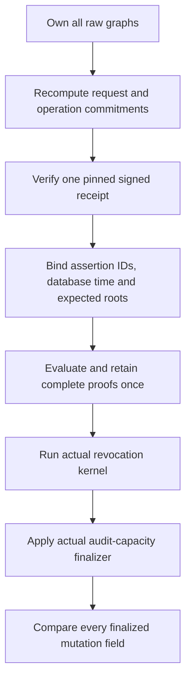

# Bounded revocation semantic verification

## Status and purpose

[`authority_revocation_semantics.py`](../catchplate/authority_revocation_semantics.py)
connects the actual request commitment, pinned verifier receipt, complete
read/write proofs, revocation kernel and audit-capacity finalizer. It rejects
proved writes whose complete effects differ from those genuine computations.
Valid database proofs alone do not authorize a change.

This is an unregistered, source-only component: **unbuilt and unexecuted**.
It does not enable an endpoint, repair startup, acquire SQL proofs, execute
writes or establish independently current roots. Its returned observation is
not a capability, signed authorization or commit receipt.

The [inactive signed-plan v4 verifier](authority-revocation-plan.md) now invokes
the same private semantic worker after one larger joint capture and real
planner-signature verification. Its guarded handoff preserves the existing
packaging ledger, compact-output hold and prior spending. It performs no second
capture or proof pass and accepts no successful observation as authority.

## One raw-input computation

`verify_revocation_semantics` accepts raw bundle, compact transition, typed
request, assertion evidence and independent expectations. It accepts no prior
successful proof or kernel object as a substitute for recomputation.

All eight stages share one cumulative hash/byte/JSON-node ledger. The joint
ownership capture includes both proof documents, request, evidence, verifier
identity, capability, receipt times, database cutoff and expected root vectors
before the first SHA operation. Each graph retains its ordinary root-depth
bound; the enclosing synthetic ownership object does not consume that level.
The pinned native public key is a separate trusted input, not a JSON graph.

The [shared registry-free worker](authority-request-commitment.md) computes the
existing request digest, including its actual business-intent checks and
authorization-argument exclusions. The planner re-exports the same body; there
is no second commitment format. Its public `typed_request_digest` registration
gate and startup closure remain closed for this candidate. The request's top-level `requestDigest`
and `operationId` are required fields, not inputs to their own hashes: this
composer separately checks both against genuine derivations and binds the
request digest and complete argument bytes to the retained proof inputs.

One receipt-work wrapper permits one actual pinned Ed25519 verification
attempt. The returned verified credential and challenge IDs must equal the
proof's assertion binding. The actual kernel receives that verified snapshot
and the exact owned rows/query records returned by proof evaluation, without
running a second proof pass or accepting caller-constructed successful tokens.

The kernel's complete business mutations enter the real shared capacity
finalizer, including its second capacity-validation pass when outbox effects
require a counter mutation. The no-audit path still validates its baseline.
The composer also
checks the source's combined query/kernel/framework work contract and mutation
bounds. Signed operation work units remain distinct from computation-budget
units. Framework counter writes are derived here, never supplied by the kernel.

Both the finalized and proved mutation inventories are independently sorted by
`(table, keyDigest, operation)`. Canonical JSON bytes then compare every field:
`templateId`, `operation`, `table`, `key`, `keyDigest`, `expectedRow` and `row`.
This distinguishes booleans from integers and includes complete OLD/NEW rows.
Transport order is not semantic meaning; duplicate or invalid inventories are
still rejected by the genuine proof/capacity workers.

## Independent trust inputs

The caller must independently admit the verifier public key and three identity
pins, capability identity, fresh receipt time/deadline/maximum age, exact
database time, and before-root expectations. Matching supplied values does not
authenticate their provenance. A real pinned verifier receipt is also not, by
itself, proof of a physical authenticator or authority to invoke the operation.

`database_now` must be an exact `datetime` with `tzinfo is timezone.utc`.
Its microsecond cutoff must equal the complete-query cutoff. Other timezone
objects, including caller-defined callbacks, are not accepted. Receipt freshness
uses a separate admitted nanosecond clock; the receipt's verification timestamp
is not substituted for database time.

`expected_before` has exactly `businessBeforeRoots`,
`authorizationBeforeRoots` and `indexBeforeHeads`, using the existing closed
root/head shapes. Each vector is compared with the corresponding proof inputs.
These checks do not establish authenticated initial population, monotonic
currentness, maintenance by every writer or an independently retained root head.

## Accounting and unchanged retained wire

The existing compact v1 remains a **proof-only** document with its six proof
phases. It gains no receipt, business result, semantic metrics or currentness
claim. The private proof worker additionally returns its actual owned result
to this composer; the public retained-proof wrappers keep their existing
return shape and remain proof-only.

The same packaging ledger reserves the existing replay-finalization allowance:
one SHA, 262144 bytes and 2048 JSON nodes. That hold constrains earlier phases
and is released only for the existing bounded proof-output finalization.
Kernel, capacity and mutation comparison then spend the same remaining ledger;
there is no budget reset. Admission must cover both the retained pre-finalization
peak and the final semantic total, not just whichever total looks smaller.
Repeated encodings, copies, hashes and comparisons retain their actual charges.

`observation.metrics` reports eight exclusive phase deltas, one signature-attempt
count and the final whole-ledger totals. In contrast, `proof.packaging` snapshots
cumulative spending when proof packaging finishes, including earlier request,
receipt and context work. Do not add that snapshot to the exclusive phase totals
or mistake it for proof-only spending. The compact document's six proof-phase
metrics keep their existing meaning.

Any error aborts the invocation. Private child workers are not retryable success
caches: failed child work can be absent from a parent's successful-phase debit,
so a caller must discard the failed computation, not retry with its ledger.
Returned dataclasses are frozen, but nested dictionaries are detached owned
observations, not deeply immutable or privileged objects.

## Authored evidence and remaining work

Source `.34` factors the genuine kernel/capacity body into the private
`_derive_revocation_effects` helper, also used by the raw acquisition producer.
It accepts owned raw observations only after request, receipt and proof
admission; its shape checks do not establish those prerequisites. It does no
new clock, signature, query-generation or proof pass. `_ordered_mutations`
retains the two charged copies around the actual planner sort. Existing replay
phase accounting is unchanged, and all work uses the caller's current meter.
Five appended controls bring the semantic suite to 28 methods, including
genuine effects, independent work arithmetic, malformed context and failure
boundaries. They have not been executed.

The [semantic fixture](../scripts/authority_revocation_semantics_fixture.py)
independently constructs full kernel/counter effects, before/after trees,
request commitments and a genuinely signed synthetic Ed25519 receipt.
The [semantic tests](../scripts/test_authority_revocation_semantics.py) include
valid proofs for deliberately wrong effects, canonical boolean/integer
distinctions, binding failures, one-pass/shared-ledger observations and independent
phase/peak-budget arithmetic. The [nine request-work tests](../scripts/test_authority_typed_request_work.py)
separately cover the genuine commitment worker and actual blocked-registry
imports. Callable public planner assertions remain in the startup-dependent
suite; import denial is not equivalent to callable-facade evidence. The
[coverage transition](authority-request-commitment.md#reviewed-coverage-transition)
records the preserved method IDs, assertion relocation and source-era diagnostic.
These are authored controls, not passing runtime evidence or provisioned trust.

Production integration still requires authenticated proof acquisition and
population, independent current-root/capability admission, coordinated versioned
planner/persisted-proof/witness/executor transport, atomic all-writer SQL
maintenance and commit/replay handling. The other missing startup kernels and
release/verification infrastructure also remain outstanding. No existing gate
is relaxed. The approved dependency snapshot, sealed verification boundary,
complete source freeze and prepared no-build artifacts remain mandatory before
running these fixtures or claiming verified behavior.
