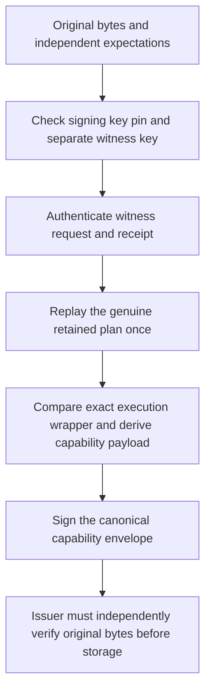

# Original-byte revocation signing

## Status

Source `.47` adds a private capability producer and preserves original signed
witness-request bytes in the existing service. The source is **unbuilt and
unexecuted**. This is not a successor issuer route, permission to store a
capability, a post-plan witness approval or authorization to execute revocation.
The four closed WebAuthn public/kernel gates remain closed.

## Preserve the request that was sent

The service's private `_witness_transition_with_request` returns the original
signed request bytes and the verified receipt. It encodes the complete signed
request once, sends those bytes with the existing length-prefixed Unix-socket
framing, and uses the same bytes for the receipt's `canonicalRequestDigest`
comparison. It returns them only after the existing receipt bindings and real
witness signature have been checked.

The existing `_witness_transition` keeps its receipt-only interface and forwards
all arguments to that helper. Peer UID/GID checks, bounded transport, timeout,
canonical response checks and connection cleanup remain in place. No witness
phase, public route, cache or signing-key role is added. This is in-memory
preservation at the send boundary, not durable retention or proof of a live
witness service.

## Sign only after genuine replay

The private capability producer accepts five original immutable byte strings:

- Signed retained planner envelope.
- Original evaluation context.
- Exact reserved execution request.
- Signed preliminary witness request.
- Signed preliminary witness receipt.

Keys, signer and issuer identities, execution identity, accepted witness receipt,
configuration, generation and historical retained-plan expectations are
independently supplied. Stored context and returned verification observations
cannot supply their own authority. The producer does not sample clocks, query a
database or enroll keys.

The producer checks the private/public signer pair and rejects reuse of that
public key as the witness key before authenticating evidence. These checks do
not enroll either role or prove that the services are independently operated.
The producer uses the same closed thirty-six-field payload and five-field
signed envelope as the [original-byte verifier](authority-revocation-capability.md).
The WebAuthn receipt retains its original credential-binding digest recipe.
Issuance timestamps bind the retained reservation, not a new current-time
assertion. A signing result does not prove that the execution reservation still
exists or remains unconsumed.

One existing cumulative work allowance covers capture, decoding, witness
authentication, retained replay, comparisons, encoding and signing transport.
The final output budget is reserved before the signing side effect. Native
cryptographic internals are not claimed as measured hash/byte/node work;
signing and verification attempts are reported separately. This is an
invocation-local allowance, not a work object transported across processes.

## Evidence and remaining integration

The pure producer fixture uses genuine locally generated signatures and retained
proofs, independently authored expected bytes and work counts, and a separate
consumer verification of the produced envelope. It is not physical-authenticator,
HSM, service-role or production evidence. The witness transport fixture checks
actual source structure without importing active service/registry code; it does
not establish successful socket traffic. All fixtures remain unexecuted.

The configured issuer owner and narrow definer load/store functions are still
required. They must load actual stored plan/context/execution bytes, preserve
independent expectations, verify the signed capability, compare every mutable
reservation binding, and atomically store or exactly compare original custody
rows. They must also reconcile the conflicting existing lock orders described
in the [issuer database boundary](authority-issuer-database-boundary.md).

A separate future witness event must bind the actual capability digest,
retained record, root transition and exact execution request. Current-state
admission, one-use execution and atomic terminal publication remain separate
requirements. The preliminary `reserve` receipt does not satisfy them.

Follow the source-freeze and preparation prerequisites in [goal.md](../goal.md).
Production Nitro/KMS, signing and independently operated witness infrastructure
remain unprovisioned; this source checkpoint does not change that boundary.
