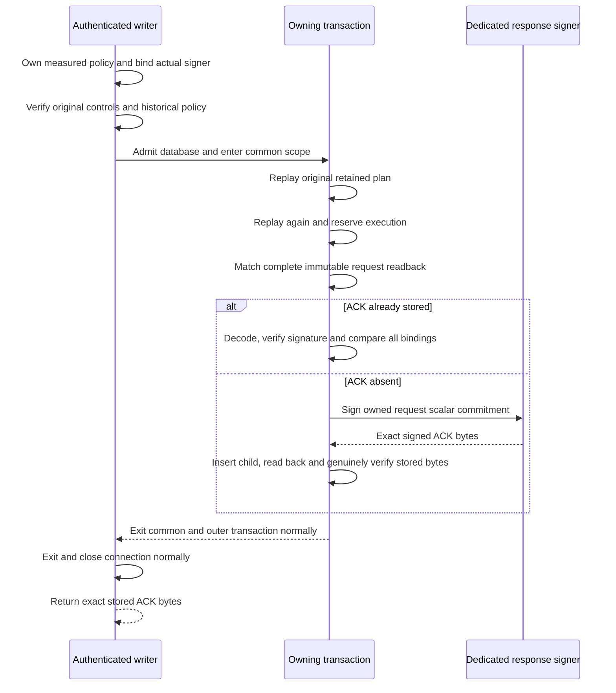

# Signed writer custody acknowledgments

Source `.67` adds private, clock-free Ed25519 acknowledgments for the authenticated
revocation writer. It does not activate an RPC, execute revocation, provision a
production key, or establish deployment readiness. This source remains unbuilt
and unexecuted under [goal.md](../goal.md).

Source `.68` adds [fixed detached transport](authority-revocation-writer-transport.md)
and a writer-only server branch that sends these exact stored bytes after normal
owner exits. The raw client returns opaque bytes, not authenticated success;
configured planner-side verification and historical recovery are still absent.

## What is signed

The closed `serverware.policyAuthorityRevocationWriterAcknowledgment/v1` envelope
has exactly seven fields:

| Field | Binding |
| --- | --- |
| `schema` | The dedicated ACK schema above, not the internal RPC envelope |
| `acknowledgmentId` | Domain-separated identity derived only from the original intent ID |
| `purpose` | `acknowledge-revocation-writer-custody` |
| `custodyState` | `retained-and-reserved` |
| `writerResponseSpkiDigest` | Independently held measured writer response-key pin |
| `request` | All 19 scalar fields of the immutable request, excluding its three base64 bodies |
| `signatureBase64Url` | Canonical unpadded Ed25519 signature transport |

The scalar projection includes intent, relay, execution and planner identities;
retained-record and planner/verifier key digests; configuration/generation;
original intent/relay/history byte digests and counts; original planned time;
plan protocol; and source revision. Large originals remain in request/plan
custody, not duplicated inside the ACK. No commit timestamp, current-root claim,
capability, witness verdict or terminal execution state is invented.

The signature covers the ASCII digest produced by framing canonical unsigned
JSON under the ACK schema domain. The identity has its own
`serverware.policyAuthorityRevocationWriterAcknowledgmentIdentity/v1` domain.
Key or configuration rotation does not create a new global identity namespace.
Wire size is at most 16 KiB, with 256 JSON nodes and depth two. These are local
ceilings, not a promise of fitting the remaining cumulative request allowance.

## Where custody and signing meet

The fixed private composition returns `(retained_receipt, execution_reservation,
acknowledgment_bytes)` only after the existing configured owner finishes normal
transaction and connection exit. Its old independent-input atomic API still
returns the original pair; no caller-supplied successful receipt bypass is added.
The [storage contract](authority-revocation-writer-acknowledgment-storage.md)
defines the immutable ten-column child and deferred request-scope foreign key.

An existing ACK is never re-signed. It must decode canonically, match its stored
digest, verify under the independently pinned key, and match every expected
request field. A legacy request without a child can acquire one only after the
same fresh control authentication and both genuine replays. A changed original
or changed scope is a conflict, not an upsert.

Serializable transactions and global uniqueness permit at most one durable
child. They do **not** promise globally exactly-once signing: two concurrent
missing-child attempts can both sign before one transaction loses. No parent
locking or stronger signing-service deduplication protocol is claimed.

## Key and work boundaries

The service holds its dedicated response key and launch-identity handle before
callbacks, owns the full measured payload, and passes actual held handles to
the private worker. The worker independently captures that payload and uses its
writer pin and other four role pins. Actual public-key derivation, DER export,
hashing, pin equality and launch-key inequality are guarded on the existing
request work. The separate startup loader is not reused as an unmetered
request-time admission step.

Pure signing and verification each bind the actual public SPKI to the external
pin. Signing also checks actual private/public correspondence before signing,
then genuinely verifies its own signature. Receiving rechecks canonical signed
bytes after key callbacks before comparing all independent expectations. The
same shared allowance pays for captures, encodings, hashes, comparisons and
signature transports; there is no new work object or cached proof-success token.
Native cryptographic internals and driver callbacks retain their existing
metric exclusions, not additional authority.

## Failure and recovery boundary

Readback, signature, comparison, work-budget or callback failures abort without
returning speculative bytes. Failures inside the common scope roll back all
seven record sets together, including when caught inside the outer scope.
An error during outer transaction or connection exit can be ambiguous after
commit. No ACK is returned in that case; the implementation does not claim that
rollback occurred or regenerate a replacement response.

Historical reconciliation and authenticated historical ACK lookup are still
unimplemented. They require an explicit independent authorization and old-key
resolution contract. Current-action freshness, measured configuration and both
replays cannot be waived to retrieve old evidence, and a rotated writer must
not re-sign old custody under its new key.

Component fixtures use genuine synthetic keys/signatures and independent work
oracles; startup fixtures keep real proof workers and the actual registry gate
with synthetic driver observations. Native schema fixtures cover constraints,
not cryptographic admission. None has been executed for this snapshot. Public
end-to-end serving and client authentication, all remaining WebAuthn kernels, release verification and the
independently provisioned production trust services remain required.
