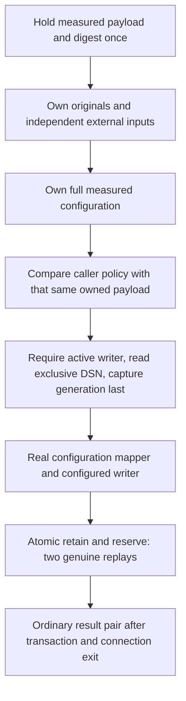

# Private measured revocation writer action

## Source boundary

Source `.62` adds
[`AuthorityProcess._persist_and_reserve_revocation_plan`](../catchplate/authority_service.py)
and inert [input/policy helpers](../catchplate/authority_revocation_writer_action.py).
The private method binds independently supplied history to measured policy,
constructs the real configured writer and invokes
[atomic retention and reservation](authority-revocation-atomic.md).

This source is **unbuilt and unexecuted**. The method is not a serving purpose,
authenticated RPC or public endpoint. It does not establish caller provenance,
clock truth, current roots, launch admission or database durability. The actual
root-signed configuration loader, active launch, exclusive descriptor and
database admission remain upstream requirements; a constructed configuration
object or synthetic fixture does not satisfy them.

## Capture before callbacks

The process method requires the planner-writer role, its exact process mode
and the actual `MeasuredConfiguration` type. It holds that configuration's
payload and digest once, then captures caller inputs and the full payload
before launch, descriptor or public-key callbacks.

The inert input helper accepts the original immutable envelope and evaluation
context, proposed planned timestamp, execution-envelope ID, planner-transaction
ID and exactly fifteen external expectations. Envelope/context bounds remain
2 bytes through 64 MiB/512 KiB. Timestamp and identifiers retain their actual
source int64/digest checks. Exact string keys prevent aliases and configuration
overrides.

Fourteen expectations receive the real bounded JSON ownership pass. The
fifteenth, `database_now`, must be an exact `datetime` with `timezone.utc`; it
is retained unchanged outside JSON. No floating-point conversion, replacement
clock or positivity restriction is introduced for that historical instant.
Pre-epoch UTC instants retain their existing semantics; this does not make an
otherwise invalid retained plan valid.

After capture, the actual source shape checks validate request, roots,
identifiers and scalar fields. The explicit planner transaction ID is joined
canonically to its independent expectation. The helper returns two ordinary
dictionaries: fixed raw arguments and owned expectations. It does not parse a
retained context to obtain its own admission, invent temporary key handles, or
return a reusable successful-proof object.

## Policy must agree, not be replaced

The three caller policy values must match the same owned full configuration
that will be passed to the real writer mapper:

| Caller expectation | Required value |
| --- | --- |
| Assertion maximum age | Exact measured WebAuthn `maximumChallengeAgeNs` |
| Plan maximum age | Minimum of measured **verifier** `maximumInternalAgeNs` and source 30 seconds |
| Maximum clock skew | Source 5 seconds |

Assertion age is not capped at thirty seconds. The writer's own internal
request age is not substituted for verifier policy. Types and bounds are
checked before the canonical tuple comparison; a mismatch fails before launch,
descriptor, key or database callbacks. Caller values are never silently
overwritten to make a retained context pass.

## One held configuration through writer construction

The existing `_revocation_planner_persistence(*, work)` factory retains its
API, role guards and complete configuration capture. Both it and the new action
use a fixed module-level continuation receiving only the owned payload, held
digest and existing work. That continuation performs the same guarded active
writer check, writer-exclusive DSN read and last generation snapshot immediately
before the actual mapper.

The action does not call the old factory after its policy comparison: that
would take a second snapshot of mutable process configuration. The continuation
does not reread `self`, accept caller-selected callbacks, obtain planner read
credentials or construct a replacement persistence implementation.

The mapper still recaptures the held payload, recomputes its commitment and
checks launch bindings, real keys, aliases and database pins. The atomic owner
still owns its external inputs, joins its planner ID and genuinely replays
both stores. Earlier local consistency checks do not authorize skipping any
of those boundaries.

## Work and remaining integration

One cumulative work object pays for the fourteen-field ownership pass, early
ID join, full configuration capture, policy comparison, genuine mapper work and
the complete atomic operation. The early ID join adds 0 hashes, 438 defined
byte-work units and 4 nodes; the atomic owner's later join is separately charged.
The existing mapper retains its four hashes. Duplicate captures and both proof
peaks remain real costs, not cached admission or new allowances. Driver/native
metadata exclusions remain unchanged.

Component fixtures and source-linkage controls are authored but unexecuted.
Synthetic mappings and driver observations are not measured service admission,
native PostgreSQL durability or a real socket exchange. Follow the
[source-freeze workflow](../goal.md) before any execution.

Source `.63` adds a pure [detached writer commitment](authority-revocation-writer-commitment.md)
contract with verifier intent and planner relay signatures. It does not connect
this action to serving ingress or replace its measured-policy and proof checks.
Source `.64` adds a separate private [authenticated writer composition](authority-revocation-writer-composition.md)
that maps keys, verifies original controls, compares authenticated history and
invokes atomic custody using one held writer-configuration tuple. This action's
existing independent-input API and policy-before-mapper order remain unchanged.
Source `.65` adds [immutable original-request custody](authority-revocation-writer-request-storage.md)
and exact retry comparison to that separate authenticated path. This action's
public owner still uses the original two-store atomic API. The separate `.67`
[signed ACK custody](authority-revocation-writer-acknowledgment.md) connects
operation-bound signing to that authenticated composition, not this action's
independent-input API. Source `.68` adds [detached-body transport](authority-revocation-writer-transport.md)
to the separate authenticated writer branch, not this independent-input method.
Configured producer/client integration and historical recovery remain unfinished. The separate `.66`
[startup key binding](authority-revocation-writer-signer.md) does not alter this
action's inputs, work or output.
The method does not enable public dispatch, alter
planner-only peers, issue capabilities or activate execution. Registry closure,
the four WebAuthn authority gates, independent current-root/witness evidence
and production Nitro/KMS/signing/witness provisioning remain incomplete.
