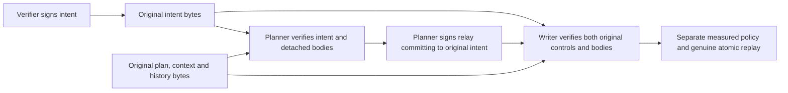

# Authenticated detached writer commitments

## Source boundary

Source `.63` adds a private, pure
[writer commitment contract](../serverware/authority_revocation_writer_commitment.py).
It authenticates verifier intent and a planner relay over original detached
plan, evaluation-context and historical-expectation bytes. It is **unbuilt and
unexecuted**. No serving purpose, transport, database table, privilege, response
signer, durable acknowledgment or public route is activated.

Correct signatures authenticate sender claims. They do not prove a valid plan,
database durability, current roots, clock truth or independently operated keys.
The genuine [measured writer action](authority-revocation-writer-action.md),
its policy comparison and both atomic persistence replays remain required.
An ordinary returned object is not a transferable proof or admission token.

The last arrow is a required integration boundary, not an enabled service path.
No API accepts a previously authenticated result in place of original bytes.

## Two signed controls, three detached bodies

Both controls retain the existing eleven-field `internal/v3` envelope:

`schema`, `envelopeId`, `parentEnvelopeId`, `purpose`, `configurationDigest`,
`issuedAtEpochNs`, `issuedMonotonicNs`, `deadlineMonotonicNs`, `fence`,
`payload`, `signature`.

Every field is authenticated. The verifier and planner have separate purposes,
payload schemas, domain-derived IDs and pinned Ed25519 keys. Planner relay
production verifies the original verifier intent before signing. Writer
reception verifies the relay and intent independently; a fresh relay cannot
refresh an expired intent. The receiver retains both complete envelopes and
the exact original bytes in its ordinary observation.

| Control | Purpose | Exact payload |
| --- | --- | --- |
| Verifier intent | `authorize-revocation-writer-custody` | `schema`, `sourceRevision`, `generationSequence`, `generationDigest`, `capabilityId`, `plannerTransactionId`, `executionEnvelopeId`, `plannedAtEpochNs`, `databaseCutoffUs`, `planEnvelopeDigest`, `planEnvelopeByteCount`, `evaluationContextDigest`, `evaluationContextByteCount`, `historicalExpectationsDigest`, `historicalExpectationsByteCount` |
| Planner relay | `relay-revocation-writer-custody` | `schema`, `sourceRevision`, `generationSequence`, `generationDigest`, `verifierIntentDigest`, `verifierIntentByteCount` |

Payload schemas are `serverware.policyAuthorityRevocationWriterIntent/v1` and
`serverware.policyAuthorityRevocationWriterRelay/v1`. Configuration, generation,
source, purpose, parent, ID, deadline and fence must agree with their independent
pins or authenticated bindings. Intent business IDs join the signed history;
the proposed planned timestamp must fall within its reservation interval.

The relay hashes the **original signed intent bytes**, not a reconstructed
payload. Intent commits to each original detached body with both SHA-256 and
an exact byte count. The receiver recomputes those commitments on the same
remaining work. Same-size substitution is not accepted merely because lengths
match. Controls and history require canonical JSON, exact fields, bounded scalar
types and duplicate-key rejection. Plan and context remain opaque originals at
this boundary; their parsing, signatures and proof semantics belong to genuine
downstream replay, not commitment authentication.

The detached history contains exactly the existing fourteen JSON external
expectations, with their existing snake-case names, at depth zero. The fifteenth
external expectation, `database_now`, is represented separately as the intent's
signed `databaseCutoffUs`. Integer conversion and exact UTC round-trip preserve
representable pre-epoch, zero and positive instants. Boolean, floating-point,
non-UTC and out-of-range values cannot stand in for that instant. Accepting a
historical instant at this codec boundary does not establish a valid retained
plan or a current clock.

Controls remain bounded to 4 MiB. The detached plan retains its 64 MiB bound,
the context its 512 KiB bound, and history the existing 64 MiB, one-million-node,
depth-128 root capture limits. No nested base64 wrapper is introduced. These
are local contract limits, **not proof that the existing one-frame socket
transport can carry all bodies**. A separately specified bounded transfer and
custody protocol is still needed.

The unchanged cumulative work ceiling also applies. Repeated ownership,
encoding and authentication can exhaust it below an individual body's local
size limit; these additional operations are charged, not granted new allowance.

## Stable IDs and independent clocks

The intent ID uses the framed domain
`serverware.policyAuthorityRevocationWriterIntentEnvelope/v1` with the execution
envelope ID and planner transaction ID. Its parent is the planner transaction
ID. The relay ID uses
`serverware.policyAuthorityRevocationWriterRelayEnvelope/v1` with the intent ID;
its parent is that intent ID.

IDs deliberately exclude timestamps and body hashes. A changed or re-signed
request must encounter the same future custody identity and fail exact-original
comparison, rather than obtaining a new action by changing its timestamp.
There is no durable replay journal in this source increment. Configuration or
key rotation must not silently provide a second action namespace later.

Current envelope freshness uses independently supplied current epoch and
monotonic clocks plus the measured **writer** internal-age limit and the
source-pinned five-second skew. Both controls are checked. Signed historical
`now` values and the database cutoff never replace those current clocks.

The signed historical assertion-age, plan-age and skew values remain unchanged.
The separate `.62` action must compare them with the same owned full measured
configuration used to construct its writer. A valid commitment signature does
not waive that comparison or let a caller widen policy.

## Ownership, keys and work

Mutable inputs are owned before external key callbacks. Signing binds the
private key to its independent public pin, and verifier/planner raw public keys
must differ. Distinct keys establish role-key separation, not independent
administration, hardware custody or production provisioning.

Actual decoding, ownership, canonical emission/comparison, framed IDs, body
hashing, key export/comparison and signature operations consume the caller's
existing work. Duplicate verification at planner and writer boundaries is
real work, not a cached success. Callback guards reject changed work state or
allowances. No replacement work object or proof-success shortcut is introduced.
Native cryptographic internals remain outside the existing defined byte/JSON
work metric; the explicit signature transport and message work remain charged.

## Durable integration still required

A future immutable custody record must preserve original intent, relay,
history and signed acknowledgment bytes, linked exactly to the existing
retained-plan and reserved-execution commitments. Planned-parent and reserved-
execution terminal fields must remain null; they are not a request journal.
The consumed-execution ledger is not one either.

New, exact-retry and conflicting-request handling must live inside the same
owning transaction as genuine retention and reservation. Constructing or
storing an acknowledgment after today's public atomic owner returns would be
too late: that owner has already committed. Exact stored acknowledgment bytes
may be released only after normal transaction and connection exit. Exit
uncertainty requires historical reconciliation, not an assumption of rollback.

Exact retry preserves original signatures and stored `plannedAtEpochNs`.
Historical acknowledgment lookup needs a separate explicit contract; it cannot
masquerade as a fresh authorization or skip current action checks.

The writer has no provisioned response signer or signer descriptor. A measured
response-SPKI digest is only a pin, not key custody. Planner or launch-identity
keys must not silently become the writer response signer.

Component and source-linkage fixtures are authored but unexecuted. Their
synthetic clocks, keys and driver observations are not production admission.
The four WebAuthn authority gates, registry closure, immutable dependency and
coverage approvals, sealed preparation prerequisites, independent current-root
and witness evidence, and production Nitro/KMS/signing/witness provisioning
remain open. Follow [goal.md](../goal.md) before any execution.
