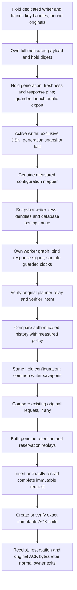

# Private authenticated writer composition

## Status and boundary

Source `.64` connects the original-byte [detached commitments](authority-revocation-writer-commitment.md)
to measured historical-policy checks and [atomic retention and reservation](authority-revocation-atomic.md).
Source `.65` adds [immutable original-request custody](authority-revocation-writer-request-storage.md)
inside that same transaction, with exact retry comparison. Source `.67` adds
the dedicated measured response signer and an immutable acknowledgment child
inside that same common scope; it does not activate transport or public dispatch.
Source `.68` adds a writer-only [detached transfer branch](authority-revocation-writer-transport.md)
on the existing activated socket. It passes the exact five originals to this
composition and sends only stored ACK bytes after normal owner exits; it does
not change the public canonical purpose gate or authenticate replies for a client.
The private service adapter accepts five original immutable byte strings and
the existing work object. It accepts no caller keys, clocks, configuration,
database credentials, alternate operation or prior successful result.

This is **unbuilt and unexecuted source**, not an enabled RPC or release-ready
service. Public dispatch, planner-only peers, registry closure and the four
WebAuthn authority gates remain unchanged. Constructing an ordinary configuration
object or calling an inert component does not establish measured launch admission.

## One configuration across authentication and custody

The service owns the full measured payload before launch, descriptor or key
callbacks. Configuration digest, generation sequence/digest and the writer's
internal-age limit are captured from that same payload. Before any external
callback the adapter holds the dedicated writer private key and launch private
handle; it captures the writer response-SPKI pin and four other-role response
pins from the owned graph before the guarded launch-public export. It never
rereads those process slots after a callback. The existing mapper
recomputes the full configuration commitment and joins those generation fields
to the actual generation-last launch snapshot. No second launch read supplies
a different generation after key callbacks.

After genuine mapping, the adapter captures the writer's seven fixed values:
DSN, timeout, planner key, verifier key, planner identity, verifier identity
and database identity. The receiver and atomic suffix use that same tuple.
Neither a later owner snapshot nor a second call through a process factory can
replace its key handles, identities or database settings after authentication.
Pinned handles do not prove hardware custody or immutable internals of an
arbitrary cryptographic key implementation.

The inert composition worker separately owns the supplied full payload before
its clock or key callbacks. This charged copy protects its policy graph against
caller aliases; it is **not a second configuration admission**. Its fixed
internal precondition is that the tuple, digest, generation and current-age
pins came from the service's genuine mapper over the same held payload.
Direct component calls cannot claim root-signed configuration or active launch
merely because this ownership pass succeeded.

Before clocks or detached authentication, the worker extracts those response
pins from its own full-payload copy and performs actual metered signer binding.
The derived Ed25519 public key must match the measured writer SPKI, differ from
the actual launch key and not reuse any of the four other-role pins. The fixed
suffix receives the held private key, this actual derived public handle and
the same response pin. No signed request supplies a key or response policy;
startup's unmetered PEM helper is not reused as request-time accounting.

## Current authorization and historical policy

The worker samples actual monotonic time and then actual epoch time through
the existing callback guards. No caller-supplied clock or replacement callback
is accepted. Both signed controls must satisfy the held measured **writer**
internal-age limit and source five-second skew. A fresh relay cannot refresh an
old verifier intent, and historical timestamps cannot supply current freshness.
These samples establish freshness at this receiver boundary, not a continuously
fresh clock or authorization at a later database commit or capability release.
The actual stores retain their separate live deadline checks around writes and
readback; new retention also checks current authorization evidence and its
pinned verifier signature. Those checks do not turn historical proof timestamps
into current clocks or establish current-root/issuance authority.

Only after genuine verification does the policy helper compare the authenticated
history against the worker-owned measured graph:

- Assertion age is the exact measured WebAuthn challenge age.
- Plan age is the smaller of measured **verifier** internal age and source thirty seconds.
- Historical skew is the source five-second limit.

These checks compare rather than overwrite history. The existing independent
input action remains available with its earlier policy-before-mapper ordering;
this authenticated path needs mapped keys first to authenticate the history.

The fixed-configuration atomic helper preserves the public owner's original-byte
bounds, independent planner-ID comparison, expectation capture and actual database
admission. Both retained-plan proof replays still run. The first receipt is
output only, never authority for reservation. The fixed request suffix compares
existing original controls/history and configuration pins before those replays,
then derives the retained-record and key links from their actual results. It
requires the signed proposed planned time to equal the original stored time,
including when first attaching to an older retained plan. An accepted identical
request never skips a replay. New insertion and every complete readback share
the same common savepoint, preserving the four existing transaction scopes.
Shared rollback and uncertain post-commit exit semantics remain those of the
actual atomic owner. Only the fully matched request row supplies the ACK's
closed scalar request commitment. A missing child is signed and stored there;
an existing child is read, canonically checked and genuinely verified without
signing again. Both paths retain both proof replays and exact original bytes.
The private result is now the retained receipt, execution reservation and
original ACK bytes, returned only after normal transaction and connection exit.
Legacy independent-input atomic APIs retain their earlier pair result.

The ACK attests request custody, not execution, current roots, capability
issuance or a witness result. It contains no invented commit timestamp. An
exception after a completed release is uncertain, not a fabricated rollback,
and returns no ACK. Uniqueness protects one durable child; concurrent missing
child observations or aborted transactions do not imply globally exactly-once
signature attempts. See [ACK storage](authority-revocation-writer-acknowledgment-storage.md).

## Work and verification

One existing cumulative work object pays for service ownership, genuine mapping,
worker ownership, detached authentication, policy comparison and both atomic
replays. Each full-payload ownership pass is charged separately. Mapping retains
four hashes; response-signer binding adds two actual SPKI hashes; the commitment
receiver retains eight. Request custody adds five
actual hashes (two stable-ID frames and three original-body hashes), three
base64 codecs, and separately charged row copies and scalar comparisons. ACK
construction or original-byte verification, codecs, hashes, signing output
reservation and row comparisons also debit the same work at their actual sites.
The atomic ID comparison and both replay peaks include prior work and are not
waived by successful authentication. Fixed scalar
checks and native clocks remain outside H/B/N but their callbacks cannot alter
the work state or allowances.

Authored component controls terminate deliberately before database opening when
testing the isolated prefix; that failure is not successful custody. Full-chain
fixtures retain the actual registry/database import gate and existing synthetic
driver observations. Source linkage covers the measured service boundary without
forging a measured configuration or active-launch success. None of these fixtures
has been executed for the current source, and none proves native PostgreSQL
durability, a socket exchange or independently operated production services.

## Still required before serving

The source now retains original intent, relay and history bytes with their
retained-plan and reserved-execution links and the signed ACK child. The
[startup response-key binding](authority-revocation-writer-signer.md) does not
prove production key custody. The `.68` fixed transfer supplies bounded original
byte ingress and raw ACK egress, not a configured end-to-end planner flow.
Source `.69` adds a separate [configured client](authority-revocation-writer-client.md)
with independently pinned remote verification. Source `.70` supplies separate
[configured producers](authority-revocation-writer-producers.md), not the missing
authenticated verifier/planner exchange. Public execution and historical
acknowledgment lookup remain separate work. A rotated key cannot silently re-sign an old child or
enroll itself through an ACK. This private path is not a complete authenticated
RPC retry protocol, and its native durability is unverified. The remaining requirements are in the
[durable integration contract](authority-revocation-writer-commitment.md#durable-integration-and-remaining-recovery).

Immutable dependency and coverage approvals, sealed preparation, sequential
no-build verification, current-root/witness evidence, unfinished authority gates
and provisioned Nitro/KMS/signing/witness services remain necessary. Follow
[goal.md](../goal.md) before any source execution.
