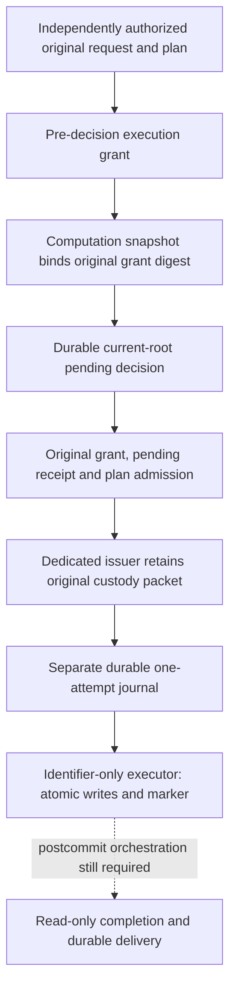

# Successor execution source path

This source path separates permission to execute from proof of the proposed
changes. Neither a planner signature, computation key, root vector nor pending
receipt alone authorizes database writes. Source `.139` now connects genuine
original admission, protected immutable custody and identifier-only execution,
including the source installer, ACL/catalog checks and actual transaction
owners. These changes remain unbuilt, unexecuted and unprovisioned; no public
successor route is activated and existing legacy gates remain closed.

## Authorization order

The grant precedes the pending decision. Its original signed-byte identity
becomes `capabilityDigest` in the reserve and computation snapshot. The grant
therefore cannot contain the later pending receipt or that snapshot's digest:
either dependency would make the signatures circular. Instead it binds the
original plan/retention, typed request, genuine result and complete before/after
vectors. Admission joins those same commitments again after reservation.

Revocation's existing signed capability ID and Snapshot/v4 remain distinct
historical commitments. Neither is relabelled as the new original grant digest.

## Dedicated authorization purpose

The successor grant uses a separate root-signed enrollment, bound to the
original current-root enrollment, database, generation, source revision and
the fixed six successor operations. Its dedicated authorizer key/measurement
is not a computation, completion, state or plan-signing identity. Existing
issuer database credentials do not supply this signing authority.

The independently admitted `requestAuthorizationDigest` must identify the real
caller/request authorization. A digest copied from the incoming grant, stored
plan or caller-supplied success object does not satisfy that requirement.
Grant verification authenticates the enrolled authorizer's assertion; it does
not independently establish the caller's session, key custody or measurement.
No generic scope-object-to-production-grant issuer is provided.

[`authority_successor_execution_preparation._produce_reserve_on_work`](../serverware/authority_successor_execution_preparation.py)
connects an original grant to actual reserve production. It accepts grant and
enrollment originals, independent authorization/history/key inputs and the
original plan, not a supplied capability digest or verified-plan object. The
grant verifier performs genuine plan replay once; the same-call result feeds
the existing computation signing suffix. The reserve uses the actual original
grant digest and cannot outlive the grant, caller deadline or inherited local
monotonic deadline. The older scope-only computation helper is not upgraded to
execution-grant admission by this separate path.

## One genuine plan replay at final admission

[`authority_current_root_execution_admission`](../serverware/authority_current_root_execution_admission.py)
authenticates the original enrollment, reserve request and state receipt, checks
the independently expected pending head/sequence/fence, and recomputes the
original computation snapshot from actual six-family plan replay. The candidate
contains only same-call derived request, selected rows, mutations, result,
work units, complete vectors and expected marker data. It is ordinary data, not
a proof token or a callable database permission.

[`authority_successor_execution_grant`](../serverware/authority_successor_execution_grant.py)
provides original enrollment/grant signature verification and a standalone
original-plan verifier. The combined
[`authority_successor_execution_admission._admit_on_work`](../serverware/authority_successor_execution_admission.py)
uses the control verifier after genuine pending/plan admission, then joins all
grant claims to the same-call reconstructed snapshot. This performs the heavy
plan proof computation once, without accepting a successful replay carrier as
an input.

The original grant identity must equal the reserved capability digest. The
reserve cannot change the grant's original issue time or extend its expiry.
Actual clock checks preserve the caller's unchanged live window and inherited
monotonic deadline. Historical plan validity is not renewed into new authority.

## Original-byte custody, not a supplied execution candidate

[`authority_successor_execution_packet._prepare_on_work`](../serverware/authority_successor_execution_packet.py)
invokes the genuine combined admission once on the caller's existing work. It
accepts original controls/plans and independent expectations, never an incoming
successful candidate or packet. Its canonical exact-16-field packet binds
authorization/request/operation identities, the unchanged reserve interval,
actual selected rows, ordered mutations, result/work units, complete vectors
and the exact 18-field marker.

The packet's `originals` object has seven entries: `currentRootEnrollment`,
`grantEnrollment`, `grant`, `reserveRequest`, `reserveReceipt`,
`computationSnapshot` and `plan`. Controls retain original bytes as canonical
base64url with raw SHA-256 and byte count; `plan` retains the ordered original
raw2/raw3/raw4 frames appropriate to its family. Raw byte hashes remain distinct
from framed grant, receipt, snapshot and packet identities. The complete
encoded packet, including this framing, is at most 64 MiB; existing cumulative
work and individual source bounds still apply. Retained originals do not
independently enroll their historical keys, authorization or checkpoint.

## Protected SQL and actual transaction owners

[`authority_successor_execution_owner`](../serverware/authority_successor_execution_owner.py)
provides `SuccessorExecutionIssuer.issue(...)`, which produces that packet
itself, and `SuccessorExecutionExecutor.execute(...)`, whose only custody
selectors are `pending_decision_digest` and `packet_digest`. The executor does
not accept candidate JSON, mutations or a successful attempt carrier.

The distinct fixed database roles each have only their protected function,
with no direct relation/sequence privileges or generic function execution:

- `serverware_policy_authority_successor_issuer` calls
  `serverware_policy_authority_issue_successor_execution(text, text)`.
- `serverware_policy_authority_successor_executor` calls
  `serverware_policy_authority_execute_successor(text, text)`.

[`authority_store.successor_execution_sql`](../serverware/authority_store/successor_execution_sql.py)
stores the admitted packet in immutable
`policy_authority_successor_execution_custody`. Its executor locks that exact
custody row, joins both identifiers and rejects an existing commit marker before
using the retained effects. SQL checks source/canonical framing and commitment
joins; it does not replace genuine Ed25519 admission with signature-shaped JSON.
The independently admitted dedicated issuer is the cryptographic boundary.

[`authority_store.current_root_execution_sql`](../serverware/authority_store/current_root_execution_sql.py)
supplies the reused source-fixed mutation body. The atomic path locks and checks
complete before roots, applies actual closed primary-key/full-row compare-and-swap
mutations with maintained primary
and counted indexes and the existing audit-capacity guard, checks the complete
after-vector, and inserts the exact 18-column immutable framework marker in the
same transaction. The later postcommit receipt commits that marker, never the
reverse. Neither a matching marker nor its absence proves rollback resistance.

Each owner uses actual PostgreSQL 16 TLS/role admission and keeps its catalog
checks and protected call on its same physical
`SERIALIZABLE READ WRITE NOT DEFERRABLE` transaction. Its exact eight-value
configuration contains the fixed role, existing connection/query pins and an
eighth independently admitted **source-generated complete structural-manifest
digest**. The actual full catalog, including functions, ACLs and business
triggers, must match that pin before the protected call and again before normal
outer commit. Observing a catalog never enrolls its own expected digest.
Returned custody locators or marker bytes are unsigned observations, exposed
only after normal outer transaction commit and connection closure, not signed
completion evidence. A late error may follow commitment; deadlines and bounded
database waits are not a hard native-call watchdog.

The source installer now includes the exact custody schema, functions, guards
and grants; it has not been run here. The two roles and identities must be
independently provisioned. Offline metadata bootstrap requires both prefixes
`SERVERWARE_POLICY_AUTHORITY_SUCCESSOR_ISSUER_` and
`SERVERWARE_POLICY_AUTHORITY_SUCCESSOR_EXECUTOR_`, each with all six suffixes:
`MEASUREMENT_SHA256`, `ATTESTATION_RECEIPT_SHA256`,
`CREDENTIAL_ISSUANCE_SHA256`, `TLS_CLIENT_DN`, `TLS_CLIENT_SERIAL` and
`TLS_ISSUER_DN`. Missing values do not fall back to legacy identity pins.
Existing custody stores require separately reviewed migration; no automatic
adoption, repair, role generation or public activation follows from installation
source. Legacy execution gates remain unchanged and no direct DML is granted.

## Durable attempt before database connection

[`SuccessorExecutionAttempts`](../serverware/authority_successor_execution_attempts.py)
owns a separate private preprovisioned `CurrentRootJournal` in an independent
database-rollback domain. Construction requires an independently current exact
local sequence/head and the expected structure-manifest digest, not a minimum
sequence or a checkpoint derived from the scanned journal. Recovery verifies
the source-bound canonical chain and exact checkpoint. Capacity is bounded by
the actual journal's 2–1024-record limit; each attempt is at most 4 KiB.

The executor joins the actual attempt owner's structure digest to its catalog
pin and calls its fixed `_claim_on_work` before opening any database connection.
One immutable record is published and fsynced before the call can return.
Either a repeated pending decision or a repeated packet is rejected forever,
including identical resubmission after SQL abort or restart. Ambiguous
publication poisons/closes the owner; a late deadline failure can leave an
already durable attempt. Nothing deletes, expires, clears or resets it, and
capacity exhaustion does not create a replacement journal or generation.

This is not request authorization or hostile-host antirollback. Restart safety
depends on the protected separate domain and independently current checkpoint;
a valid old local prefix cannot admit itself. Local inspection is unsigned and
cannot authorize retry, completion or cancellation.

## Completion remains a separate authenticated path

The `.136` [fixed read-only completion
producer](authority-current-root-completion.md) authenticates original
pending/plan/grant bytes historically under an independently current exact
pending checkpoint, reads the committed marker and all roots in one admitted
transaction, and requires exact expected-marker/full-after-vector equality.
Only after normal database closure does the enrolled completion key sign the
fresh complete control. Its inner observation record is not independently
signed. This can follow grant expiry but cannot execute, reset or release a
transition without the matched committed marker. The executor's unsigned return
does not replace that readback or grant premature completion authority. Normal
outer-postcommit orchestration into completion and durable delivery, including
uncertain outcomes, is still not activated by these private owners.

## Remaining production boundary

Independent caller authorization and key/history provenance, cold configuration,
source-generated catalog/checkpoint admission and measured service ownership
remain prerequisites. Authenticated custody read/recovery, normal outer-postcommit
completion/delivery orchestration and public business finalization are still
missing. An expired or unanswered request cannot clear a pending fence, reset
an attempt or authorize SQL retry. No currentness authority is inferred from
source installation, matching digests or local observation. Independent
production infrastructure/provisioning and the consolidated frozen
build/verification phase remain outstanding.
