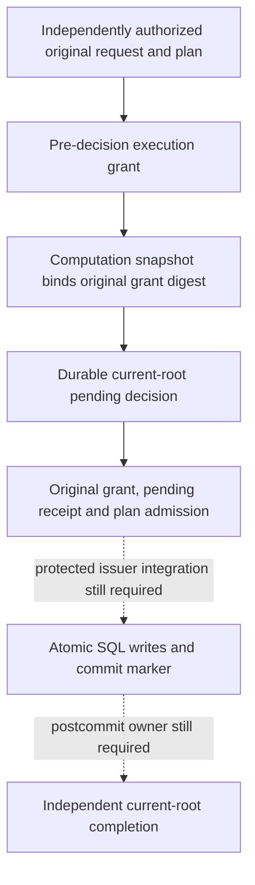

# Successor execution admission

This source path separates permission to execute from proof of the proposed
changes. Neither a planner signature, computation key, root vector nor pending
receipt alone authorizes database writes. The current implementation remains
unbuilt and unexecuted; no successor SQL function is installed or enabled.

## Authorization order

The grant precedes the pending decision. Its original signed-byte identity
becomes `capabilityDigest` in the reserve and computation snapshot. The grant
therefore cannot contain the later pending receipt or that snapshot's digest:
either dependency would make the signatures circular. Instead it binds the
original plan/retention, typed request, genuine result and complete before/after
vectors. Admission joins those same commitments again after reservation.

Revocation's existing signed capability ID and Snapshot/v4 remain distinct
historical commitments. Neither is relabelled as the new original grant digest.

## Dedicated authorization purpose

The successor grant uses a separate root-signed enrollment, bound to the
original current-root enrollment, database, generation, source revision and
the fixed six successor operations. Its dedicated authorizer key/measurement
is not a computation, completion, state or plan-signing identity. Existing
issuer database credentials do not supply this signing authority.

The independently admitted `requestAuthorizationDigest` must identify the real
caller/request authorization. A digest copied from the incoming grant, stored
plan or caller-supplied success object does not satisfy that requirement.
Grant verification authenticates the enrolled authorizer's assertion; it does
not independently establish the caller's session, key custody or measurement.
No generic scope-object-to-production-grant issuer is provided.

[`authority_successor_execution_preparation._produce_reserve_on_work`](../serverware/authority_successor_execution_preparation.py)
connects an original grant to actual reserve production. It accepts grant and
enrollment originals, independent authorization/history/key inputs and the
original plan, not a supplied capability digest or verified-plan object. The
grant verifier performs genuine plan replay once; the same-call result feeds
the existing computation signing suffix. The reserve uses the actual original
grant digest and cannot outlive the grant, caller deadline or inherited local
monotonic deadline. The older scope-only computation helper is not upgraded to
execution-grant admission by this separate path.

## One genuine plan replay at final admission

[`authority_current_root_execution_admission`](../serverware/authority_current_root_execution_admission.py)
authenticates the original enrollment, reserve request and state receipt, checks
the independently expected pending head/sequence/fence, and recomputes the
original computation snapshot from actual six-family plan replay. The candidate
contains only same-call derived request, selected rows, mutations, result,
work units, complete vectors and expected marker data. It is ordinary data, not
a proof token or a callable database permission.

[`authority_successor_execution_grant`](../serverware/authority_successor_execution_grant.py)
provides original enrollment/grant signature verification and a standalone
original-plan verifier. The combined
[`authority_successor_execution_admission._admit_on_work`](../serverware/authority_successor_execution_admission.py)
uses the control verifier after genuine pending/plan admission, then joins all
grant claims to the same-call reconstructed snapshot. This performs the heavy
plan proof computation once, without accepting a successful replay carrier as
an input.

The original grant identity must equal the reserved capability digest. The
reserve cannot change the grant's original issue time or extend its expiry.
Actual clock checks preserve the caller's unchanged live window and inherited
monotonic deadline. Historical plan validity is not renewed into new authority.

## Atomic SQL body, not an enabled SQL entrypoint

[`authority_store.current_root_execution_sql`](../serverware/authority_store/current_root_execution_sql.py)
supplies source-fixed declarations and an apply body for the future protected
owner. The body must receive only values derived from genuine admission inside
that owner; its JSON/scalar arguments cannot authenticate signatures themselves.
It is not a generic SQL function accepting arbitrary proposed mutations.

The intended atomic path locks and checks complete before roots, applies actual
closed primary-key/full-row compare-and-swap mutations with maintained primary
and counted indexes and the existing audit-capacity guard, checks the complete
after-vector, and inserts the exact 18-column immutable framework marker in the
same transaction. The later
postcommit receipt commits that marker, never the reverse. A matching marker
or its absence does not prove that the database was not rolled back.

Existing legacy execution gates are unchanged. A protected capability-custody
and issuer bridge, source-exact function installation/ACL/trigger admission,
actual outer-commit ownership and purpose-bound postcommit producer must be
connected before this path can execute. No direct DML permission is added.
The fragment does not fabricate a legacy writer token or set a bypass GUC;
existing or future controlled-writer guards must be admitted as part of the
actual installed owner and lifecycle.

## Remaining production boundary

Independent caller authorization, cold configuration and key ownership,
trusted measurement, latest-head/pending authority, protected SQL activation,
postcommit confirmation and uncertain-outcome recovery are still required.
An expired or unanswered request cannot clear a pending fence or authorize
automatic SQL re-execution. Independent production infrastructure and the
consolidated frozen build/verification phase remain outstanding.
