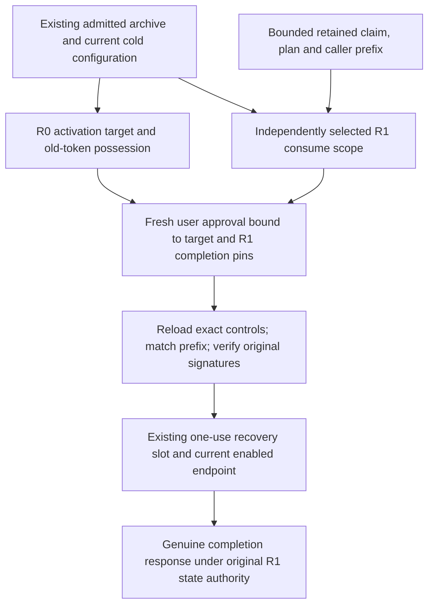

# Independent consume authority in completion recovery

An activation and its later consume operation can belong to different signing
roots. The activation target still authenticates old-token possession and the
original user/session association under R0. It cannot also supply the authority
for consume controls signed under R1. Fresh completion custody may be authorized
by another root, R2.

The `.226` source selects the original consume scope before constructing the
fresh completion approval. It uses the existing root-admitted history archive
and current cold configuration, not a second catalog of trusted keys.

## Selection is not trust enrollment

The retained caller's configuration, generation and enrollment digests are
locators into already admitted scopes. Exactly one current or archived candidate
must match. Missing and ambiguous candidates refuse; neither an old activation
root nor the current root is a fallback. Current R1 can be selected explicitly
even when R0 is archived. Duplicated current/archive candidates are ambiguous,
not an invitation to choose one.

The selector genuinely verifies the caller enrollment and signature, the signed
consume plan, their key and configuration joins, and original intervals. An
archived candidate must also join its independently pinned archive snapshot.
The exact signed caller identity must match the independently configured
completion-authorization digest before a fresh approval is constructed.
Only the fixed supported source contract is accepted; this is not a migration
adapter for old source revisions or a renewal of original execution authority.

The bounded journal reader returns only the fixed activation claim, consume
claim, prepared plan and authorized caller prefix. It checks retained association
and framing but grants no authority. Source-owned selection retains the four
record identities. After fresh approval, full control loading must match those
identities and genuinely admit the originals again. The activation claim remains
checked against R0, while consume caller/grant/state and completion expectations
use R1. Stored completion responses likewise receive genuine verification.

## Fresh approval, old evidence, current routing

Only consume-profile completion uses this independent selection. The actor seals
the actual selector, owner, target, original work and narrowed processing lifetime
before constructing its WebAuthn/two-person binding. The selected R1 scope supplies
packet, caller-authorization and pending-state pins. The currently enabled
configuration alone supplies the transport endpoint.

The existing activation completion and separate intent/proof/release purposes
retain their own authority rules. A completion result is not permission to
release a credential, a token or a browser cookie. The public actor now admits
the distinct fresh consume purpose through the explicit signed old/current input
bridge and purpose-specific workers. Fresh action-specific WebAuthn and approval
remain mandatory; merely selecting old evidence grants no new effect. Other
historical effect purposes retain their current-mode gate.

## Capacity and uncertainty

The original target's reservation already includes its held history and future
response allowance. Selection adds its own bounded candidate and prefix captures
before the first new retained body. Later control admission starts from that
combined total once, then adds its new captures within the unchanged 64 MiB
ceiling. Work, clock origins and deadlines cannot reset between stages.

Recovery preserves the same target/phase slot, original attempt and raw-response
retention rules. Selecting R1 never creates a second SQL attempt, retries an
uncertain dispatch, infers nonexecution from missing local evidence, changes an
old source label or extends original expiry.

This is source integration only. The current tree has not been built or executed;
historical intent/proof/release connections, explicit older-source replay and
independent deployment and production acceptance remain separate work.
