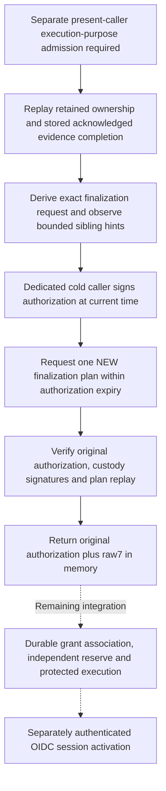

# Dedicated finalization caller and ordered planning

This is source-only implementation, not a deployed or verified registration
flow. Existing public preparation routes and portal buttons remain
preparation-only. They do not invoke the new execution-purpose continuation.

## Why a separate path

Finalization has its own root-enrolled caller identity and signature domains.
Evidence-admission permission and permission to inspect or prepare a transition
are not permission to execute finalization. The existing grant contract also
requires authorization to be issued before the signed plan. Asking for fresh
authorization after retaining an old raw7 cannot satisfy that contract.

The new private continuation implements the correct order:

The first box is an application-admission prerequisite, **not implemented by
this private helper**. No new HTTP route or portal action yet admits that purpose.

## Actual source path

[`prepare_authorized_retained_registration_finalization`](../serverware/control_plane_registration_finalization.py)
accepts only the existing evidence-admission local locator and independently
authenticated user/session scalars. A local locator is not ownership. Under
the actual cold owner's lock and one work/window, the shared retained-original
path loads the exact associated signer/grant pair, reservation, irreversible
SQL claim and acknowledged completion originals. It genuinely replays live
ownership and completion against independently admitted pending-state pins.
An uncertain result is not a substitute, and this path never calls recovery
or retries SQL to manufacture a completed prerequisite.

The [dedicated cold profile](control-plane-registration-finalization-custody.md)
must be enabled before this continuation starts. Its separately held key and
root-signed purpose enrollment do not replace application-level permission.
Old enrollment profiles do not silently gain this purpose.

[`control_plane_registration_finalization_execution`](../serverware/control_plane_registration_finalization_execution.py)
then replays the actual signer originals to derive lookup selectors. It obtains
bounded sibling IDs from the existing database observer, and the dedicated
[authorization issuer](registration-finalization-authorization.md) reconstructs
the exact request with that same hint set before signing. Hints are not proof
of the complete population: the genuine measured transition planner still
proves all required history, sibling and committed evidence-row preconditions.

Authorization issuance completes before the existing custody client makes
one new finalization-planning request. The old prepared raw7 is not an input.
The request deadline is capped at the authentic authorization expiry. Genuine
local [plan admission](registration-finalization-plan-admission.md) then checks
the returned original custody controls, independently configured history and
actual transition replay, joining the exact request/operation and interval to
the original authorization. A changed request or plan issued too early fails;
there is no automatic reauthorization, replanning or timestamp adjustment.

The returned pair is `(existing_evidence_locator, original_raw8)`. Raw8 is:

1. Original dedicated finalization authorization.
2. Original verifier custody intent.
3. Original planner custody relay.
4. Signed transition envelope.
5. Transition proof.
6. Original inputs.
7. Original evaluation context.
8. Separate signed-custody-committed historical expectations.

It is not a new local journal locator or a successful-verification token. A
separate explicit cold-owner grant-request method accepts this original raw8
and a complete before-vector. It first authenticates the original permission
and plan, performs one bounded [original-byte exchange](registration-finalization-authorization.md#bounded-finalization-grant-transport),
then genuinely verifies the returned grant and full before/after vector before
returning the original grant bytes. It neither runs automatically after
preparation nor retains the resulting grant. The [grant producer](registration-finalization-grant-production.md)
is implemented, but the separate authorizer service that must own its signing
key and serve this protocol is not yet connected.

## Limits and remaining work

All work uses the existing cumulative allowance. The supplied current clock
bracket remains unchanged; attestation, signer, authorization, custody and
transport limits only reduce remaining time. Epoch/monotonic checks reject
observed reversals. Cooperative checks cannot interrupt blocked native work.
The complete retained input inventory plus new enrollments, authorization and
returned plan is capped at 64 MiB. Existing per-original bounds also apply.

The new raw8 is currently returned in memory, not durably associated or
automatically sent to a grant service. Dedicated public present-purpose admission,
full-vector acquisition, the cold authorizer service, grant retention, independently
current reservation, protected one-use execution and completion remain to be
connected. The existing credential-finalization kernel does not activate an
OIDC browser session; that is a separate authenticated transition.

No keys, services or socket permissions were provisioned. No build, import,
parser, tests or runtime verification ran. Frozen verification must cover old
profile compatibility, purpose/key separation, authorization-before-plan
ordering, changed authentic requests/siblings, expiry during callbacks,
aggregate/work limits and failures between signing and the new plan response.
This source checkpoint closes no production acceptance gate.
