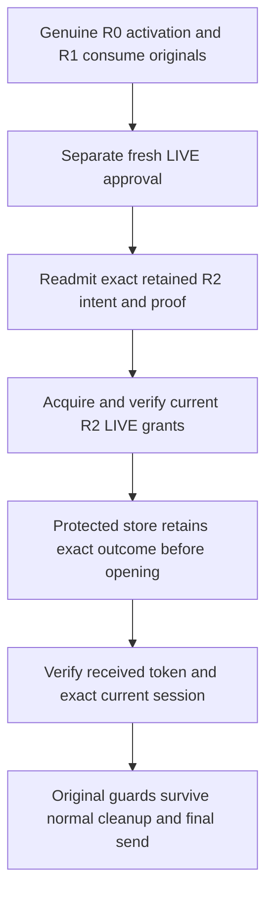

# LIVE release after historical activation and consume

This is source integration only. The current tree is unbuilt and unexecuted;
none of these source connections is runtime, pilot or production evidence.

## Authority remains separate

The LIVE action can continue from activation evidence under R0, consume evidence
under R1 and a retained fresh intent/proof under current R2. The earlier
[proof bridge](control-plane-release-proof-history-selection.md) authenticates
these contexts separately. It does not itself authorize release.

The `release` actor independently selects R1 before its own fresh WebAuthn and
approval ceremony. Current cold handoff and grant-acquisition configuration must
be enabled. Its original packet, caller and pending-state pins come from R1;
its endpoint comes only from current configuration. The retained proof must
still verify under current R2 intent/proof policy. Reading it does not require
permission to create another proof or contact the proof-setup service.

Missing proof, a spent claim without output, or an uncertain earlier request
does not authorize signing again, repeating SQL, retrying transport or switching
to retained-release recovery.

## Actual grant and receiving connections

The grant issuer's existing proof-bootstrap admission verifies the explicit v2
bridge. The producer authenticates the consume caller, grant, COMPLETE request
and state acknowledgment under the genuinely admitted R1 evidence root. Current
R2 remains the authority for the intent, proof, release custody and LIVE grants.
Complete state-enrollment payloads, database and generation must agree; signature
envelopes may differ across roots. The proof bridge retains the original R0
delivery-key identity, and the final private opener still binds the actual key
to the exact current custody and original delivery.

The caller, fixed/dynamic issuer, independent grant receiver and protected LIVE
opening use the existing closed request/response contracts. No new grant format,
descriptor, private-key export, privileged process or evidence-root fallback is
introduced. Actual current-planner and historical-policy copies are reserved
before decoding or reading bodies, within the unchanged work/window and 64 MiB
aggregate. The caller's smaller grant/exchange lanes remain binding.

## Continuity through the final response

The staged response seals three distinct configurations: the current enabled
endpoint, the independently admitted historical completion scope, and the
actor's exact endpoint-plus-historical-pins combination. It also seals the
original consume selection and its R1 authority. Matching fields cannot replace
those actual source-owned identities.

After normal actor/owner cleanup, only the original base guards continue. Closed
actor, controls, input, proof and exchange methods are not revived. The terminal
continues to check original R0/R1 evidence, processing limits, request binding
and current configuration before its receiver can authorize a response. The
existing exact current-session, credential, role and trust checks remain
mandatory, including immediately before the cookie response begins.

Protected custody retains the exact durable outcome before opening the delivery.
A successful outcome record or grant alone proves neither browser delivery nor
that the session is currently usable. The ordinary unknown-result responses and
no-automatic-retry rule are unchanged.

## Remaining boundaries

This path keeps current R2 intent/proof and release authority. An already
retained intent/proof under a retired distinct authority still requires its own
independent readmission. `retained-release` remains current-only; retiring the
root of an old release-custody outcome requires an explicit historical recovery
bridge, not a LIVE fallback.

Delivery-key/state migration, explicit older-source adapters and independent
deployment/verification remain unfinished. This increment does not close H05 or
any production acceptance gate.
