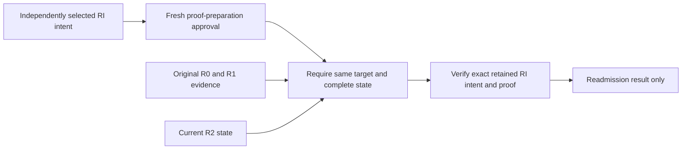

# Read-only retained intent and proof recovery

The completion-recovery proof-preparation route can readmit an already retained
intent and proof under their independently archived signing authority, RI.
Original activation authority R0, consume authority R1 and current processing
authority R2 remain separate. This implements a read-only historical lane, not
retired-key signing or permission to release a token.

## Selection before approval

`completion_recovery_intent_selection` uses the existing bounded journal loader
for exactly three records: activation claim, consume claim and retained intent.
The first two must match the previously authenticated consume selection. The
third supplies only lookup fields until the original intent signature and
enrollment are verified under the actual cold history archive.

[Archive v3 and parent v22](control-plane-oidc-session-activation-release-proof-history.md)
pin the independent proof enrollment under that same RI. Missing or null proof
authority is a refusal; neither the proof response nor current configuration
can silently fill an old archive entry. Current selection is explicit and
requires matching actual current root, configuration, generation, planner,
intent enrollment/scope and proof enrollment/scope originals.

The proof-preparation approval binding is v2 and includes the selected intent
record digest (or explicit absence) and retained-only mode. Changing the prefix
between options and approval therefore changes the approved payload. A second
tuple-five release read must match the retained intent commitment before any
genuine admission or effect. Proof bytes are not in that three-record prefix;
their independent RI enrollment and genuine verification remain mandatory.

## Verification without retired private keys

Inputs carry the independently selected RI intent/proof policies, root and
planner original only in retained-only mode. Activation, consume, RI and
current state enrollments are separately authenticated and their complete
payloads must agree, including database and generation. Rotation does not
authorize state migration, a new delivery key or new credential possession.

The existing intent/proof verifiers recheck actual signatures, target, old-token
possession, completion and custody originals. Both signed intent/proof intervals
must fit inside the independently selected RI archive interval; expiry is not
rewritten or extended. Retained readmission never loads a retired private key.
Current private-key/descriptor checks exist only in the fresh signing branch.

Missing retained intent or proof cannot create a claim, sign a replacement,
request proof setup, contact a proof service or retry a spent operation. The
read-only preparation result cannot itself enter token delivery. The separate
[current-authority retained-RI delivery bridge](control-plane-current-authority-retained-ri-delivery.md)
now connects a fresh release actor, fixed current issuer policy, current custody
and LIVE delivery; it does not grant retired signing or proof-service contact.
Retained-outcome delivery across a retired release root remains unfinished.

## Bounds and remaining work

The selector carries the original owner/work/clock guards, reserves candidate
cold captures before prefix body one, and retains exact prefix commitments.
Its total includes the target and consume selection once; controls replace,
not add, their inherited reservation. The 64 MiB aggregate ceiling, fixed
loader shapes, existing global attempt slots and original deadlines stay
unchanged. Large individually valid inventories may still be refused.

The fresh-current preparation and current-R2 LIVE paths keep their separate
authority requirements. Older source-cohort adapters, migration and retained
release-outcome root history remain H05 work. This is source integration only: no build,
execution, pilot, AWS deployment or production acceptance is claimed.
