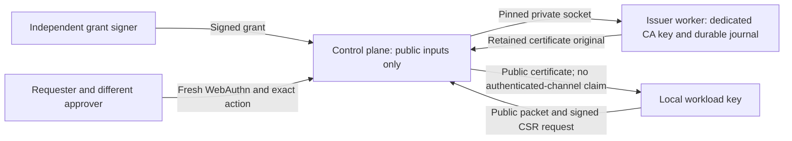

# Control-plane workload certificate issuance

This source path connects the dedicated [issuer worker](workload-identity-issuer.md)
to an explicitly authenticated operator action. It is unbuilt, unexecuted and
unprovisioned. It does not establish a tested pilot, deploy a CA, install proxy
trust or authenticate a workload channel. Existing local enrollment CLI modes
remain network-free; separate [explicit CLI submission and portal controls](workload-identity-submission.md)
now connect to these actions in source.

## Authority stays separate

The local key/request proves possession. A `policy_author` role, enrollment
packet, CA-install capability or approved WebAuthn ceremony cannot replace the
separately signed issuance grant. Neither the application nor this caller owns
a CA key or a generic signing callback. The independent grant still binds the
original packet/request, principal/nonce, issuer, SANs, serial and validity.

## Cold caller and request lifetime

The runner initializes custody, enrollment and then workload-identity ownership
before importing the application or HTTP runtime. Shutdown closes these owners
in reverse order, including exceptional startup. Configuration validation
requires the actual admitted owner, not a PID environment marker or lazy setup.

`SERVERWARE_CONTROL_PLANE_WORKLOAD_IDENTITY_BOOTSTRAP_FD` names one root-owned,
sealed public bootstrap descriptor already in the original runtime-admitted
inventory. Paths, private keys and a second descriptor-inventory scan are not
alternatives. Production requires a root-signed bootstrap; `issuer: null` is the
explicit disabled profile. Only genuinely unconfigured development may have no
owner. Mentioning an invalid or empty setting does not opt out.

The signed payload domain is `serverware.controlPlaneWorkloadIdentityBootstrap/v1`,
paired with `serverware.signedControlPlaneWorkloadIdentityBootstrap/v1`. Its
runtime-root signature independently selects the issuer root and exact worker
bootstrap originals. Those nested originals are genuinely admitted, not trusted
because their JSON has expected fields. The bootstrap is capped at 256 KiB.

The fixed endpoint is `/run/serverware/workload-identity-issuer/issuer.sock`.
Connected server credentials are independently pinned to UID/GID **0:0**, the
root-created systemd listener profile. That is distinct from the socket path's
**65492:65532** ownership, worker identity **65492:65492**, and accepted caller
**65532:65532**. A pathname owner alone is not connected-peer authentication.

Every HTTP request starts its actual work ledger and one clipped processing
window before reading the body. A fresh request may open its own window; no
stage can refresh an existing request's deadline or extend signed authority.
The scope survives framing, synchronous route processing and final ASGI send,
then closes on success or failure. The grant and returned leaf are independently
verified from original bytes within that same scope.

## Explicit public action

The two fixed POST paths are:

- `/api/agents/workload-identity/issue/options`
- `/api/agents/workload-identity/issue`

Both require a current cookie-authenticated operator. Issuance uses the fixed
action `workload.identity.issue`: the requester must be a `policy_author`, and
a different operator with the `approver` role must approve the exact action.
Fresh WebAuthn assertion verification and two-person approval are mandatory for
this action even when development or other mutation settings are less strict.
The matching generic approval/options branches enforce the same cookie and
fresh-assertion requirements for approvers; unrelated actions retain their
existing behavior.

Approval crosses the database boundary through a workload-only, source-created
one-use receipt from genuine assertion verification. It is not a posted evidence
dictionary or an optional-MFA flag. The database consumes it under the existing
authority locks against the actual approval row and actor, then preserves the
current credential, role, distinct-requester and conditional-update checks.
The live cookie and original processing guard remain required through the effect;
the application discards the receipt on both success and failure.

This dedicated path remains separate from the later [generic approval repair](control-plane-approval-verification.md),
which connects genuine verification to a one-use receipt while preserving the
generic route's own authentication modes and optional-MFA policy. Neither repair
closes the remaining protected provider/filesystem side-effect workflows.
Both remain source-only; connected approval code is not evidence that an action
has passed runtime acceptance.

The closed request has schema `serverware.workloadIdentityIssuanceRequest/v1`
and three members, `authorization`, `packet` and `request`. Each contains exactly
`base64Url`, `byteCount` and `bytesDigest` for one original; digests use the
`sha256:` prefix. The issue route additionally requires `mfa` containing
`assertion` and, when continuing an approved request, `approvalId`. The options
route does not accept `mfa`. No endpoint, CA, signer, replacement CSR or private
key is accepted from this body.

Options genuinely admit the grant and public originals, then bind their exact
digests and principal/nonce into the fresh challenge. They never contact the
issuer. A pending two-person decision returns a bounded 428 continuation with
the approval ID and safe action binding, not the packet or CA-install token.
After approval, obtain fresh options and an assertion for the same originals;
the previous assertion is not a reusable execution credential.

The literal HTTP body ceiling is 12 MiB, but the cold/request aggregate is
stricter: cold reservations, sixteen times Content-Length, framing reserve and
the caller's fixed exchange allowance must fit within the original 64 MiB before
the first body byte. Per-original caps are also enforced. These are bounded
representation/work reservations, not an RSS measurement or a promise that
every individually permitted maximum can be combined. The fixed exchange
allowance includes the shared verifier's conservative journal reservation;
the control-plane caller does not create a second issuer journal.

## One exchange and truthful outcomes

The client first admits the grant from the original tuple; a prior options
result cannot authorize issuance. It spends the request's exchange claim before
the sole socket connection, sends raw grant/packet/request originals and receives
only bounded public association/certificate originals. There is no endpoint
fallback, reconnect or automatic retry. Returned association bytes must match
the exact canonical expected association; the certificate undergoes genuine
original-only grant/request/issuer admission rather than an echo check.

A successful response has status `certificate-issued`, the public association
and certificate wrapper, with `proxyAuthenticated`, `enrollmentComplete` and
`automaticRetryAllowed` all false. It may represent the worker's identical
durably completed certificate, not a new signature on every request. The local
client must still admit the returned leaf against its independently pinned
issuer, retained request and private key.

An uncertain exchange produces an explicit unavailable/unknown result without
retry permission. No missing response establishes that issuance did not happen.
The worker's sticky claim and exact-certificate replay rules remain authoritative;
this HTTP caller never clears journal state, renews a grant or signs a replacement.
Final sending remains guarded by the original live context, and cleanup cannot
turn an uncertain result into successful delivery.

## Still required

The [public trust publisher and standard ingress admission](workload-identity-trust-distribution.md)
are now source-connected. Deployed issuer trust, native/client trust-pin integration,
rotation/revocation/retirement, authenticated service channels and local sidecar integration remain open. Real acceptance must exercise
the complete workload flow, negative identity cases, interruption/recovery, mandatory proxy mTLS and
unchanged upstream TLS/egress controls. Software-key custody and a local journal
prefix do not satisfy measured custody or independent rollback witnessing.
