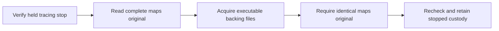

# Controller body observer acquisition

Status: source-only, unbuilt and unexecuted. The receiver, descriptor-bound
target acquisition, read-only gate snapshot and namespace-confined initial
tracing stop with descriptor-backed task and mapping custody are prerequisites for a future
observer, not an operational observer server or permission to release a body.
No ready acknowledgement, continuous event acquisition or signed evidence is
produced by these components.

## Received originals and actual target

The shared
[exchange contract](../data-plane/decision-gate-rs/src/body_observer_contract_v12.rs)
fixes the launch, ready and terminal schemas, original deadline and nine descriptor
roles: pidfd, proc directory, executable, user/mount/PID/network/cgroup namespaces,
and cgroup directory. The launch retains the complete body context, original
source/artifact scope and inherited proxy pin. These values do not authenticate
themselves merely by being well-shaped or arriving over a socket.

The actual composition is
[AcquiredBodyObserverLaunchV12::acquire(accepted, expected_controller_executable, deadline)](../data-plane/decision-gate-rs/src/body_observer_v12.rs).
It takes ownership of an already accepted socket and an independently supplied
controller executable pin. The fixed-endpoint receiver checks `SO_PEERCRED`,
obtains the actual peer pidfd through `SO_PEERPIDFD` rather than opening a peer
pidfd from a numeric PID, and joins its immutable static executable to that pin.
It receives one `L` byte carrying exactly nine `SCM_RIGHTS` descriptors, then
one bounded u32-big-endian-length original launch frame. Extra ancillary data,
pre-ready bytes and premature EOF are rejected. The effective deadline is the
minimum of the independently owned service bound and original launch deadline.

Both peers now require Linux `SO_PEERPIDFD` (available in Linux 6.5), with no
numeric-PID reopening fallback. The returned descriptor comes from the socket's
retained peer identity; it is not a new process lookup. See the
[Linux 6.5 implementation](https://github.com/torvalds/linux/blob/v6.5/net/core/sock.c#L1671-L1699).
The receiver requires `SO_PASSPIDFD` disabled and still adopts/closes any forbidden
`SCM_PIDFD` before returning an error. The client also closes such unsolicited
descriptors. This accounts for the kernel's actual descriptor installation,
not just ordinary `SCM_RIGHTS`; see the
[ancillary pidfd receive path](https://github.com/torvalds/linux/blob/v6.12/include/net/scm.h#L127-L158).

The composition calls the actual target owner and then the read-only gate.
`verify_pending(deadline)` rechecks the retained peer/channel and gate without
sending anything. The future service must independently admit its controller
pin and authenticated listener and provision their ownership; the accepted
socket and this API do not supply that missing cold authority. There is no
daemon, listener creation, client-ready, workload-resume, signature or terminal
method. The separate helper stop handshake described below is private local
acquisition data; it does not answer the controller's waiting ready request.

[ReceivedBodyTargetV12](../data-plane/decision-gate-rs/src/body_observer_target_v12.rs)
owns the received descriptors and joins them to actual kernel/filesystem
observations: target PID and start ticks, shared pidfd identity, namespace
identities, immutable static supervisor measurement, exact cgroup membership and
the retained original launch context. It verifies that the fixed release file
is still absent. A numeric PID, decoded launch object or copied observation does
not replace this acquisition.

The read-only
[HeldBodyGateV12](../data-plane/decision-gate-rs/src/body_observer_gate_v12.rs)
takes that actual owner, not a caller-supplied census. `acquire(target, deadline)`
and `verify_gated(deadline)` check the original target and absent release around
bounded procfs observations: exact PID/Tgid, `TracerPid == 0`, one task and an
empty child list. Status reads are capped at 64 KiB, child reads at 4 KiB and the
task inventory at the selected task plus `.` and `..`. Calls may only shorten
the retained original deadline; they do not reopen a window.

This is a repeated live snapshot, not an atomic or continuously maintained
no-child guarantee. The owner does not stop, trace, signal, resume, detach or
reap a process, and dropping it only releases its owned descriptors. Passing
the snapshot does not authorize a ready response, a signature or a new claim
that an event source has been armed.

## Numeric ptrace attachment deliberately withheld

The proposed numeric `PTRACE_SEIZE`/`PTRACE_INTERRUPT` owner was removed before
integration. A task can exit and its numeric TID can be reused between the held
target check and `PTRACE_SEIZE`. A later original-pidfd/proc recheck can detect
the mismatch but cannot undo the attachment safely: signaling only the original
pidfd leaves the unrelated task traced, while `PTRACE_O_EXITKILL` can kill it when
the tracer exits. A numeric kill or detach fallback would introduce another
unapproved target operation, not repair the missing atomic association.

Linux documents that ptrace addresses individual thread IDs, that seize itself
does not stop the target, and that `EXITKILL` kills a tracee when its tracer exits.
The read-only replacement makes no pidfd-to-ptrace atomicity claim. See the
[ptrace manual](https://man7.org/linux/man-pages/man2/ptrace.2.html).

## Namespace-confined initial stop

The replacement uses a different target-selection rule, not a retry of the
numeric host-PID attachment. A fixed helper is born inside the exact PID
namespace retained from the gated target. Linux resolves PID-taking operations
in the caller's active namespace; namespace-init death kills that namespace's
members and prevents further births. Our inference from those guarantees is
that, after joining the actual namespace, fixed PID `1` cannot become an unrelated
reused host PID. This depends on actual namespace custody and the Linux rules,
not a supplied namespace number. See
[PID namespace semantics](https://man7.org/linux/man-pages/man7/pid_namespaces.7.html)
and [setns](https://man7.org/linux/man-pages/man2/setns.2.html).

`AcquiredBodyObserverLaunchV12::stop_for_initial_acquisition` consumes actual
pending custody. The source-fixed
[process owner](../data-plane/decision-gate-rs/src/body_observer_process_v12.rs)
requires a single-threaded root
host owner with no existing children and default `SIGCHLD` disposition, retains
the original `pid_for_children`, and births only the fixed helper using `clone3`
with an atomically returned child pidfd. This dedicated owner must remain the
sole reaper; it is not a helper for an arbitrary multithreaded application or
an application with a child-reaping signal handler. The parent remains
in its original active PID namespace and restores its child-namespace selection
and signal mask. An unrepairable restoration error is fatal to this dedicated
observer process; it cannot return an ambiguously configured owner for more work.
No generic child function, executable, argv, environment or target PID is accepted.

The fixed [helper](../data-plane/decision-gate-rs/src/body_observer_worker_v12.rs)
receives only its fixed retained descriptors and private channel.
It verifies its actual namespace and init identity before attaching to fixed
namespace PID `1`, checks the genuine interrupt stop, and emits one bounded
`serverware.controllerBodyObserverNamespaceStop/v12` original. The host parent
joins that message to the exact child pidfd, kernel per-message credentials,
launch and target identities, birth interval and actual target `TracerPid`/state.
The private socketpair's creator credentials are not substituted for the helper's
actual message-sender identity.

The initial wait now has a dedicated same-thread acquisition owner rather than
discarding the raw kernel observation after a status comparison. It retains
that original and rechecks the exact namespace-init stop. The kernel syscall-info
reader is usable only with this actual owner; the initial path requires `NONE`,
not a guessed syscall phase. The
[history guide](controller-body-observer-history.md#kernel-wait-observations-before-journal-events)
explains the separate status classifier and the still-missing continuous producer.
This does not widen the worker's target selection or private control protocol.

After that genuine stop, the fixed helper calls
[`acquire_initial_task`](../data-plane/decision-gate-rs/src/body_observer_task_acquire_v14.rs).
The same-thread owner duplicates the source-held target proc directory rather
than reopening a numeric target. It retains actual status/stat and PID-namespace
descriptors, together with the worker's current-thread proc view. It joins the
target's host TID/TGID and original start ticks, tracing-stop state, single-thread
shape and namespace PID/TGID `1`; the target's actual `TracerPid` must identify
the actual worker. Both namespace descriptors must match the retained namespace.
Acquisition and revalidation bracket these reads with the genuine stop and
descriptor checks under the original deadline. The worker retains this owner
and rechecks it before sending its private stop record.

The owner retains the before/after status and stat originals and compares their
identity projections, not volatile counter bytes. The shared
[raw proc parser](../data-plane/decision-gate-rs/src/body_observer_task_proc_v14.rs)
offers separate status/stat parsing plus a joined identity parser. Status is
bounded to 64 KiB, stat to 16 KiB and each ordered namespace vector to 32 IDs.
Required identity fields are unique and canonical; the joined parser checks
PID, parent, state and thread-count agreement and coherent thread-leader shape.
Stat parsing validates the complete 52-field layout while retaining raw command
bytes, including non-UTF8 bytes, `)` and newline. Unrelated status values such
as `Name` do not require UTF-8. Parsing alone establishes neither descriptor
provenance nor a stopped task.

This initial task owner supplies no lifecycle event, address-space-sharing
decision, completion outcome, ready response or signature. The proposed next
cohesive session owner and its unresolved acquisition/storage/terminal boundaries
are described in the [native observer lifecycle design](controller-body-observer-lifecycle-design.md);
that design is not an implemented continuous producer.

The private
[stop contract](../data-plane/decision-gate-rs/src/body_observer_worker_contract_v12.rs)
is one canonical, closed, eleven-field JSON packet capped at 4 KiB over an
inherited nonblocking, close-on-exec `AF_UNIX/SOCK_SEQPACKET` pair. The parent
enables `SO_PASSCRED` before birth. Unexpected received rights and ancillary
pidfds are closed before rejection; truncation, duplicate credentials, extra
packets and a zero-length packet masquerading as EOF are rejected. The record
is unsigned acquisition data, not an independently signed observer result.

The resulting `StoppedBodyObserverLaunchV12` retains both worker and target.
The helper holds the initial stop without resuming the workload and accepts only
abort/EOF, parent death or the existing absolute deadline. Abandonment uses
exact held pidfds and the fixed tracer's exit behavior; it is not a claim that
the target or full outer generation has been destroyed. The host controller's
existing termination/cgroup cleanup and authenticated destruction remain required.
Explicit abort signals the held target and helper through their pidfds and reaps
only the helper using `waitid(P_PIDFD, WEXITED | WNOHANG)`, with no numeric-PID
fallback. A caller-shortened cleanup deadline is retained, so destructor cleanup
cannot retry with an older, longer allowance. After expiry it may still request
fail-closed termination and attempt a nonblocking reap, but cannot report cleanup
success or acquire another waiting interval.

This is still not a ready sender or continuous event/mapping producer. No
namespace, process, ptrace, signal or cleanup operation has been executed as part
of this source work. An admitted immutable observer process, its required host
capabilities and complete serving/signing lifecycle remain to be provisioned.

## Held initial mapping snapshot

`StoppedBodyObserverLaunchV12::acquire_initial_mappings` consumes the stopped
owner into
[StoppedBodyMappingSnapshotV12](../data-plane/decision-gate-rs/src/body_observer_snapshot_v12.rs).
The worker, target and external channel stay owned together with the actual
procfs maps descriptor, original map bytes, complete parsed inventory and retained
executable-file descriptors. There is no snapshot-to-ready or snapshot-to-signed-
evidence conversion.

The [maps parser](../data-plane/decision-gate-rs/src/body_observer_maps_v12.rs)
retains every row, including non-executable regions and special or unsupported
labels. Input is capped at 4 MiB and 4,096 mappings, with bounded path display
bytes, complete records, checked numeric fields and sorted nonoverlapping ranges.
Raw pathname bytes are preserved, including non-UTF8 names. Classification is
an observation about a displayed label, not a permission decision or proof of
kernel provenance. No row is omitted merely because the existing evidence
contract cannot represent it.

The [file owner](../data-plane/decision-gate-rs/src/body_observer_mapping_files_v12.rs)
acquires every executable row with a nonzero backing inode through the retained
proc directory's `map_files` entry named by the actual address range. It never
resolves the displayed pathname. Files must satisfy actual immutable root-owned
regular-file custody; device/inode, range, offset and held/named identities stay
bound to the same row. One retained file and full-file SHA-256 may serve multiple
mapping ranges, but those bindings remain separate. Unique file bytes are capped
at 512 MiB in aggregate and reads share the original absolute deadline. The file
owner allows at most 4,094 unique backing descriptors, plus its retained directory
and one transient named reopen, within its 4,096-descriptor bound. Verification
rechecks metadata and actual immutability without repeating the full-file hash.

This path choice follows Linux's documented ambiguity: a maps pathname can
contain an ambiguous newline escape or deletion suffix. The corresponding
`map_files` entry is the kernel reference to the mapped object, and access has
host capability requirements; missing permission fails acquisition rather than
falling back to a path lookup. See
[maps format](https://man7.org/linux/man-pages/man5/proc_pid_maps.5.html) and
[map_files references](https://man7.org/linux/man-pages/man5/proc_pid_map_files.5.html).

Executable zero-inode mappings, including kernel-special or unsupported labels,
remain explicit and unmeasured in this unsigned inventory. Non-executable rows
are also retained but do not receive executable-file measurements. A full-file
digest is not a digest of mapped process memory, and neither a mapping label nor
a file digest establishes membership in an independently admitted runner or
kernel closure. The snapshot covers this initial stopped task only, not later
processes, address-space changes, transient code or complete execution history.

## Deferred verification scope

The held snapshot can also start an unsigned v14 history through
`StoppedBodyMappingSnapshotV12::begin_history`. The
[history guide](controller-body-observer-history.md) describes its separate
task/address-space identities, bounded original records, structural lifecycle
replay and actual initial-record production. It does not add continuous
observation, signed evidence, readiness or resume.

The consolidated frozen verification must exercise this code only with owned,
isolated fixture processes and the exact prepared observer artifact. Source
review is not a substitute for those checks. Required cases include:

- An actual initial stop joined to the held namespace, target, clone3 child and
  kernel message credentials, with the release file still absent and no ready
  or resume message emitted.
- Rejection before attachment for the wrong active namespace, mismatched target
  custody, a previously released target, extra tasks/children or a bad parent.
- Successful parent namespace/signal restoration, and fail-closed ownership
  after setup, restoration or child-start failures.
- Malformed, extra and truncated private packets; forbidden descriptor delivery;
  wrong credentials; actual EOF versus an empty packet; and deadline expiry.
- Parent or target death during setup and while held, abandoned custody and
  bounded exact-child cleanup. A helper exit or reap must never be counted as
  proof that the full generation is destroyed.
- Complete bounded maps parsing, raw ambiguous/non-UTF8 display names, explicit
  special/unknown mappings, exact maps readback and file range/device/inode
  joins. File alias deduplication must not merge mapping ranges or enlarge the
  aggregate byte allowance; permission, immutability, identity, truncation and
  deadline failures must not yield a partial successful inventory.

None of these runtime checks has been performed for this source checkpoint.

## Remaining boundary

A safe event acquisition owner, complete executable/kernel-provided mapping
treatment, continuous event history, independent signing authority and an actual
serving lifecycle remain missing. In particular, the current file-backed mapping
contract must not invent a backing file for `[vdso]` or silently omit it.

The unsigned initial snapshot supplies source-level acquisition for the held
initial task, not accepted observer evidence. Unsupported mappings remain
explicit; acquisition does not authorize readiness or resume.

This ordering is deliberate. The existing
[runtime evidence contract](../data-plane/decision-gate-rs/src/runtime_evidence.rs)
requires nonanonymous, absolute-path file-backed executable maps, a globally
sorted nonoverlapping mapping vector and a positional one-to-one join between
that vector and executable mappings. Its mapping root hashes that flat vector,
not a temporal event history; `RuntimeProvided` does not exempt kernel mappings
from the file-backed checks. Combining successive snapshots or different
process address spaces would misrepresent those semantics. Continuous execution
therefore needs actual per-task/address-space event acquisition and independently
admitted kernel-mapping policy. The separate unsigned v14 record/replay model
now represents those lifetimes structurally, but it does not implement the event
source or signed-evidence admission. Neither is supplied by silently weakening
or reinterpreting the v13 consumer.

No listener provisioning, observer keys, release approval or production-runtime
proof is supplied here. The existing client must still obtain a genuine observer
original, and root must authenticate it and join actual exit/output/target
observations before its separate terminal publication path can succeed.
