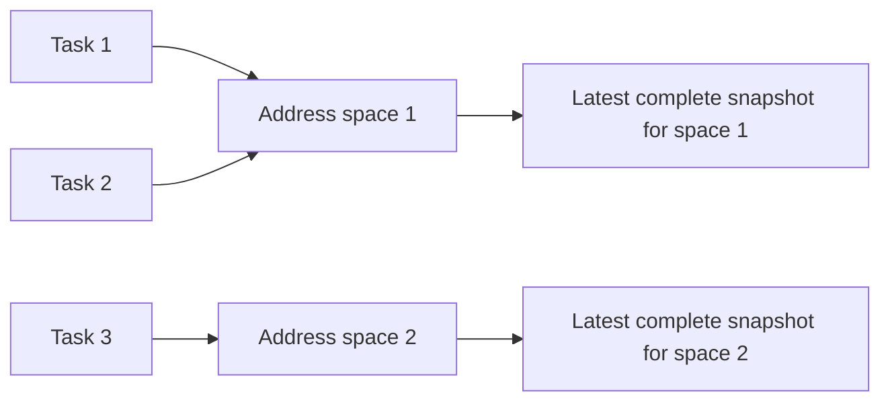

# Controller body observer history

Status: source-only, unbuilt and unexecuted. This is an unsigned observation
format, structural replay model and actual **initial-record** producer. It is
not a continuous event source, approved kernel policy, signed runtime observer,
ready sender, workload resume operation or production release proof.

The existing v13 signed runtime-evidence consumer remains unchanged. These v14
records do not satisfy that consumer and cannot be substituted for its evidence.
The [acquisition guide](controller-body-observer-acquisition.md) describes the
retained target, initial stop and mapping custody on which this work depends.

## Why task and address-space identities are separate

A process-local address range is not a globally unique code identity. Different
processes may use the same ranges, while several tasks may share one address
space. Execution replacement introduces another address-space lifetime. The
new model therefore separates monotonically assigned journal-local task and
address-space ordinals from reported host/thread-group/namespace/start identities.
Those ordinals are scoped identifiers, not kernel pointers or proof of shared
memory. A future actual event owner must establish the reported relationships.

Ranges are ordered and nonoverlapping within each complete snapshot, never
globally across tasks or successive observations. The replay owner stores one
current snapshot reference per live address space; replacing that reference
updates the view of every task sharing it.

## Closed originals and bounds

The [record codec](../data-plane/decision-gate-rs/src/body_observer_history_contract_v14.rs)
defines two separate typed-canonical JSON originals:

- `serverware.controllerBodyMappingSnapshot/v14`: exact scope, reported task and
  address-space identity, observation interval, original maps-byte digest and
  every mapping row. Permissions and raw display pathname bytes survive; names
  use canonical padded standard Base64 without pathname decoding or lookup.
  Only executable rows with a nonzero inode have full-file measurements.
  Kernel-special and other unmeasured rows remain explicit.
- `serverware.controllerBodyHistoryEvent/v14`: exact scope, contiguous sequence,
  previous event digest, observation time and one closed lifecycle event.
  Events requiring a new snapshot bind that snapshot's domain-separated digest.

Each digest commits to its fixed NUL-terminated domain followed by the unchanged
canonical original. There is no self-digest field and no digest-as-authority
claim. Parsing rejects noncanonical bytes instead of repairing them.

Snapshot originals are capped at 16 MiB, with at most 4,096 mapping rows and
4,096 decoded pathname bytes per row. Unique executable backing measurements
remain within 512 MiB and repeated device/inode identities must agree. Event
originals are capped at 256 KiB so an atomic execution replacement can name a
full admitted thread group. Streaming replay is capped at 1,000,000 events and
512 MiB of combined event and supplied snapshot originals. Each supplied original
is charged once; repeated snapshot hashes do not waive that input cost. These are
structural processing limits, not a provisioned durable log or permission to
consume unaccounted output space.

The live-task bound is copied exactly from the admitted runner's `pids` value;
the model supports its existing maximum of 8,192 rather than silently clamping
it to a smaller inventory. Live address spaces cannot outnumber live tasks.
Task and newly allocated address-space ordinals never restart or reuse an old
lifetime after exit. A live group's leader ID stays reserved even if its leader
already has a reported exit; another birth cannot take that group's identity.
Reported namespace-local task IDs are likewise unique within each live reported
PID namespace. Exhaustion is an error, not permission to drop events.

## Reported lifecycle replay

The [replay owner](../data-plane/decision-gate-rs/src/body_observer_history_state_v14.rs)
processes bounded original frames sequentially. It retains the chain head,
counters and bounded live task/address-space tables, not an unbounded history.
Every error poisons the owner; later input cannot repair or resume that instance.

| Event | Structural effect | Required snapshot original |
| --- | --- | --- |
| `Initial` | Start task 1 and address space 1 in the original target scope | Complete initial snapshot |
| `TaskBorn` | Add a new task, sharing the parent's address space or allocating a new one | Required for a new address space; forbidden for sharing |
| `Executed` | Replace the surviving task identity, explicitly supersede recorded peers and allocate a new address space | Complete replacement snapshot |
| `MappingsObserved` | Replace the snapshot reference for the task's current address space and all its sharers | Complete current snapshot |
| `TaskExited` | Remove one finally terminated reported task and retire an unreferenced address space | Forbidden |
| `End` | Close the reported history only when no tasks or address spaces remain | Forbidden |

Every event must preserve the scope, advance the exact sequence and previous
hash, and retain ordered observation times before the original deadline. A
snapshot must match the event's exact task/address space and scope, lie after
the preceding observation and finish no later than the current event. Missing,
extra or mismatched snapshot originals are errors. Distinct address spaces may
legitimately contain identical virtual ranges.

Execution replacement is not modeled as invented final exits. Linux can change
a non-leader thread's numeric identity during `execve`, and the old leader may
never report a separate final death. `Executed` therefore carries the exact
sorted set of remaining recorded peers superseded by that transition. Replay
rejects omitted, duplicate, unknown or foreign-group peers, retires them together
and preserves unrelated address-space sharers. A future producer must join the
actual exec event, former thread identity and complete post-exec task census.
This is distinct from `TaskExited`, which means reported final termination, not
an early ptrace exit stop. See the
[Linux exec-under-tracing rules](https://man7.org/linux/man-pages/man2/ptrace.2.html).

Reported namespace inode equality is not proof of ancestry. New process groups
can report a different PID namespace; same-group threads and execution
replacement must preserve their applicable group/namespace identities. Actual
birth, sharing, namespace and lifetime custody remain the event producer's job.

## Initial records from actual custody

`StoppedBodyMappingSnapshotV12::begin_history` consumes the actual held snapshot
into [HeldInitialBodyHistoryV14](../data-plane/decision-gate-rs/src/body_observer_history_acquire_v14.rs).
It accepts no caller-supplied records or replacement measurements. It derives the
scope and initial task facts from the retained owner, projects every original
mapping, and joins each executable measurement exactly by range, offset, device
and inode. Missing, extra or mismatched bindings fail acquisition.

The original mapping bytes receive their own digest; raw displayed names remain
unchanged through Base64. The complete canonical snapshot and one `Initial`
event are created under the original deadline, with actual stopped-snapshot
verification around construction. Structural replay consumes those originals
once. The resulting owner retains the actual snapshot first in drop order,
both originals and the replay state together. It emits no `End` event.

Revalidation checks the actual held snapshot and unchanged projected originals;
it does not manufacture later history or reopen the original window. Abort
delegates to the existing exact-pidfd cleanup path. Read-only record bytes and
chain hashes can be copied for inspection, but those copies do not transfer
process custody, freshness or action authority.

## What is still missing

Structural consistency does not establish that all tasks/events were observed,
that a shared address space was actually shared, or that mapped memory matched
the backing file. The current worker still holds the initial stop and never
resumes. There is no ongoing event transport, scheduler, durable event/snapshot
store, independently admitted kernel-mapping policy, memory-integrity authority,
terminal reconciliation/signing or serving lifecycle supplied by this model.

The next owner must acquire real descendant lifetimes, actual shared-address-
space relationships, execution replacement and mapping changes without gaps.
It must preserve originals and handle resource limits and ambiguity without
silently omitting history. A separately versioned signed-evidence admission path
must then join that evidence to policy and the genuine runtime/body results.
Neither a closed replay nor `End` proves cgroup destruction or release readiness.

Deferred frozen verification must cover original/canonical-byte rejection,
scope/sequence/hash/time drift, shared-memory updates, distinct processes with
overlapping virtual ranges, thread-group exec supersession, PID/ordinal reuse,
final exit versus pre-exit notifications, cap exhaustion and permanent poisoning.
Initial production also needs actual custody/measurement-mismatch and cleanup
checks. None of these tests or runtime scenarios has been executed for this
source checkpoint; immutable preparation and full production gates remain.
