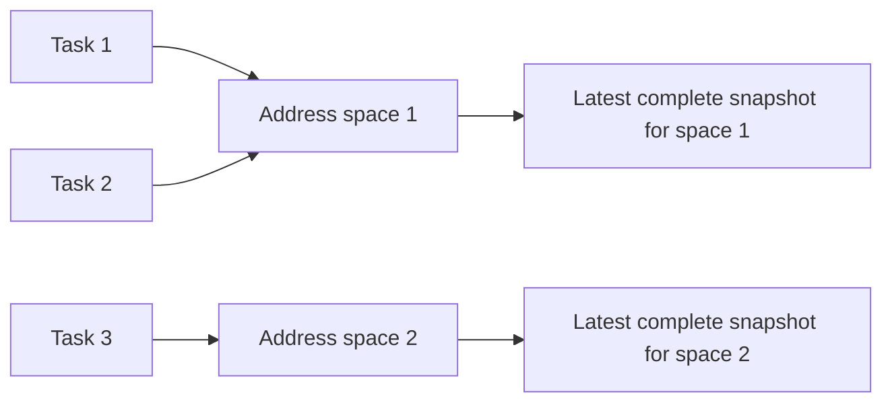

# Controller body observer history

Status: source-only, unbuilt and unexecuted. This is an unsigned observation
format, structural replay model and actual **initial-record** producer. It is
not a continuous event source, approved kernel policy, signed runtime observer,
ready sender, workload resume operation or production release proof.

The existing v13 signed runtime-evidence consumer remains unchanged. These v14
records do not satisfy that consumer and cannot be substituted for its evidence.
The [acquisition guide](controller-body-observer-acquisition.md) describes the
retained target, initial stop and mapping custody on which this work depends.

## Why task and address-space identities are separate

A process-local address range is not a globally unique code identity. Different
processes may use the same ranges, while several tasks may share one address
space. Execution replacement introduces another address-space lifetime. The
new model therefore separates monotonically assigned journal-local task and
address-space ordinals from reported host/thread-group/namespace/start identities.
Those ordinals are scoped identifiers, not kernel pointers or proof of shared
memory. A future actual event owner must establish the reported relationships.

Ranges are ordered and nonoverlapping within each complete snapshot, never
globally across tasks or successive observations. The replay owner stores one
current snapshot reference per live address space; replacing that reference
updates the view of every task sharing it.

## Closed originals and bounds

The [record codec](../data-plane/decision-gate-rs/src/body_observer_history_contract_v14.rs)
defines two separate typed-canonical JSON originals:

- `serverware.controllerBodyMappingSnapshot/v14`: exact scope, reported task and
  address-space identity, observation interval, original maps-byte digest and
  every mapping row. Permissions and raw display pathname bytes survive; names
  use canonical padded standard Base64 without pathname decoding or lookup.
  Only executable rows with a nonzero inode have full-file measurements.
  Kernel-special and other unmeasured rows remain explicit.
- `serverware.controllerBodyHistoryEvent/v14`: exact scope, contiguous sequence,
  previous event digest, observation time and one closed lifecycle event.
  Events requiring a new snapshot bind that snapshot's domain-separated digest.

Each digest commits to its fixed NUL-terminated domain followed by the unchanged
canonical original. There is no self-digest field and no digest-as-authority
claim. Parsing rejects noncanonical bytes instead of repairing them.

Snapshot originals are capped at 16 MiB, with at most 4,096 mapping rows and
4,096 decoded pathname bytes per row. Unique executable backing measurements
remain within 512 MiB and repeated device/inode identities must agree. Event
originals are capped at 256 KiB so an atomic execution replacement can name a
full admitted thread group. Streaming replay is capped at 1,000,000 events and
512 MiB of combined event and supplied snapshot originals. Each supplied original
is charged once; repeated snapshot hashes do not waive that input cost. These are
structural processing limits, not a provisioned durable log or permission to
consume unaccounted output space.

The live-task bound is copied exactly from the admitted runner's `pids` value;
the model supports its existing maximum of 8,192 rather than silently clamping
it to a smaller inventory. Live address spaces cannot outnumber live tasks.
Task and newly allocated address-space ordinals never restart or reuse an old
lifetime after exit. A live group's leader ID stays reserved even if its leader
already has a reported exit; another birth cannot take that group's identity.
Reported namespace-local task IDs are likewise unique within each live reported
PID namespace. Exhaustion is an error, not permission to drop events.

## Reported lifecycle replay

The [replay owner](../data-plane/decision-gate-rs/src/body_observer_history_state_v14.rs)
processes bounded original frames sequentially. It retains the chain head,
counters and bounded live task/address-space tables, not an unbounded history.
Every error poisons the owner; later input cannot repair or resume that instance.

| Event | Structural effect | Required snapshot original |
| --- | --- | --- |
| `Initial` | Start task 1 and address space 1 in the original target scope | Complete initial snapshot |
| `TaskBorn` | Add a new task, sharing the parent's address space or allocating a new one | Required for a new address space; forbidden for sharing |
| `Executed` | Replace the surviving task identity, explicitly supersede recorded peers and allocate a new address space | Complete replacement snapshot |
| `MappingsObserved` | Replace the snapshot reference for the task's current address space and all its sharers | Complete current snapshot |
| `TaskExited` | Remove one finally terminated reported task and retire an unreferenced address space | Forbidden |
| `End` | Close the reported history only when no tasks or address spaces remain | Forbidden |

Every event must preserve the scope, advance the exact sequence and previous
hash, and retain ordered observation times before the original deadline. A
snapshot must match the event's exact task/address space and scope, lie after
the preceding observation and finish no later than the current event. Missing,
extra or mismatched snapshot originals are errors. Distinct address spaces may
legitimately contain identical virtual ranges.

Execution replacement is not modeled as invented final exits. Linux can change
a non-leader thread's numeric identity during `execve`, and the old leader may
never report a separate final death. `Executed` therefore carries the exact
sorted set of remaining recorded peers superseded by that transition. Replay
rejects omitted, duplicate, unknown or foreign-group peers, retires them together
and preserves unrelated address-space sharers. A future producer must join the
actual exec event, former thread identity and complete post-exec task census.
This is distinct from `TaskExited`, which means reported final termination, not
an early ptrace exit stop. See the
[Linux exec-under-tracing rules](https://man7.org/linux/man-pages/man2/ptrace.2.html).

Reported namespace inode equality is not proof of ancestry. New process groups
can report a different PID namespace; same-group threads and execution
replacement must preserve their applicable group/namespace identities. Actual
birth, sharing, namespace and lifetime custody remain the event producer's job.

## Kernel wait observations before journal events

A kernel wait result is not itself a v14 journal event. The
[wait classifier](../data-plane/decision-gate-rs/src/body_observer_wait_contract_v14.rs)
preserves the namespace-local task number and original status while separating
final exit/signal outcomes, ptrace events, syscall stops, ambiguous signal-stop
candidates and continued notifications. Unknown events and malformed status
bits fail classification. In particular, an early exit event cannot become a
`TaskExited` merely because both concern termination. Signal-stop candidates
still need actual kernel metadata and lifecycle context.

The first concrete caller is deliberately limited to the existing initial
interrupt stop. Its
[acquisition owner](../data-plane/decision-gate-rs/src/body_observer_wait_acquire_v14.rs)
waits only for literal PID `1` inside the already joined target namespace. It
retains the actual wait observation, original deadline and same-thread custody,
and rechecks namespace, pidfds and stop metadata. No caller-authored wait record
can construct this owner. It does not add a wait-any-child loop or a target-PID
parameter.

Held descriptor metadata is checked for changes, not treated as a unique
process identifier: older Linux pidfds can share anonymous-inode metadata.
The fixed worker still joins the actual pidfd `fdinfo` process identities before
and after acquisition; the wait owner retains exact descriptor duplicates.
The observer's filesystem-type comparisons and syscall-info request use the
target's actual libc field/argument types, including the static musl build.
These are source compatibility corrections, not executed platform verification.
The relevant primary definitions are Linux's
[pidfd creation](https://github.com/torvalds/linux/blob/v6.6/kernel/fork.c),
[shared anonymous inode](https://github.com/torvalds/linux/blob/v6.6/fs/anon_inodes.c)
and the pinned [libc musl ABI](https://github.com/rust-lang/libc/blob/0.2.186/src/unix/linux_like/linux/musl/mod.rs).

The [syscall-info reader](../data-plane/decision-gate-rs/src/body_observer_syscall_info_v14.rs)
requires that actual stop owner, uses the kernel's returned operation and length,
and preserves architecture, instruction/stack pointers and the applicable typed
payload. It rejects truncated or unsupported ABI shapes. Syscall phase is never
inferred by toggling an entry/exit flag. The current initial-stop integration
requires the kernel's `NONE` operation; an entry, exit or seccomp observation is
not accepted as that initial interrupt stop.

These distinctions follow the [Linux tracing interface](https://man7.org/linux/man-pages/man2/ptrace.2.html)
and [kernel syscall-info ABI](https://github.com/torvalds/linux/blob/v6.6/include/uapi/linux/ptrace.h).
Supporting a status or ABI variant in a decoder does not implement its actual
lifecycle producer. There is still no descendant scheduler, shared-memory
acquisition, mapping-change tracking, resume operation or history-end producer.
The worker holds the initial stop through its existing abort-only lifetime.

## Initial records from actual custody

`StoppedBodyMappingSnapshotV12::begin_history` consumes the actual held snapshot
into [HeldInitialBodyHistoryV14](../data-plane/decision-gate-rs/src/body_observer_history_acquire_v14.rs).
It accepts no caller-supplied records or replacement measurements. It derives the
scope and initial task facts from the retained owner, projects every original
mapping, and joins each executable measurement exactly by range, offset, device
and inode. Missing, extra or mismatched bindings fail acquisition.

The original mapping bytes receive their own digest; raw displayed names remain
unchanged through Base64. The complete canonical snapshot and one `Initial`
event are created under the original deadline, with actual stopped-snapshot
verification around construction. Structural replay consumes those originals
once. The resulting owner retains the actual snapshot first in drop order,
both originals and the replay state together. It emits no `End` event.

Revalidation checks the actual held snapshot and unchanged projected originals;
it does not manufacture later history or reopen the original window. Abort
delegates to the existing exact-pidfd cleanup path. Read-only record bytes and
chain hashes can be copied for inspection, but those copies do not transfer
process custody, freshness or action authority.

The owner can now be consumed by `HeldInitialBodyHistoryV14::persist_initial`
into a [persisted initial gated session](controller-body-observer-persistence.md).
That composition retains actual process custody while publishing the authenticated
worker stop/task originals, exact maps, snapshot and event originals, and a fixed
local commit record into a consumed preprovisioned directory. It supplies neither
continuous history transport nor
independently admitted storage/execution policy, readiness or continuation.

## What is still missing

Structural consistency does not establish that all tasks/events were observed,
that a shared address space was actually shared, or that mapped memory matched
the backing file. The current worker still holds the initial stop and never
resumes. The [integrated lifecycle design](controller-body-observer-lifecycle-design.md)
defines the next cohesive owner: consume actual initial custody into a session
with a same-thread scheduler, bounded birth/exec joins, actual stopped-task MM
comparison and sharer barriers, admitted execution/mapping policy, and durable
original-byte transport/store with acknowledgment before continuation. More
decoded event variants alone do not close these dependencies.

Release also requires independently retained output custody and a host-surviving
actual terminal-status source: the namespace-local worker cannot supply its own
post-init-death completion. The initial persistence composition does not supply
that continuous session lifecycle, monitored resume, admitted durable history
transport, kernel-policy admission or terminal reconciliation/signing. The
separately versioned signed consumer and serving owner remain required;
v14 records cannot weaken or replace existing v13
admission. Neither a closed replay nor `End` proves cgroup destruction or release
readiness. The lifecycle design records the staged implementation and authority
boundaries without activating them.

Deferred frozen verification must cover original/canonical-byte rejection,
scope/sequence/hash/time drift, shared-memory updates, distinct processes with
overlapping virtual ranges, thread-group exec supersession, PID/ordinal reuse,
final exit versus pre-exit notifications, cap exhaustion and permanent poisoning.
Initial production also needs actual custody/measurement-mismatch and cleanup
checks. Kernel-wait coverage must also exercise malformed status bits, unknown
events, continued versus stopped state, shortened deadlines, stale descriptor or
thread/namespace custody, truncated syscall-info replies and initial phase
mismatch. Decoder fixtures cannot replace isolated real-kernel acquisition tests.
None of these tests or runtime scenarios has been executed for this
source checkpoint; immutable preparation and full production gates remain.
