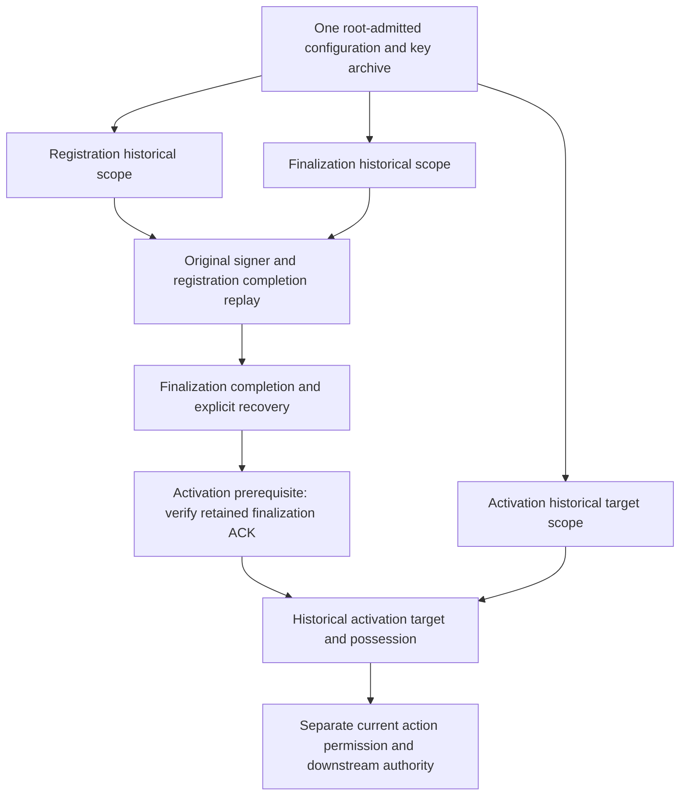

# Historical authority resolution (H05)

Implementation decision after `.218`, connected for registration in `.219`,
finalization history in `.220`, and activation recovery targets in `.221`:
reuse the existing independently
root-admitted historical archive and genuine original replay. Do not create a
second trust catalog, infer retired keys from stored records, or weaken a
current-source equality check to an unverified list of source labels.
H05 remains open. The [registration recovery connection](control-plane-registration-historical-recovery.md)
now supplies independent historical configuration/key authority through the
actual completion action under the supported source contract. The
[finalization recovery connection](control-plane-registration-finalization-historical-recovery.md)
extends this rule through nested registration evidence, finalization completion
and the finalization prerequisites of activation. [Activation recovery](control-plane-oidc-session-activation-history.md) now joins
historical planner/caller originals and retained release intents to independently
archived authority when deriving its target and old-token possession. Downstream
completion, consume, proof, grant and release authorities still need their own
historical joins. Explicit older-source replay implementations also remain open.

## Existing components and the actual gap

`authority_historical_archive.py` verifies a current-root-signed archive of
original configuration envelopes, artifact packages/trust states and attestation
cohorts. It freezes admitted snapshots, bounds the archive to 4 MiB and sixteen
historical entries, and meters selected-snapshot capture on request work. Its
existing [historical plan lookup](authority-historical-replay.md) supports
configuration and key changes under the supported source contract; it does not
provide arbitrary old-binary compatibility.

The generic archive uses each historical configuration root during admission
but does not retain it in its frozen snapshot. The new operation-specific cold
material retains that independently authenticated root and the enrollment
originals; it never recovers authority from a later journal record.
Parent bootstrap v17 connects registration inventory to `_EnrollmentMaterial`;
v18 adds optional finalization inventory and v19 adds optional activation
inventory against that **same** archive and its independently authenticated roots.
Older schemas leave the corresponding history
lane disabled. Null is explicit disablement, not archive discovery or fallback.
The existing sealed parent bootstrap is also capped at 4 MiB: archived originals
must fit that aggregate, not acquire a second allowance. Its generation summary
does not carry the complete historical archive admission interval, so that
provenance must be supplied through genuine cold admission rather than invented
from a record timestamp or the current clock.

Historically, registration recovery obtained `payload`, `configuration_digest`,
`generation`, `runtime_role_identities`, `root_public_key` and caller/grant/state
enrollment originals only from the **current** cold owner. The enabled resolver
now selects independently archived values for original verification and keeps
current permission/transport separate. The retained pair still requires the
supported source revision. Finalization now selects its archived scope separately
from the nested registration evidence scope. Activation's target and possession
inspection likewise selects explicitly enrolled archived scopes; its downstream
effect and release authorities still retain current-cohort restrictions.
Preserving an old source label alone does not close those joins.

The existing genuine replay entry points are reusable:

- `authority_webauthn_registration_signer_history._verify_subject_on_configuration`
  authenticates the original signer request/response and derives the subject.
- `authority_registration_history_exchange._verify_on_configuration`
  authenticates the original planning/caller/grant exchange using independently
  supplied configuration, root and three enrollment originals.
- `control_plane_registration_recovery_subject._replay_on_owner` is the first
  public-workflow consumer to connect to independent historical resolution.
- `control_plane_registration_finalization_completion_subject._inspect_material_on_owner`
  now connects the actual finalization consumer, including nested signer/evidence
  replay and independently pinned pending/packet/authorization identities.

## Implementation and remaining sequence

Steps 1–3 are connected for registration evidence/completion in `.219`, including
the real producer, startup, bounded loader and public recovery continuation.
`.220` advances step 4 through finalization and its activation prerequisites;
`.221` adds the two actual activation recovery target/possession consumers.
Downstream activation history and step 5 remain open. None is runtime-verified.

1. Cold-admit the operation-specific historical enrollment originals alongside
   their exact configuration/root/cohort inventory. Bind the inventory to the
   current independently admitted startup scope and its nonrenewing lifetime.
   Retained request data may select an admitted entry, never enroll one.
2. Bound the complete selected association and held enrollment/configuration
   representations before reading or copying their bodies. Preserve the
   existing original bytes and source labels; a new work object must not reset
   the caller's cumulative allowance.
3. Resolve the admitted historical scope, authenticate the original controls,
   and genuinely replay the signer and exchange semantics. Cross-check the
   independently derived user, session, operation and request before returning
   subject observations. Present actor permission remains a separate decision.
4. Connect the same authority rule to finalization and activation recovery,
   including nested evidence and completion originals. One registration-only
   consumer is not H05 completion. Finalization now uses independently selected
   old enrollments/root and pending/packet/authorization pins through completion
   recovery. Three activation prerequisite readers verify that finalization ACK
   with the same historical pins. Activation's pre-intent target now verifies
   old planner/caller originals, while its retained-intent target verifies the
   old intent and possession under a separately selected archived enrollment.
   This does not authenticate downstream completion, consume, proof, grant or
   release policy under current keys.
5. Admit older source revisions only through explicit versioned replay code
   covering their original schemas and semantics. Unsupported revisions and
   unknown or ambiguous cohorts continue to fail closed. Do not rewrite signed
   source fields, mutate a global source constant, or reuse current pins as a
   compatibility shortcut.

Historical validity is evaluated against the authenticated original intervals;
current processing retains its actual live clock, inherited deadline and current
archive authorization. Recovery does not renew an original grant, activate an
old generation, retry uncertain SQL, or establish present witness currentness.
Use the genuine historical enrollment verification path for expired originals;
do not disable expiry checks in a live enrollment admission function.

Source closure requires the real startup-to-consumer joins above. Frozen
verification must subsequently exercise retired-key/configuration transitions,
supported and unsupported source revisions, ambiguous/missing inventory,
mixed-cohort originals, expiration, interrupted recovery and denial controls.
No build, execution, provisioning or production acceptance is claimed here.

## Finalization-to-activation boundary

Retained headers locate admitted entries; signatures and complete semantic replay
establish their meaning. The finalization inventory supplies no second root or
trust catalog, and remains inside the parent bootstrap's 4 MiB aggregate limit.
Its bounded combined read reserves the held parent, archive/enrollments, replay
representations and future completion response before reading the first body.

Consumers keep the full same-call result guard until the finalization ACK has
been verified. Activation prerequisites then retain only copied subject scalars
and a narrow cold-owner/archive/time continuity guard before dropping replay
originals and loading the next stage. Merely deleting tuple aliases would not
release bodies still captured by a bound result method. This continuity function
is not replay evidence or permission and is never accepted as an external input.

V19's activation inventory retains genuine original planner/caller/consume/intent
configuration, not private keys or live permissions. Cold historical planner
admission uses an actual current startup-processing window; an archived issued
time never becomes the present clock. The original planner interval must still
fit the selected archive entry, and startup checks current archive authorization
again before private-key intake. Normal live admission is unchanged.

Both target paths reserve archive/configuration captures before retained body
reads, authenticate the original controls and bind the exact historical subject
and possession. The retained-intent selector accepts an explicit remaining cap,
and its resulting reservation survives actor admission, acquisition and delivery
checks. A verified historical target is not an old permission, proof of current
completion, or authority to reissue a token. The remaining downstream authority
joins must be implemented rather than silently borrowing current pins.
