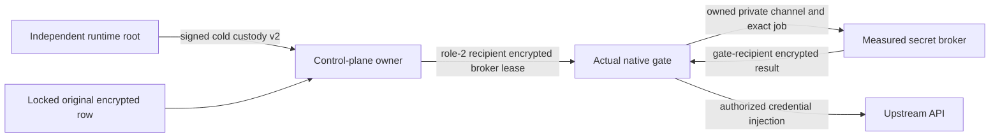

# Ciphertext-only credential delivery

This is the control-plane producer for the measured enclave broker. It does
not establish an executed enclave, provision KMS, replace the complete release
chain, or finish measured OAuth issuance and refresh. Source is unbuilt and
unexecuted; do not treat these contracts as pilot acceptance.

## Actual delivery boundary

The root-signed cold configuration selects `enclave-ciphertext-rows-v1`.
An HTTP request, successful quote or copied configuration value cannot select
it. `controlPlaneCustodyStartup/v2` retains the existing ten startup fields and
adds `credentialBrokerProfile` and `signature`. The signature covers every
other field as canonical ASCII JSON, prefixed by the purpose-specific byte
domain `serverware/control-plane-broker-startup/v1` followed by NUL.

The genuine startup client first admits its existing runtime-root signature,
attestation, process identity and inherited FD inventory. It then verifies the
broker authorization using that actual retained root key and the same source
revision/configuration digest. The root-owned fully sealed memfd, journal
directory identity, exact UID/GID, one-shot startup and shutdown/fork refusals
remain mandatory. No new key or trust selector arrives from the browser.

The purpose-fixed offline producer is
`scripts/authority/sign_control_plane_broker_startup.py`. It accepts
`--configuration` (an independently prepared canonical custody v1 document),
`--runtime-root-private-key` and a new `--output` path. Inputs are bounded,
owner-controlled regular files; key permissions are private. Existing outputs
are never overwritten. Provisioning must independently deliver the resulting
document through the existing sealed-FD path. The root key never belongs in
the control-plane service. This tool has not been executed for this source.

## Separate wire families

| Original purpose | Broker request | Encrypted result |
| --- | --- | --- |
| Generation metadata | `nativeBrokerCredentialLeaseRequest/v1` | Broker envelope/set v1; unchanged metadata entry |
| Genuinely uncontrolled dispatch | Same v1 | Broker envelope/set v1; ciphertext-only dispatch entry |
| Controlled dispatch | `nativeBrokerCredentialLeaseRequest/v2` | Broker envelope/set v2; actual native request/release authority |

All family names have the `serverware.` prefix. The outer
`nativeCurrentCredentialLeaseRequest/v2` and matching envelope v2 bind the
original inner broker request to the current measured holder. Old outer v1,
old native, policy-aware and legacy families are neither reinterpreted nor
fallbacks. Existing native authority/release formats remain exact.

Recipient verification independently selects
`nativeBrokerCredentialRecipientExpectations/v1` with
`leaseRequestProfile: serverware.nativeBrokerCredentialLeaseRequest`. The
existing CLI digest pin, genuine role-2 quote, original release/PCR/TLS/key and
full request binding still apply. Ordinary native expectations do not admit
broker requests. X25519/HKDF/AES-GCM retains its existing recipe; the explicit
broker API label changes the authenticated AAD rather than borrowing old bytes.

## No parent-side opening in this lease path

The broker dispatch branch never calls the old runtime secret cache,
`credential_lease_snapshot`, `load_master_key`, or `material.current`.
`credential_ciphertext_snapshot` holds the existing real credential mutation
lock and reads ciphertext, generation and metadata from the same row. Current
holder, route policy, one-use issuance, recipient nonce, expected generation,
metadata hash and original reservation/lease expiry checks remain in place.

A dispatch entry replaces `secret` with two mandatory fields:

- `encryptedCredential`: exactly `credentialId`, `credentialVersion`,
  `secretKekId`, `encryptedDek`, `secretNonce`, `secretCiphertext`,
  `secretUpdatedAt`, preserving original at-rest strings.
- `storageMetadata`: the untouched stored JSON **string**, not a normalized
  object. It is at most 32 KiB UTF-8, strictly parsed with duplicate and
  nonfinite-number rejection, and travels only inside the encrypted set.

String transport preserves allowed finite custom metadata numbers across
Python/Rust canonicalization. Public metadata responses remain unchanged.
Neither confidential field is written into issuance audit events.

At-rest material must use the actual `envelope:v2` storage marker. Nonces are
12 bytes, the wrapped DEK is 48 bytes, and the secret ciphertext is at most
1 MiB plus its 16-byte tag. Shared transport readers accept canonical padded
URL-safe base64 from native writers and canonical unpadded URL-safe base64 from
the ordinary Python envelope writer. Partial or surplus padding, nonzero unused
pad bits and other alternate encodings are refused. The original versioned
strings are not rewritten; native creation/refresh admission codecs and writers
remain unchanged. No legacy encrypted-secret fallback exists.
The recipient must authenticate the original credential/version AAD, actual
assigned KEK and retained request scope before decrypting or using any secret.

For enrolled OAuth, the control plane retains the actual application owner,
generation head, currentness and incomplete-refresh fence without opening token
material. The broker must check token/application association, Bearer type,
scopes and access/refresh expiry against the original storage metadata before
returning access-token-only material encrypted to the gate. A due refresh is
currently refused in this profile until measured provider refresh is connected;
it cannot fall back to control-plane decryption or provider contact.

This does not assert that every control-plane operation is now secretless.
Measured provider issuance/refresh, immutable helper/image packaging, actual
KMS recipient custody, complete native startup integration and consolidated
runtime acceptance remain required for the full production goal.
