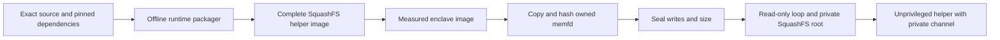

# Measured broker runtime packaging

The default decision-gate production image selects a native-only entrypoint.
It cannot fall through to the host/development proxy when configuration is
missing. The old `production-decision-gate` Docker target remains an explicit
migration artifact, not the default production target.

This is source implementation, not a built image, accepted release or deployed
pilot. Actual EIF construction, independently reproduced measurements, signed
release/configuration admission, startup artifact delivery and Nitro/KMS tests
remain required. A local build manifest cannot supply independent authority.

## Why a sealed SquashFS image

Nitro boots the application filesystem from its measured ramdisk, not a host
disk. The published AWS x86-64 bootstrap
[kernel configuration](https://raw.githubusercontent.com/aws/aws-nitro-enclaves-sdk-bootstrap/main/kernel/microvm-kernel-config-x86_64)
enables loop devices and SquashFS, but disables EROFS and fs-verity.
The broker therefore uses a distinct `sealed-memfd-squashfs-v1` owner. Existing
host-side EROFS/fs-verity owners and their guarantees are unchanged.

At runtime the actual native owner copies the full bounded image, checks its
independently admitted SHA-256 and installs/checks all four memfd seals:
write, grow, shrink and seal. It retains the readonly loop's exact backing
device/inode, zero offset and full size, plus its private readonly mounted root.
The helper executes the held interpreter inside that root, with no writable
overlay or host import paths. Hashes and a readonly mount alone are not Nitro
provenance: genuine NSM quotes and independent release/KMS admission remain
mandatory.

## Closed build inputs and outputs

The production Dockerfile consumes its verified source archive and hash-locked
Python wheelhouse. The pinned Python 3.11 image supplies the actual interpreter,
libpython, standard library and extension modules. Only locked `cryptography`,
`cffi` and `pycparser` distributions enter the helper's normal site-packages,
together with purpose-fixed Serverware helper/CMS modules. Package metadata
and licenses travel with those distributions.

`scripts/package_native_broker_runtime.py` runs only in the offline build stage.
It records and copies the actual loader and recursively resolved shared-library
dependencies of every admitted ELF file. Wheel-relative layouts are preserved.
A root-specific loader cache closes `/usr/local/lib` resolution. No external
host loader/library graph, `PYTHONPATH`, shell, pip or build tool enters the
helper root. CPython remains a measured general-purpose interpreter, not a
proof of language-level isolation.

The image producer uses the checksum-pinned Debian SquashFS tool from
`production-dependencies/native-broker-linux-amd64.sha256`: one worker, gzip,
fixed timestamps and root ownership, without append, xattrs or recovery.
See its [documented options](https://manpages.debian.org/bookworm/squashfs-tools/mksquashfs.1.en.html).
The [snapshot candidate producer](production-dependency-snapshot.md) carries
these tool packages into the same unpublished candidate as Python and Rust
dependencies; it does not publish or accept that candidate.

| Artifact | Fixed location |
| --- | --- |
| Broker filesystem | `/opt/serverware/native-broker-runtime.squashfs` |
| Build inventory and expected pins | `/usr/share/serverware/native-broker-runtime.json` |
| Native-only entrypoint | `/usr/local/libexec/serverware-native-enclave-entrypoint` |
| Interpreter inside private root | `/usr/local/bin/python3.11` |
| Helper inside private root | `/opt/serverware/serverware/native_secret_broker_helper.py` |

The manifest lists each packaged file's path, mode, size and SHA-256, the source
manifest digest and image/interpreter/helper hashes. Its `helperImage` object
is the exact five-field input for independently admitted native startup v5.
`releaseAuthority` is always false. The `native-broker-runtime-artifact` target
exports these same two outputs without mounting the image or starting custody.

## Startup boundary and remaining acceptance

The entrypoint starts as UID/GID 0 inside the enclave, checks the local NSM
character node, ensures root-only loop-control, clears the environment and
execs the fixed gate with `--native-enclave-startup`. It accepts configuration
and launch artifact flags/pins, not an executable or arbitrary command.
The real parser requires v5 before constructing broker and measured audit
owners. Local device checks are only early refusal, never attestation.

The broker constructor needs mount/device and privilege-drop capabilities.
The helper drops groups, capabilities and UID/GID, disables dumping and uses
only the inherited anonymous channel. Private keys are generated inside that
helper; no key, provider token or host socket is baked into the image.
The gate itself still retains its initial privilege in this source checkpoint;
steady-state gate privilege separation remains an N06 hardening requirement.

Frozen verification must check actual kernel features, recursive loader/import
closure, reproducible image bytes, refusal without v5/NSM, memfd/loop/mount
association, child isolation/cleanup, real KMS recipient decryption and
permitted/denied/revoked requests with audit delivery. The source changes do not
establish those runtime results. Measured OAuth issuance/refresh and remaining
credential custody connections are still required for complete N06.
