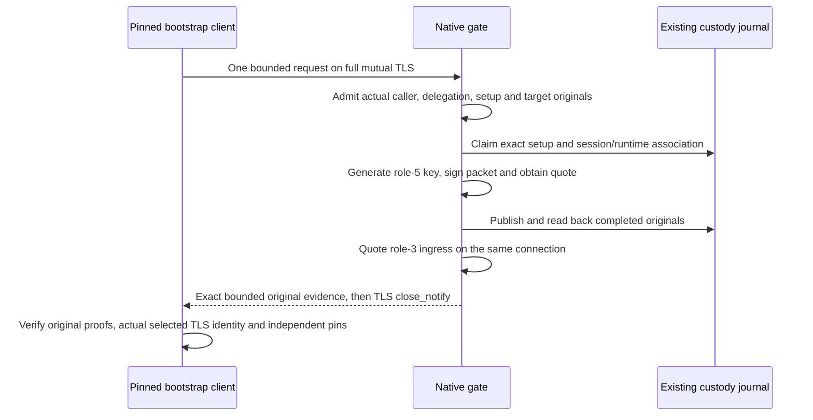

# Native bootstrap evidence exchange

This is the original-evidence exchange for enrolling ordinary services,
applications and agents. It connects an already authenticated bootstrap caller
to a prospective target workload without demanding that target's first client
certificate. It does not issue a workload certificate, install a CA, change
egress policy or return an actionable production receipt.

The implementation is source-only: it has not been built, exercised or accepted
on Nitro hardware. The full production acceptance gates remain separate.

## Fixed request

The native proxy reserves `POST /_serverware/native-enrollment/bootstrap` for one
bounded HTTP/1.1 exchange on the caller's actual mutual-TLS connection. The path
does not fall back to development enrollment, management authorization or
ordinary upstream proxy dispatch. Full caller policy, separate delegation and
independent setup authorization are required before signing. The challenge
header uses the existing raw32, canonical unpadded-base64url ingress challenge;
it must agree with the signed delegation and actual TLS exporter binding.

The [request schema](../schemas/native-enrollment-bootstrap-request.v1.schema.json)
has exactly these fields:

| Field | Meaning and decoded limit |
| --- | --- |
| `apiVersion` | `serverware.nativeEnrollmentBootstrapRequest/v1` |
| `delegationBase64url` | Exact independently signed caller-to-target delegation, 32 KiB |
| `setupAuthorizationBase64url` | Exact separately signed setup authorization, 32 KiB |
| `targetRequestBase64url` | Exact target request containing CSR and proof of possession, 64 KiB |

The request is canonical sorted ASCII JSON with exactly one final LF, at most
192 KiB including that LF. Base64url is canonical and unpadded. Unknown or repeated
fields, nested containers, escaped spellings and alternate JSON formatting are
refused. Components remain original bytes; decoding alone authenticates nothing.
No key, endpoint, replacement policy or issuer trust root is selected by this body.

## Original ownership and delivery

The server's original process/clock/deadline starts before TLS and HTTP intake,
including any prefetched body, and survives admission, signing, quotation,
assembly and bounded delivery. Other proxy routes drop the unused bootstrap clock
without changing their own deadlines. The actual
policy, trust and identity owners remain retained during the private cryptographic
operation. Final delivery keeps genuine admission checks; a later failure does
not undo a durable claim or completion. Deadline checks do not interrupt blocked
kernel, NSM or filesystem calls; an outer watchdog remains necessary.

Role-5 signing and durable readback precede the new role-3 session quote. Therefore
a later quotation or delivery failure can leave completed signing originals even
when the client received no usable response. There is no automatic retry,
re-signing, claim reset or inferred rollback. A new connection changes the
operation's exporter association; explicit cross-session recovery remains open.

The response is the unchanged eight-field
[bootstrap evidence original](../schemas/native-enrollment-bootstrap-evidence.v1.schema.json),
at most 1 MiB including its final LF. It contains the exact packet, session
evidence, signature, public key and quote. `okForAction` remains `false`.
The [original receiver](native-enrollment-bootstrap-verification.md) authenticates
those inputs independently; server success status is not an attestation verdict.

## Fixed client and packaging

The [single-purpose client](native-bootstrap-client.md),
`serverware-native-bootstrap-client`, uses a pinned configuration and literal
endpoint. It verifies original startup evidence
before acquiring the client private key or contacting the network, builds and
retains the reviewed TLS configuration, and tracks the actual selected client
certificate. It permits no DNS lookup, redirects, retries, resumed/early-data
handshake, arbitrary HTTP dispatch or CONNECT continuation.

Its explicit pre-pinned challenge must already agree with the signed delegation;
it is not learned from the response or replaced with a new invocation's random
value. Possession of a challenge pin does not independently establish freshness.
Original setup/delegation lifetimes, quotes and actual connection binding remain
mandatory. Both public authorizer roots, caller and target identities, target
nonce and target-request hash are independently selected, not supplied as trusted
values by the response. The received packet must also retain the exact request
originals sent by this invocation.

The original at-most-30-second client budget includes configuration reads, key
acquisition, connection, HTTP, proof verification and guarded local output. Each
direction has a fixed 2 MiB encrypted transport ceiling, reserving room for the
1 MiB response plus HTTP/TLS framing. The smaller legacy ingress-client ceiling
is unchanged. Exact HTTP body framing and authenticated TLS EOF are required;
a bare TCP close is not success. The resulting public capture and verification
diagnostic are not an installation capability or production receipt.

The production Dockerfile includes the new binary in its frozen static build,
checks dynamic-interpreter/dependency absence and a 64 MiB file ceiling, provides
the `native-bootstrap-client-artifact` export stage, and declares installation at
`/usr/local/libexec/serverware-native-bootstrap-client`. These are packaging
declarations, not evidence that a binary or image has been built or deployed.

## Still required

Separate issuer grants and actual issued-leaf/full target-policy admission,
protected installation reservation and token possession, observed namespace and
network ownership, scoped CA installation, proxy egress and canaries remain
unfinished. Signed public setup associations do not prove those effects. Local
filesystem claims/readback do not supply independent rollback witnessing.
Dependency/release provenance, independently operated trust services, measured
Nitro/KMS custody and consolidated exact-source verification remain mandatory.
