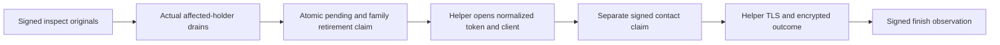

# Measured staged-pending credential retirement

This source slice joins a distinct pending-retirement purpose to the native
gate and its retained encrypted-secret helper. The companion
[controlled-writer kernel](measured-pending-family-retirement.md), complete
family admission, actual holder coordination and
[staged-original binder](measured-pending-retirement-originals.md) are integrated
in source. This is not a built, deployed or runtime-verified release.

## What it retires

The target is a known-subject, normalized pending credential produced by a
successful measured OAuth exchange and Stage. It is neither a refresh work item
nor an active credential. Its pending ID does not create a currentness root.
The grant pins the exact exchange, measured custody, initial and current pending
rows, Stage arguments, normalized ciphertext and normalized token commitment.
The earlier minimal issued-token capture has a different commitment and is not
substituted for the normalized material.

An independent purpose-specific authority must authorize provider-family
retirement, including its external-family scope and the complete affected
active-credential population. The native assignment selects `pendingIds`, not
`credentialIds`. Every affected active lineage uses its own genuine currentness
root and completed holder drain. More than 24 affected lineages is an explicit
capacity refusal; no prefix, omitted holder or partial family is accepted.

## Retained operation

Inspection validates public and encrypted originals only. The helper opens no
pending token or client material until the authenticated claim receipt joins
the exact pre-claim pending row, affected-row list, barrier vector and owner
nonce. The writer's claim must atomically fence that pending row, family and
every affected active credential. Each individual provider request additionally
requires its exact contact claim before any TLS byte is sent.

Google selects one token purpose; X can require two. The helper retains one
operation deadline, burns each contact before sending, and encrypts the complete
received response before requesting finish. Accepted, rejected and unknown are
observations, not proof that all external copies are invalid. Failures poison the
actual owner; there is no request resubmission or plaintext fallback.

Recovery uses a separately fresh current assignment admitting the exact old
authorization hash. It reads authenticated observations only: it cannot open
the token, contact a provider, reopen a fence or renew the old operation.

## Explicit startup and custody

`--native-measured-pending-retirement-startup-v13` selects
`serverware.nativeStartupConfiguration/v13`; the enclave image selector is
`--measured-pending-retirement-v13`. It retains every v12 owner and adds the
required `measuredPendingRetirement` configuration. Earlier profiles and the
default v6 selector are unchanged; missing material does not enable a fallback.

The separate configuration admits up to 16 selected targets and one or two
provider applications. Applications contain encrypted client material, exact
enrollment originals, TLS roots and sorted pending IDs. Authority configuration
roots, independent retirement grant roots, native keys and role signing keys
retain their separate identities and signature domains.

Only the actual private broker reply can construct the Rust preparation accepted
by `sign_native_pending_retirement`. The retained native key signs the distinct
statement and obtains a fresh purpose-bound quote. Imported/UDS custody cannot
sign this purpose. The helper independently verifies the exact controlled-writer
request, response, authority configuration, assignment and grant originals.

The same encrypted service-token owner supplies the existing credential-service
HTTPS origin and token; the distinct endpoint is
`/api/data-plane/oauth-pending-retirement`. Provider relays carry TLS ciphertext
only. The helper channel remains serialized with issuance, refresh and refresh
cleanup, using the current operation's original deadline throughout. No broker,
identity or currentness mutex is held while waiting on the control plane's
holder-drain coordination.

## Evidence still required

The native [configuration schema](../schemas/native-oauth-measured-pending-retirement.v1.schema.json)
and [startup schema](../schemas/native-startup-configuration.v13.schema.json)
describe data, not permission or execution evidence. Cold selected targets do
not implement every background lifecycle scheduler.

Pre-subject captured-token cleanup, setup/reconnect successors, historical
currentness migration and broader lifecycle orchestration remain separate
required work. This slice does not provision Nitro/KMS, independent signers,
assignments, provider applications or witnesses.

The consolidated post-freeze verification must exercise real staged originals,
normalized-vs-minimal substitution refusal, complete zero/one/24-lineage claims,
over-capacity refusal, missing/changed barriers, wrong grant/assignment purposes,
expired owners, uncertain contact outcomes, exact finish/recovery originals,
cross-purpose helper interleaving, old-profile compatibility and the full v13
startup lifetime. No build, parser, test, runtime or provider call ran during
this source-only implementation and integration.
