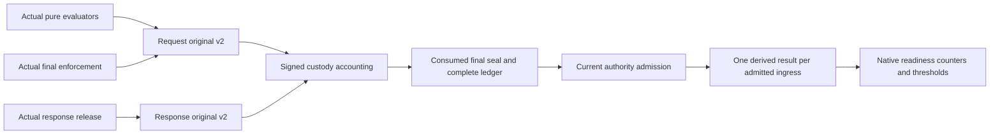

# Native observation assembly

This is source wiring, not an executed pilot or production acceptance. Broad
testing remains deferred until the connected pilot batch is assembled.

The actual pure evaluator now retains a credential-free dispatch projection:
rewritten method/target components, stripped forwarded-header and body
commitments, classified principal/route/operation, credential slot and injection
policy. Denied plans retain an explicit no-dispatch outcome. There are no raw
credentials, request headers, query values or bodies in this document. It is
not a dispatch capability and does not contain a resolved credential version.
Actual response constraints use the signed classifier's finite-number canonical
transcript, not a policy-plan hash presented as a different semantic digest.

The real release transaction retains the entity hash/length, status and final
physical Content-Type state only after immutable retrieval, strict HTTP parsing,
inspection, final-envelope, reflection and durable completion checks. Duplicate,
non-ASCII or oversized media declarations remain unavailable for comparison.
This does not alter old HTTP acceptance. `native-immutable-exact` describes the
actual release provenance, not an inferred adapter transformation.

`authority_transition_policy_canary_native_detail.py` consumes the freshly
re-admitted complete checkpoint inside the fixed protected readiness transition.
It joins every opening to its unique actual enforcement and evaluation originals;
dispatched requests also require their genuine response original. A sampled-out
request requires both its signed assignment decision and matching signed
exclusion event. Missing details, failures and unsupported ingress are not
silently excluded. The original verifier's admitted data is reused internally,
not accepted as a caller-supplied verification flag.

Each result is explicitly bound under
`serverware.nativePolicyObservationResult/v1`, with actual receipt and source
original hashes, compiler-analysis identity and full semantic result. This is
derived evidence, not a newly invented Fleet signature. Current compiler roots,
complete policy classes, approved pilot membership, expansion cells, response
obligations and actual latency samples remain required. Native comparisons can
represent accepted responses whose actual outputs differ; the readiness
thresholds still reject divergence and noncomparable observations.

The [semantic and pilot-inventory guide](native-observation-semantics-and-pilot.md)
describes the exact membership roots, explicit compiler-analysis successor and
purpose-fixed offline publication command. Its signing key is supplied by an
independently provisioned operator; the command does not generate authority.

Request/response original v1 and legacy Fleet profiles retain their strict
contracts. Only selected native detailed delivery emits original v2. Native
approval/publication, remaining receipt/proof services, independent provisioning,
enrollment, final Setup and end-to-end acceptance are separate unfinished work.

At the frozen pilot checkpoint, build the exact combined commit once and run
the sequential acceptance pass against it: ordinary allow/deny credential use,
signed sampling exclusions, equal and divergent released responses, missing
evidence refusal, and the real approval/publication journey. Historical test
results do not validate this source revision.
