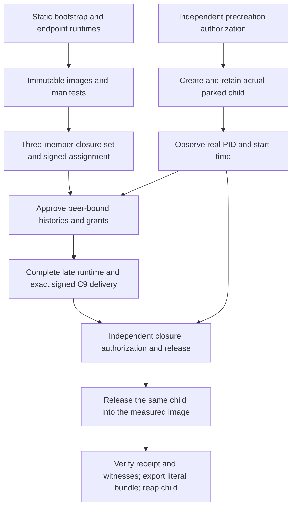

# Acyclic cold commissioning

The original cold coordinator embedded the complete runtime in its immutable
image. That runtime contained the assignment hash, but the assignment committed
the image manifest through its closure set. No producer ordering could satisfy
that hash cycle. It also embedded ordinary-service histories naming the actual
coordinator child before the old controller had created that child.

The explicit successor separates static image measurement from later runtime
authorization and retains a genuinely parked child before accepting its late
inputs. This is a source integration, not evidence of a deployed ceremony.

## Dependency order



The diagram describes dependencies, not permission to self-approve them. The
operator must supply independently approved originals and real retained
resources. A PID observation is not readiness, attestation, a running service
or authorization to release the child.

## Closed profile selection

| Document | Explicit successor | Unchanged boundary |
| --- | --- | --- |
| Cold closure set | `nativePublicationGenesisClosureSet/v2` | Same three ordered roles; distinct leaf, set and seccomp domains |
| Coordinator image manifest | `nativeCustodyExecutionClosure/v2` | Measured static bootstrap, not complete operational runtime |
| Live closure and member authorization | `nativeCustodyClosure/v6` and `nativeCustodyClosureAssignment/v6` | Exact role, assignment, guest, manifest and both set roots |
| Coordinator runtime | `nativePublicationGenesisCoordinatorRuntime/v2` | Complete original remains signed and hashed in C9 |
| Unsigned static preparation | Preparation/v3 | Explicitly selects only the new cold set |
| Assignment authority input | AuthorityInput/v3 | Explicitly selects only the new cold set; signed assignment wire stays v2 |
| Adoption authorization | `nativePublicationAdoptionAuthorization/v2` | Separate signature domain; requires cold Runtime/v2 |
| Keyless adoption validator | Input/v2 and result/v2 | Exact input/payload pairing; still cannot sign or create owners |

The coordinator image contains only the canonical two-field document:

```json
{"apiVersion":"serverware.nativePublicationGenesisBootstrapRuntime/v1","purpose":"measure-publication-genesis-before-runtime-admission"}
```

It contains no assignment, current runtime, future process or grant hashes.
The coordinator's full late runtime is a distinct retained original, never
relabeled as that image file. Its exact hash, real guest association, current
trust and original authorization windows remain checked. The two native
endpoint image runtimes stay static: their assignment-dependent service grants
are separate launch inputs, not embedded in their measured runtime.

Legacy cold v1 is not silently repaired or widened. The old image-bound
coordinator path remains distinct, and the ordinary bridge late-runtime path
cannot be used to impersonate the cold coordinator. Old adoption/v1 only
accepts old cold runtime/v1; new adoption/v2 only accepts runtime/v2.

## Retained process, not a predicted PID

The explicit invocation is
`serverware-native-publication-genesis-controller --parked-genesis` with an empty
environment, one root thread, descriptors 0–3 only at entry, an anonymous
nonblocking write-only stdout pipe and the real root operator's authenticated
Unix seqpacket control channel on FD3. The old no-argument mode keeps its old
launch contract and refuses coordinator Launch/v2.

The protected configuration files are
`/etc/serverware/native-publication-genesis-parent.json` and
`/etc/serverware/native-publication-genesis-precreation.json`. Parent/v1 pins
the delivery configuration and actual executable, and selects distinct
precreation and release authorities. Precreation/v1 binds that configuration,
the actual boot/time namespace, invocation and original BOOTTIME bounds.
The initial startup interval is at most 30 seconds; no later input renews it.

The new controller mode parks a real child before asking for peer-bound runtime
originals. The parent retains that child and its PIDFD, executable, control
channel and original absolute timers. A separately authorized release binds
the actual observation and the exact late launch/image inputs. It releases
the same child, not a replacement with a copied numeric PID.

The result socket pair must also originate in that actual controller. Both
ends' kernel peer credentials are checked against the controller PID, and a
challenge proves their real pair association. An externally created pair cannot
be substituted through descriptor transfer. The controller retains its pair
before observation so its actual identities can be included in the later C9
authorization; release supplies the other eight activation descriptors.

`nativePublicationGenesisParentObservation/v1` carries the actual child PID,
start time, PIDFD identity, sealed executable observation and two result-FD
identities, with the real child PIDFD transferred over the retained control
channel. `nativePublicationGenesisParentRelease/v1` is signed under its own
domain and binds the exact configuration, precreation, observation, invocation,
launch and image pins. It accompanies exactly eight other activation FDs.
An invalid or duplicate release is terminal for this owner, not a retry request.
Both signatures use the existing `policy_shadow::signature_preimage` framing
(signed-envelope prefix, named domain and canonical-profile separators), not
the older proof-cohort's bare domain-plus-payload helper. Producers for these
new precreation and release originals and the retained Python caller are in the
[next source slice](native-pilot-genesis-authorities.md); the complete
commissioning graph and live ceremony remain separate.

The child independently admits the measured image, complete C9 delivery,
closure, assignment, key material and service histories. There is no initial
receipt, policy load or publication permission manufactured by the parking
step. Original startup/lifetime limits are not renewed while waiting.

The existing cold handoff remains unchanged: actual parent-side verification,
acknowledgment and post-ACK inspection precede bundle export; successful exit
also requires actual reap. A partial bundle or nonzero exit is not success.
The actual cold core file must separately stay retained for later retrieval.

Only after the final authenticated inspection reply and handoff may the child
already be terminal. The parent still checks the original unreaped PIDFD,
start time and parent association; it does not demand continued liveness and
thereby race the expected exit. Before that boundary, live sender checks remain
mandatory. Uncertain reap or private-image detach retains the actual owner and
its original watchdog; it does not trigger a replacement child or cleanup claim.

## Verification and remaining work

Exact `b1ac17ec439782480bf92473f3a881ffdf3f1c29` passes all 49 focused Python
controls (2.690 seconds), five-file grammar and exact membership in both Make
inventories. These controls cover static profiles, roots and schema selection;
they do not authenticate real owners or execute a privileged ceremony.

Its offline native compiler check found one missing initializer in the existing
operational driver. Correction `7be9b3b7aa79371e0d38736e0405b41d1be4e157`
explicitly keeps that driver outside the genesis late-runtime profile. The
corrected snapshot passes the gate, controller and adoption-validator check in
2m01s under pinned Rust 1.88, one CPU, 8 GiB and no network. Both attempts are
retained. The seven new inline Rust controls are authored, not test-compiled or
executed. No release artifact, live ceremony, signer, cloud resource or paid test
was used. Passing Python controls were not repeated for the one-line Rust fix.

Evidence, archives, commands and checksums are retained at
`codex-offload/serverware/engineering-builds/7be9b3b7-genesis-bootstrap-F30bpC/`.
Static and compiler checks cannot establish that the privileged
park/release/receipt ceremony actually runs.

Independent cold grant/closure issuers, the complete Python commissioning
owner, actual cold-core descriptor transfer, native-validator-to-signer
ownership, provisioned services and a connected allow/deny/cleanup run remain
required. The earlier 164-job/113-selector graph does not include this ceremony.
The [cold binding producer](native-pilot-genesis-authorities.md#separate-cold-binding)
uses a distinct approved cold commitment. The hot measured-configuration recipe
still requires a real operational driver and cannot be reused by inventing a
cold driver observation.
Project checkpoints remain 36/46 source-landed and production acceptance 0/6.

See [commissioning tools](native-pilot-publication-commissioning.md),
[cold receipt production](native-pilot-genesis.md) and
[operational adoption](native-pilot-adoption.md).
