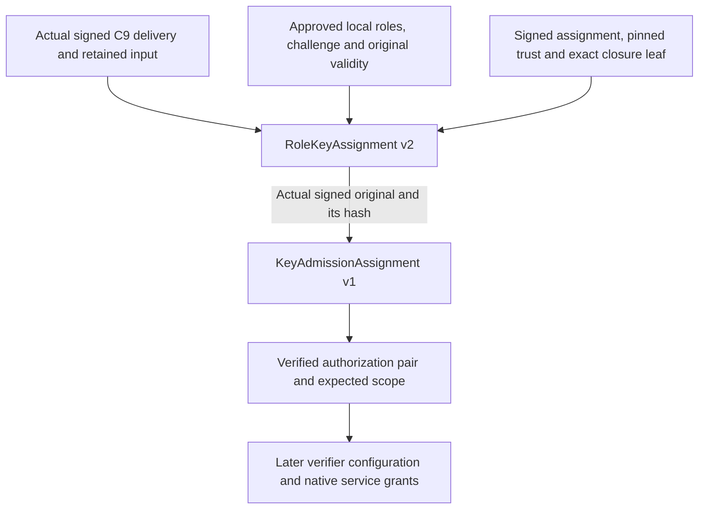

> Publication note: deployment-specific addresses, identities and paths in this document are example placeholders, not a public service or release-verification evidence.

# Native endpoint key authorizations

The `.377` source connects two genuine authorization issuers and twenty ordered
startup decisions for ten native endpoints. These prerequisites were absent
from the earlier 85-job inventory. The expanded coordinator has **105 jobs**,
of which **69 have fixed supervisor composers**; 36 existing decisions remain
unimplemented. Startup still refuses before spawn. Source checkpoints remain
**36/46**, production acceptance **0/6**; this is not a runnable pilot.

## Identity first, authorization second

The preceding [C9 deliveries](native-pilot-native-deliveries.md) establish exact
public delivery originals and Guest13 identities. For each endpoint, the
independent authority then performs this sequence:



Both authorizations use the assignment-authenticated
`custody-supervisor-capability` key. Neither the C9 delivery authority nor the
attestation verifier may substitute for it. The signed admission *result*
produced after genuine Nitro verification is a different protocol and cannot
stand in for either authorization.

The role-key payload is the existing eighteen-field
`serverware.nativeShadowRoleKeyAssignment/v2`. Its exact signature domain is
`serverware.nativeShadowRoleKeyAssignment.signature/v2`. Admission uses the
existing seventeen-field `serverware.nativeShadowKeyAdmissionAssignment/v1`
and `serverware.nativeShadowKeyAdmissionAssignment.signature/v1` domain.
Both retain the existing `{payload, signature}` envelope. The second signature
binds the SHA256 of the complete first signed original, not a predicted result.

The original signed assignment/trust must bind the complete eighteen-authority
key set. Each endpoint's closure-set leaf must match its actual observed worker
and exact runtime marker. The approved local-role subset is ordered and unique,
with the endpoint's source-required role included. No new private keys, random
challenges, observations or replacement validity intervals are generated.

## Policy and retained orchestration

Explicit commissioning policy/v8 adds only `nativeKeyAuthorizationsOriginal`
to v7's fifteen fields. The canonical ASCII fragment contains exactly ten role
rows, each with `localRoles`, `challengeBase64url`, `issuedAtUnixNanos` and
`expiresAtUnixNanos`. Challenges are nonzero 32-byte values supplied by the
independent authority. UNIX intervals must fit the authenticated assignment,
trust, keys, checkpoint freshness and assignment evidence-age limit. They do
not replace the original boot/time namespace or BOOTTIME startup/lifetime.

There are 77 purpose selectors: the previous 57 plus twenty new fixed signing
purposes. These are capability bindings, not 77 newly created private keys.
V1–v3 retain exactly 42 selectors; v4–v7 retain 57. They cannot bind the new
coordinator without explicit independent policy approval. Before any v8 key
decision, the real retained recipe supplies the authenticated supervisor key
against which all twenty added public capability pins are compared.

The twenty service jobs 43–62 are role-major pairs over the existing ten-endpoint
order: `native-role-keys-<role>`, then `native-key-admission-<role>`. The first job
opens the completed native-delivery handoff. Every continuation rechecks all
ten C9 complete inputs/results, original cohort/resource/recipe bindings and
all preceding authorization signatures. The earlier endpoint-input entry and
ordinary installer preparation at job 26 remain unchanged; only completed-owner
read-only continuations extend through job 63.

Each result is retained as `{original, sha256}` without early publication.
Downstream native service/GenerationInstall inputs and endpoint launch bundles
must contain the same actual pair outputs. At job 63 a read-only handoff returns
the ten verified literal pairs, not authority to execute that service grant.
Failure consumes the attempt; known terminal cleanup is required to retire
retained public state. The existing 128 MiB retained-byte limit is unchanged.

## Issuer input and command

`nativePilotKeyAuthorityInput/v1` has eight exact fields: `apiVersion`,
`operation`, `role`, `deliveryInputOriginal`, `deliveryOriginal`,
`recipeOriginals`, `measured`, and the selected `policy` row. Admission adds only
`roleKeyOriginal`. The complete independently approved input is bounded to
32 MiB; each signed output is at most 64 KiB. Embedded originals remain literal
canonical ASCII, not file paths or runtime templates.

The fixed issuer API is
`sign(operation, role, input_original, signing_key) -> (original, startup_deadline)`.
The protected-FD command is separate from the conductor:

```text
python3 -I -B scripts/authority/sign_native_pilot_key_authorization.py --operation role-keys --role retrieval --input-fd 3 --authority-key-fd 4
python3 -I -B scripts/authority/sign_native_pilot_key_authorization.py --operation admission --role retrieval --input-fd 3 --authority-key-fd 4
```

These are separate invocations with separately approved complete inputs; they
do not create descriptor contents or provision a key. The existing authority
I/O contract requires protected public input and a sealed private-key memfd.
The issuer checks the actual signing key, boot identity and both clocks around
validation/signing. The command rechecks FD identities and exact input bytes
around bounded, no-newline pipe output. Require complete output and exit 0;
partial or uncertain output does not permit a retry. Software key copies do
not establish hardware custody or guaranteed erasure.

## Remaining assembly

The pure pair helper returns verified `authorization`, `admissionAuthorization`,
`expectedScope`, `authorityKeys` and `trustCheckpoint`. It does not manufacture
a Nitro verifier configuration, collateral, attestation evidence or success
result. The next connected batch must combine these actual outputs with
independently approved verifier settings and operation-specific commitment,
origin, persistence and trusted-time inputs, then compose the ten native service
grants and GenerationInstall. Later launch prerequisites, remaining dispatch/
spool decisions, executable packaging, provisioning and connected application
allow/deny/cleanup acceptance still remain.

The first remaining job, CommitRequest, also requires authentic runtime identity:
its `scope.runtime.teeEvidenceSha256` is absent from the signed fleet membership
and the current pair/measured handoff. Retain independently verified actual
runtime-attestation evidence before composing this field; a chosen verifier
setting or arbitrary policy digest is not a substitute. The later generation
origin issuer consumes installed-generation/load/publication evidence and
cannot supply this earlier prerequisite. This is a source-audit finding, not
runtime verification.

## Focused verification

Exact source **`dbf915d430f66bba53a491b135d6a1577d7aa6b2`** passed one focused
Python **3.11.15** run: **79 controls** (67 prior and 12 new), grammar checks for
fourteen changed Python files, both Make source inventories and **72 relative
documentation links**. The environment-cleared command used `-I -S -B`, CPU 0,
a private network namespace and a 120-second timeout. It started at
`2026-09-30T23:18:53.981420450Z`, ended at
`2026-09-30T23:19:03.280406167Z` and exited **0**, without retry.

The new controls cover all ten complete role-key/admission payloads, exact C9
Guest13 and preceding-envelope hashes, supervisor/C9/verifier key separation,
signature domains, closed policy/input fields, original time bounds and signed
role-leaf runtime/worker bindings. The source inventory check independently
asserts the twenty job names, operation order, no-publication outputs and next
job 63. These are synthetic in-memory fixtures; unrelated assignment policy
fields remain empty. They do not prove complete native assignment admission,
real process ownership or runtime provenance.

No live issuer entrypoint, protected owner, installer or native service was
executed; no DB/app/authority-store module was imported. The retained engineering
dependency candidate is still not an approved release snapshot. Rust, schemas
and dependency lock were unchanged, so no native rebuild was repeated. No
cloud or paid action ran. Production acceptance remains **0/6**.

Durable evidence is retained at:

```text
/home/catchplate/codex-offload/serverware/engineering-builds/dbf915d4-key-authorizations-0Urfnc/
```

It contains the frozen source archive/commit, exact check and runner scripts,
complete result log, machine-readable result and verified `SHA256SUMS`. The
archive is **85,022,720 bytes**, SHA256
`be2e70b17b1053ce3d8e4bd44b27e34e5fc633ec18f69d5b9b13b1c71abddbf4`.
