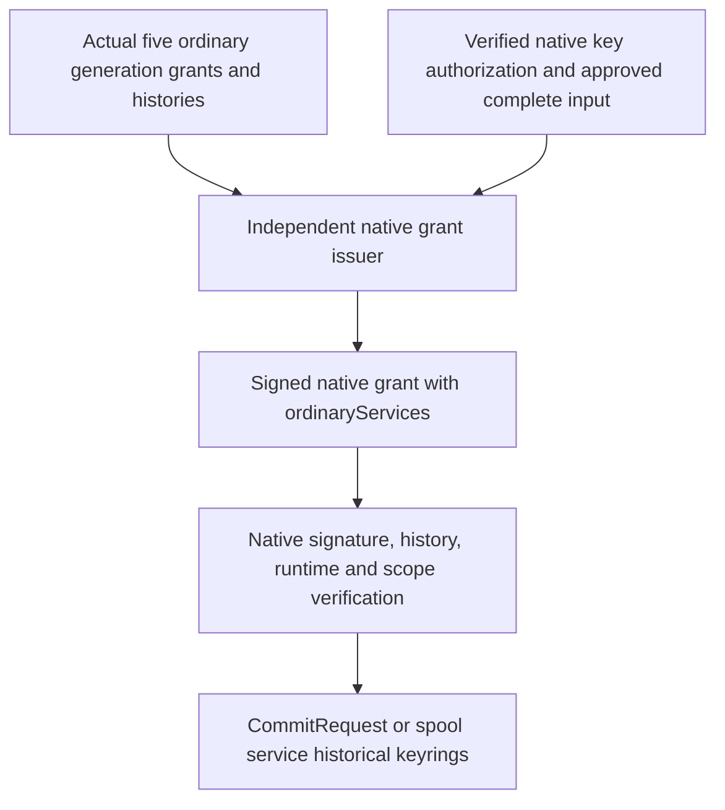

# Native operational history handoff

The `.378` batch addresses prerequisites discovered while assembling native
service grants. It does not add supervisor composers: coverage remains **69/105**
and the startup guard still refuses. Production acceptance remains **0/6**.

## Why the marker was not enough

The ten endpoint C9 deliveries bind a small, fixed runtime marker. CommitRequest
and the six spool signers previously tried to deserialize that marker as the
bridge's full production RPC configuration to obtain ordinary-service histories.
The bridge is a different process; its retained owner is not an object those
endpoints can borrow.

The explicit successor grants instead carry `ordinaryServices`, a fixed-five
map of authenticated public originals. Each row contains
`generationGrantOriginal`, `runtimeOriginal`, `historyOriginal`, `rootKeyId`
and `rootKeySpkiSha256`. These are public histories and generation grants, not
private signing keys or fabricated process owners.

The issuer's explicit `nativePilotNativeServiceAuthorityInput/v3` requires the
actual ordinary launch and complete five-service contexts. The coordinator
matches them to its earlier approved inputs and actual signed outputs. This
profile is limited to CommitRequest and the six spool operations; it does not
silently add fields to earlier input versions.
Retrieval's explicit input/v4 accepts the six actual successor grants under a
32 MiB complete-input bound and requires the same ordinary history bundle in
all six. It keeps the existing Retrieval/v4 output and signature domain;
earlier input/v1 and input/v2 retain their old predecessors and 4 MiB bound.

The seven output successors are CommitRequest/v2, ingress/v2, ledger/v3,
terminal/v2 and the three effect grants/v2. Each has its own signature domain
and closed fields. Their complete signed original is bounded to **4 MiB**;
legacy outputs retain **64 KiB**. V3 inputs are bounded to **32 MiB** while
earlier inputs retain **4 MiB**. Existing aggregate publication, channel and
retained-byte budgets still apply, so independently valid per-file maxima do
not guarantee that an entire oversized assembly fits.

Native consumers authenticate the outer supervisor signature before accepting
the selected ordinary roots, then check the actual generation/history signatures,
runtime byte hashes, peer, original guest windows and shared generation scope.
Ordinary and native invocations remain independently selected; interval
containment does not require them to have identical invocation identifiers.
The original initial-history wrapper remains intact. Legacy grants retain their
old full-RPC-runtime path; a marker is not accepted as that configuration.

GenerationInstall has the same wrapper boundary: its explicit v2 successor
retains each member's actual `runtimeOriginal` alongside its grant and history,
so the native initial-history adapter can bind the wrapper to that runtime.
Legacy GenerationInstall/v1 is not silently reinterpreted.
The [successor schema](../schemas/native-ordinary-history-grants.v1.schema.json)
describes all eight new grant versions; the native consumers still perform
signature, retained-original and live-key admission separately.
Its v2 journal selects an 8 MiB + 1,024-byte per-record bound and 32 MiB total
before any write; v1 retains 512 KiB per record and 4 MiB total. The current
issuer remains explicitly fresh-only with no supplied historical records.

## Runtime identity is a different attestation

The CommitRequest scope also needs a fleet runtime identity containing
`teeEvidenceSha256`. Signed fleet membership alone does not contain this digest.
The existing `catchplate.policyRuntimeAttestation/v2` startup receipt supplies
it under an independently pinned generation-trust issuer with the
`runtime-attestation-authority` role. The selected instance must be explicitly
approved and must match exactly one member of the authenticated assignment.
The receipt binds that member's boot, SPIFFE identity, measurement, ordinal and
complete member commitment, within its original validity interval. Its signed
`roleKeysDigest` remains an opaque assertion, as in the existing native join;
it is not claimed to equal the assignment's different key-set root.

This is the fleet's runtime identity, not the custody driver's invocation hash
or the endpoint's Nitro key-admission result. No attestation digest is invented
or inferred from a local process. The native startup receipt now uses the actual
SPIFFE parser: the previous generic token check rejected the slashes required
by every valid `spiffe://` identity.

The explicit v3 CommitRequest input includes that closed `runtimeEvidence`
fragment and the actual signed `assignmentOriginal`. The issuer derives the
runtime from these originals and requires equality with the requested scope.
The coordinator also requires the same assignment original retained by its
earlier native key-authorization input.

The authentic receipt and independently approved generation trust still need
to be supplied by the real attestation authority. Local synthetic signatures
cannot establish hardware verification or provision that authority.

## Remaining work and verification

Finish the native verifier/input composers and the eleven service-grant
supervisor decisions, then dependent dispatch/spool and launch inputs,
supervisor packaging, independently approved dependencies, provisioning and
connected application allow/deny/cleanup acceptance. All original production
requirements remain open where no independent evidence exists.

### Focused verification

Native source `03d4075d` passed the cached, offline Rust 1.88 check of
`catchplate-decision-gate` (exit **0**, compiler-reported **1m 01s**). Its
**312 library / 2,449 binary warnings** remain in the retained log.
Python source `efccf551` passed **99 focused Python 3.11.15 controls**, seventeen
Python grammar/both Make inventories, thirteen native/schema inventory entries,
**55 relative links** and **1,175 local schema-reference joins** (exit **0**).
Only Makefile differs between those sources; runtime/native/schema/lock inputs
are identical. Two earlier inventory checks exited **1 before tests ran**:
the GenerationInstall input module, initial-history adapter and startup-receipt
module needed existing-source inventory entries. Both snapshots and logs remain
available rather than being discarded as successful runs.

The Python run used an environment-cleared, CPU-0 private-network invocation;
the compiler used a network-none, read-only, one-CPU/8-GiB container. Both reused
unpublished engineering dependency candidates. Controls use synthetic public
contracts/signatures; the ten history-grant tests are shape controls, not
signature admission. Schema-reference joins are not full semantic validation.
No real protected owner, issuer command, installer, service, cloud or paid action
ran. These results are not hardware, deployed-pilot or production acceptance.

Exact source archives, commands, failed and successful logs, `result.json` and
verified `SHA256SUMS` are retained outside disposable scratch at
`codex-offload/catchplate/engineering-builds/03d4075d-operational-histories-K1NmLz/`.
