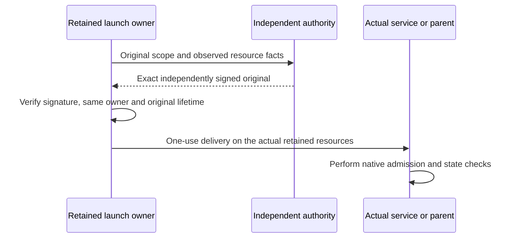

# Independent signed inputs for pilot launch

The pilot's real resource owners can now consume signatures produced outside
the launcher process. They do not need an independent authority's private key
to admit those inputs. This `.353` source connection is not a running conductor,
deployed signer, completed launch or accepted pilot.

The existing signing APIs remain available to independently installed producers.
Their wire formats and signature domains are unchanged. New receiving methods
verify the exact signed bytes and join them to the **same live resource owner**;
they do not recreate ownership from a JSON observation or sign a replacement.

## Actual receiving APIs

| Retained owner | Input path | What is bound |
| --- | --- | --- |
| `GenerationInputs` | `admit_delivery(role, signed_delivery_original=...)` | Cold C9 authority, exact allocated activation descriptors, invocation, boot and original startup/lifetime; actual runtime and credential originals are retained before publication. |
| `GenerationInputs` | `admit_grant(role, signed_grant_original=...)` | Existing C9 delivery, runtime, pinned history-root key and generation scope; the original is written to the already allocated memfd and sealed once. |
| `PersistenceInputs` | `admit_delivery(signed_delivery_original=...)` | Actual listener, durable journal, held lock, cold authority and the original cohort lifetime. |
| `PersistenceInputs` | `admit_service_grant(signed_grant_original=..., configuration_original=..., configuration_sha256=...)` | Retained guest, independently supplied genesis/journal, scope and peer; genuine authorization verification selects the independent supervisor key, distinct from the C9 authority. |
| `TrustedTimeActivation` | `admit_delivery(signed_delivery_original=...)` | Actual time-service activation resources, cold authority and unchanged startup window. The operational grant remains a separate existing input. |
| `DriverBootstrap` | `prepare_bootstrap_driver_admission()` then `accept_bootstrap_driver_admission(original)` | Actual measured parent/driver and retained namespace; acceptance requires the precise prepared payload under the cold-pinned authority. |
| `DriverBootstrap` | `prepare_constructed_driver_admission()` then `accept_constructed_driver_admission(original)` | One real parent census/export and retained sealed public descriptor, exact earlier bootstrap admission, current live owner and the actual retained acknowledgment. |

Ordinary profile selection comes from the resources already allocated by the
owner: generation, commitment, spool or effects. An incoming signed document
cannot upgrade an old owner. The history-root signer must remain distinct from
the cold delivery signer and service credential keys. Preparation checks do not
replace the final-role Rust service's complete authority-history/current-state
admission.

Each receive path shares its existing signing/admission attempt fence. Invalid,
expired or uncertain input does not clear that fence, repeat allocation, retry
contact or renew a deadline. Driver preparation returns only public bytes for
independent signing. The same live owner must accept the result; no returned
dictionary can reconstruct it. Constructed admission retains the exact signed
original before sending it to the actual parent, then requires its authenticated
retained acknowledgment.

This diagram describes the required trust flow, not a newly deployed transport
or proof that an authority approved supplied observations.

## Native effect-session startup

The existing native proof factory creates inspected sessions for all six
selected signer roles. The production receiver now consumes those actual
sessions for DispatchBarrier, ActiveEffectBarrier and ActiveEffectCommit as
well as LedgerAppend, IngressAdmission and TerminalAppend. Previously the
three effect roles fell through to ordinary activation lookup even though the
native factory had already consumed their descriptors. The correction adds no
new role or permission and preserves ordinary fallback for unselected profiles.

## Remaining launch work

`NativePilotLaunch` remains a same-process staged API. Its executable conductor
still needs the following actual resource producers before it can assemble
the complete request path:

- An explicit four-descriptor Retrieval receiver joining its existing listener
  and objects with the real spool store and lock; the old two-descriptor profile
  must remain unchanged.
- A GenerationInstall listener and durable journal producer consuming genuine
  independently admitted genesis/head originals, not generating that authority.
- A fixed CommitRequest server listener, plus the actual remaining production
  listener/journal and selected proof resources expected by `OperationalInputs`.
- The fixed operator phase machine, retaining all these owners across external
  signing and ordered release under the existing startup deadlines.

The cohort already has signed-original receiving for nine non-Persistence
endpoints; Persistence retains its separate transfer owner. Outgoing client
sockets are not substitutes for these server listeners. Genuine generation
installation must precede the existing one-shot generation-origin delivery;
construction alone is not readiness. Cleanup must retain uncertain owners and
originals rather than restart over them.

See [live composition](native-pilot-launch.md),
[bounded operator-tool and artifact builds](native-pilot-build.md), and
[production gates](security-review.md#production-acceptance-gates).
