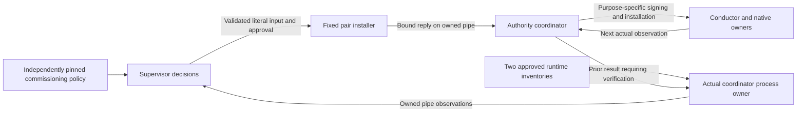

# Native pilot commissioning supervisor

This is a partial source implementation, not a runnable or deployed supervisor.
The .368 source batch connects the retained measured-recipe owner; it supplies
no new build or runtime evidence and does not increase job coverage.
Three of the existing 60 jobs have fixed policy/input composers. The automated
owner refuses startup **before spawning** while any job is unimplemented. There
is no CLI, generic template renderer, approval callback or implicit approval of
future inputs. Independent production acceptance remains separate.

## Decision and process ownership

The supervisor is separate from the authority coordinator, which holds the
purpose-specific signing capabilities, and from the conductor, which owns native
launch resources and never receives those capabilities.

`native_pilot_supervisor_process.AuthorityCoordinatorProcess` admits both complete
runtime inventories at their protected installed locations. It starts only the
packaged authority command with the separate conductor inventory and exact
source-selected key-purpose FDs. Requests are opaque objects created by its real
pipe reader, not dictionaries supplied as supposed process ownership. A received
result still needs signature and input association checks; a pipe is not itself
independent authority or measured Nitro evidence.

Runtime inventory preparation precedes `prepare_bootstrap()`, which retains the
actual installed bootstrap originals. Policy binding compares all four originals
before any child spawn; checking only after a launch request would be too late.
The original short startup window is never renewed to accommodate preparation.

`native_pilot_supervisor_policy.SupervisorPolicy` retains a protected policy FD
whose literal bytes match an independently supplied pin. Its closed grammar binds
both runtime inventories, their source metadata, all 42 measured public-key
bindings, the four approved bootstrap originals and the explicit precreation
fragment. Selecting these values and approving their digest remains a separate
commissioning responsibility. Computing a digest locally does not approve it.

Legacy policy/v1 retains its exact eight fields and purpose
`initial-driver-bootstrap-and-endpoint-precreation`. Explicit
`serverware.nativePilotSupervisorCommissioningPolicy/v2` adds only
`measuredRecipeSha256` and uses purpose
`initial-driver-bootstrap-precreation-and-measured-configuration`. The pin selects
the complete independently approved [recipe/v2](native-pilot-measured-configuration.md),
not a predicted configuration hash or a future driver identity.

## Implemented composition

| Existing job | Independently selected inputs | Actual data admitted during the attempt |
| --- | --- | --- |
| `driver-bootstrap` | Driver control/configuration/window and cold delivery configuration | Genuine prepared admission payload and bootstrap observation from the owned coordinator |
| [`cohort-precreation`](native-pilot-supervisor-precreation.md) | C9 authority, endpoint executable, cleanup authority/scope/journal/genesis, ten native and five ordinary cold configurations, ordinary executable hashes | Verified prior bootstrap signature, gate association and measured original hashes |
| `install-precreation` | Same retained policy, including cohort executable | Verified actual cohort signature and the exact derived v7 cohort/v6 ordinary launch originals |

The original boot, time namespace, invocation and startup/lifetime interval are
preserved; no timestamp renewal, invented journal, placeholder signature or
fabricated successful observation is allowed. The gate binding is checked
against the prepared bootstrap association; it is not inserted into a schema
that has no such field. Every prior signature is joined to the complete input
actually approved for that job.

`native_pilot_supervisor.CommissioningSupervisor` connects the owners/composers
to the existing approval installer and reply protocol. `prepare(policy=...,
process=..., measured_recipe=...)` requires the actual retained recipe/v2 for
policy/v2; policy/v1 requires no recipe. It checks the independent recipe pin
before bootstrap preparation, then binds that owner to the same actual process
before spawn. On the genuine pending `cohort-precreation` request, `step()` derives
once from the verified prior bootstrap result. A downstream fixed composer can
read `policy.measured_configuration(process=..., request=...)` only with that
process's actual pending startup request. The checked result is unsigned public
data, not approval of another job or proof of a populated retrieval store.

`start()` checks complete source coverage
before attempting a child start; it currently refuses. Future complete coverage
will let `step()` receive, compose, approve, install and reply once in fixed order.
The returned `approval-installed-and-replied` status is not a claim that the
authority has executed that job successfully. `close()` retains both owners on
unknown cleanup, including the retained recipe when present; it does not delete
partial files or authorize a retry. Recipe access keeps the original startup
deadline; lifetime/cleanup checks do not renew it or require a fresh derivation.

The process also retains each actual fixed installed input before sending its
reply, bounded by existing per-job limits and a cumulative 128 MiB. The
`approved_input_original(phase, job)` accessor returns it only after the complete
reply was sent. Future composers must still validate the actual returned result;
retained bytes and a reply hash are not proof of successful execution.

## Remaining work

The first endpoint extension is **held, not admitted**. Source review found
[two concrete commissioning contradictions](native-pilot-endpoint-commissioning-design.md):
pre-start inputs depend on a future measured driver identity, and a shared
assignment hash cannot simultaneously identify the endpoint and bridge closure
manifests. The separate draft is not restored. The explicit
[assignment/closure-set contracts](native-pilot-assignment-closure-set.md), retained
post-observation derivation and [endpoint runtime marker](native-pilot-endpoint-runtime.md)
now provide source prerequisites; they do not connect the draft endpoint
composers or approve their inputs. Coverage remains three jobs.

The other 57 jobs, from `endpoint-inputs` through `shutdown`, still need fixed
policy composition and applicable prior-result verification. Existing signers,
installers and the 60-job executor do not supply those independent decisions.
The next bounded batch is `endpoint-inputs` and the first three native delivery
jobs. It needs fixed publication for the run-specific peer/proof-scope/retrieval
manifest, an independently provisioned nonempty fs-verity object store, the
signed assignment/verification trust and the three role runtimes. The real
activation arrays then supply dynamic delivery bindings. A cgroup-original
digest is not a cgroup-path digest; neither can be substituted for the other.
Each later launch still needs independently authorized closure-set membership
and its exact leaf/runtime bytes; the marker alone supplies neither authorization
nor service settings.

Complete coverage, the executable supervisor entrypoint/package, connected
runtime verification and protected deployment remain required. The first three
composers do not close an overall project checkpoint or establish pilot readiness.

External dependencies remain: approved immutable dependency publication, genuine
policy/key/service/history provisioning, live AWS/Nitro/KMS and independent
witness/provider/hardware evidence. Earlier engineering artifacts predate this
source and are not automatically rebuilt, deployed or promoted by it.
