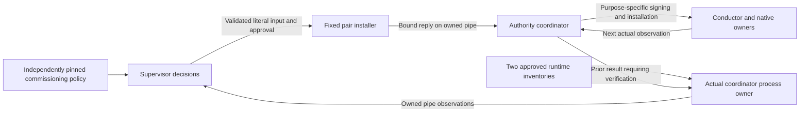

# Native pilot commissioning supervisor

This is a partial source implementation, not a runnable or deployed supervisor.
The `.375` source connects five ordinary generation grants after C9 delivery,
initial history, endpoint preparation and first native C9 decisions. **42 of 85**
jobs now have fixed policy/input composers. Source coverage is not production
acceptance, which remains **0/6**. The automated
owner refuses startup **before spawning** while any job is unimplemented. There
is no CLI, generic template renderer, approval callback or implicit approval of
future inputs. Independent production acceptance remains separate.

## Decision and process ownership

The supervisor is separate from the authority coordinator, which holds the
purpose-specific signing capabilities, and from the conductor, which owns native
launch resources and never receives those capabilities.

`native_pilot_supervisor_process.AuthorityCoordinatorProcess` admits both complete
runtime inventories at their protected installed locations. It starts only the
packaged authority command with the separate conductor inventory and exact
source-selected key-purpose FDs. Requests are opaque objects created by its real
pipe reader, not dictionaries supplied as supposed process ownership. A received
result still needs signature and input association checks; a pipe is not itself
independent authority or measured Nitro evidence.

Runtime inventory preparation precedes `prepare_bootstrap()`, which retains the
actual installed bootstrap originals. Policy binding compares all four originals
before any child spawn; checking only after a launch request would be too late.
The original short startup window is never renewed to accommodate preparation.

`native_pilot_supervisor_policy.SupervisorPolicy` retains a protected policy FD
whose literal bytes match an independently supplied pin. Its closed grammar binds
both runtime inventories, their source metadata, all 57 measured public-key
bindings, the four approved bootstrap originals and the explicit precreation
fragment. Selecting these values and approving their digest remains a separate
commissioning responsibility. Computing a digest locally does not approve it.

Legacy policy/v1 retains its exact eight fields and purpose
`initial-driver-bootstrap-and-endpoint-precreation`. Explicit
`serverware.nativePilotSupervisorCommissioningPolicy/v2` adds only
`measuredRecipeSha256` and uses purpose
`initial-driver-bootstrap-precreation-and-measured-configuration`. The pin selects
the complete independently approved [recipe/v2](native-pilot-measured-configuration.md),
not a predicted configuration hash or a future driver identity.

Explicit policy/v3 retains those nine fields and adds `endpointPreparation` and
`endpointDeliveries`, with purpose
`initial-driver-bootstrap-precreation-and-endpoint-commissioning`. The preparation
fragment selects only fresh-ledger initialization, an existing empty protected
directory and three independent peer expectations. It contains no future process,
configuration hash, proof scope or receipt. The delivery fragment supplies the
three exact role runtimes, their fixed public pins and nonempty credential
metadata; it supplies no private bytes. V1/v2 remain unchanged. See
[endpoint commissioning](native-pilot-supervisor-endpoints.md).

Explicit policy/v4 adds `ordinaryInitialHistories` with purpose
`initial-driver-bootstrap-precreation-endpoints-and-ordinary-initial-history`.
It delegates checkpoint, root-anchor, checkpoint-anchor, service-anchor and
keyless assembly for each ordinary role. The 15 new key selectors are pinned
to approved raw public material; each role's two checkpoint calls reuse its
checkpoint capability. Legacy v1–v3 preserve their 42-key field set and cannot
bind the expanded coordinator; selecting v4 requires independent reapproval.
See [initial-history policy and job binding](native-pilot-ordinary-initial-history.md#supervisor-connection).

Explicit policy/v5 adds the literal `ordinaryDeliveriesOriginal` and purpose
`initial-driver-bootstrap-precreation-endpoints-and-ordinary-deliveries`.
It selects closed five-role runtime recipes and existing credential metadata,
not future process identities or runtime hashes. The same 57 selectors remain;
ordinary delivery keys must match their actual approved cold authorities. V4
continues to authorize only its existing initial-history scope. See
[ordinary runtime preparation and deliveries](native-pilot-ordinary-deliveries.md).

Explicit policy/v6 adds `ordinaryGenerationsOriginal`: only the independently
approved installation UNIX interval, not predicted scope hashes. Its five
generation selectors must match the initial-history roots. Legacy policies gain
no new authority. See [ordinary generation grants](native-pilot-ordinary-generations.md).

## Implemented composition

| Existing job | Independently selected inputs | Actual data admitted during the attempt |
| --- | --- | --- |
| `driver-bootstrap` | Driver control/configuration/window and cold delivery configuration | Genuine prepared admission payload and bootstrap observation from the owned coordinator |
| [`cohort-precreation`](native-pilot-supervisor-precreation.md) | C9 authority, endpoint executable, cleanup authority/scope/journal/genesis, ten native and five ordinary cold configurations, ordinary executable hashes | Verified prior bootstrap signature, gate association and measured original hashes |
| `install-precreation` | Same retained policy, including cohort executable | Verified actual cohort signature and the exact derived v7 cohort/v6 ordinary launch originals |
| `endpoint-inputs` | Recipe/v2, explicit fresh-ledger directory and peer expectations | Actual measured configuration/scope, original assignment, verified prior jobs and actual empty-directory preparation |
| `native-delivery-retrieval` | Retrieval runtime and credential metadata | Actual activation FDs, original cohort window and assignment-bound runtime leaf |
| `native-delivery-persistence` | Persistence runtime and credential metadata | Same joins plus the verified actual Retrieval delivery result |
| `native-delivery-trustedTime` | TrustedTime runtime and credential metadata | Same joins plus both earlier verified delivery results |
| Five `ordinary-initial-*` jobs per role | Three public authorities, protocol role, generations/deployment, revocation facts and original-lifetime validity rule | Actual preparation/empty directories, exact approved predecessor inputs, verified checkpoint and three anchor results; only the complete wrapper is published |
| Five `ordinary-delivery-*` jobs | Closed runtime recipes, existing credential metadata and each cold C9 authority | All five verified wrappers, actual peer/preparation/directories, retained fixed public installation and prior signed delivery results |
| Five `ordinary-generation-*` jobs | Original installation interval and existing independent history-root keys | Verified delivery/runtime/history handoff, authenticated assignment/trust, actual bootstrap/driver recipe and complete prior signed grant results |

The original boot, time namespace, invocation and startup/lifetime interval are
preserved; no timestamp renewal, invented journal, placeholder signature or
fabricated successful observation is allowed. The gate binding is checked
against the prepared bootstrap association; it is not inserted into a schema
that has no such field. Every prior signature is joined to the complete input
actually approved for that job.

`native_pilot_supervisor.CommissioningSupervisor` connects the owners/composers
to the existing approval installer and reply protocol. `prepare(policy=...,
process=..., measured_recipe=...)` requires the actual retained recipe/v2 for
policy/v2–v6; policy/v1 requires no recipe. It checks the independent recipe pin
before bootstrap preparation, then binds that owner to the same actual process
before spawn. On the genuine pending `cohort-precreation` request, `step()` derives
once from the verified prior bootstrap result. A downstream fixed composer can
read `policy.measured_configuration(process=..., request=...)` only with that
process's actual pending startup request. The checked result is unsigned public
data, not approval of another job or proof of a populated retrieval store.

`start()` checks complete source coverage
before attempting a child start; it currently refuses. Future complete coverage
will let `step()` receive, compose, approve, install and reply once in fixed order.
The returned `approval-installed-and-replied` status is not a claim that the
authority has executed that job successfully. `close()` retains both owners on
unknown cleanup, including the retained recipe when present; it does not delete
partial files or authorize a retry. Recipe access keeps the original startup
deadline; lifetime/cleanup checks do not renew it or require a fresh derivation.

The process also retains each actual fixed installed input before sending its
reply, bounded by existing per-job limits and a cumulative 128 MiB. The
`approved_input_original(phase, job)` accessor returns it only after the complete
reply was sent. Future composers must still validate the actual returned result;
retained bytes and a reply hash are not proof of successful execution.

## Remaining work

The original endpoint draft remains a historical design artifact, not a source
of approvals. The new composers use the explicit
[assignment/closure-set contracts](native-pilot-assignment-closure-set.md), retained
post-observation derivation, [role runtimes](native-pilot-endpoint-runtime.md) and
[fresh-ledger profile](native-pilot-fresh-ledger-startup.md). They do not restore
the old contradictory pre-start scope/manifest requirements.

The other 43 jobs, from `native-delivery-generationInstall` in `service-originals`
through `shutdown`, still need fixed
policy composition and applicable prior-result verification. Existing signers,
installers and the 85-job executor do not supply those independent decisions.
The first-generation boundary revalidates the five actual deliveries; explicit
v6 decisions then compose the five grants. The next native-delivery boundary
revalidates all five grants and retained runtime/history originals but does not
approve a native delivery.
Further composition still needs independently approved authority inputs and
actual resource observations. A cgroup-original digest is not a cgroup-path
digest; neither can be substituted for the other.
Each later launch still needs independently authorized closure-set membership
and its exact leaf/runtime bytes; the marker alone supplies neither authorization
nor service settings.

Complete coverage, the executable supervisor entrypoint/package, connected
runtime verification and protected deployment remain required. These 42
composers do not close an overall project checkpoint or establish pilot readiness.

External dependencies remain: approved immutable dependency publication, genuine
policy/key/service/history provisioning, live AWS/Nitro/KMS and independent
witness/provider/hardware evidence. Earlier engineering artifacts predate this
source and are not automatically rebuilt, deployed or promoted by it.
