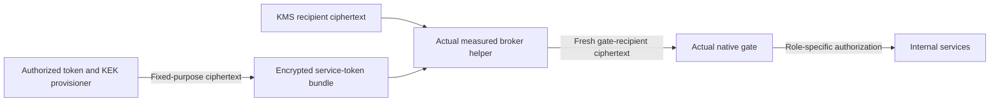

# Encrypted native service-token delivery

Status: source-integrated; unbuilt, unexecuted and unprovisioned.
This is the service-token portion of native startup v6, not complete enclave
startup delivery, independent release admission or a pilot acceptance result.

## Why this is separate

The v1–v5 gate configuration contains service bearer tokens. Owner-only files
do not make those tokens safe to copy into an OCI image, EIF, public source
archive or parent-side launch configuration. V6 carries a purpose-specific
encrypted bundle instead. The existing credential-row format remains unchanged;
this envelope cannot be passed as an upstream provider credential or generic
decryption request. All legacy profiles retain their existing requirements.

The authorized secret provisioner supplies the actual KEK and independently
provisioned service tokens. It must not run on the untrusted build worker or
transfer either plaintext input to that worker. The helper receives its KEK
through the existing actual Nitro/KMS recipient path and independently checks
the full KEK commitment. The abbreviated secretKekId is only an association,
never a replacement for that full check.

## Exact custody path

`serverware.nativeServiceTokensEnvelope/v1` has exactly apiVersion, binding,
secretKekId, nonce and ciphertext. Its binding names the workload instance,
actual gate binary, admitted policy hash, exact service URLs and atomic-release
mode. Startup must derive the expected binding from its actual retained inputs;
reading the envelope's own values back to it is not admission.

AES-256-GCM authenticates the fixed purpose domain plus the canonical public
header. The encrypted plaintext is exactly 32768 bytes: a four-byte big-endian
length, a canonical ASCII document of at most 24576 bytes, then zero padding.
Nonce and ciphertext use canonical unpadded base64url. This avoids revealing
individual token lengths in the immutable configuration.

The plaintext contains exactly five named roles: credential lease, grant
consume, rate-limit consume, release authorization and management. Every slot
is present; unused roles are null. Credential lease and management are required.
Configured service URLs require their corresponding token; an absent URL forbids
one. Non-atomic mode requires both grant and rate-limit endpoints. Tokens are
distinct, printable ASCII, 32–4096 bytes with the existing minimum diversity
check; this check is not proof of entropy. Audit uses its dedicated workload
mTLS and never receives a bearer slot in this bundle.

Only one service-token open may occur, before any credential-row open. Both the
Rust owner and actual helper irreversibly consume that phase before decryption.
Output uses a separate service-token ciphertext family and HKDF/AEAD domain,
bound to the entire original request and a fresh gate-owned X25519 recipient.
No RSA key, KEK, DEK or plaintext token crosses the helper channel. The actual
gate retains service tokens for their intended HTTP authorization; it is not
claimed to be tokenless. Failures poison/terminate the broker, with no fallback
or new deadline. Private parsed copies are not claimed completely erased.

## Provisioner interface

`scripts/seal_native_service_tokens.py` accepts distinct inherited sealed memfds
through --kek-fd, --tokens-fd and --binding-fd, plus the nonsecret --kek-sha256
commitment. Each descriptor must be a caller-owned, owner-only anonymous regular
file with write/grow/shrink/seal seals. Tokens and binding are exact canonical
ASCII JSON; the token input is the five-slot object, not a full configuration.
The command emits only the encrypted envelope. It does not generate service
credentials, provision KMS, sign or publish configuration, or authorize a release.

The runtime packager explicitly includes the shared closed-format module in the
actual immutable helper image. Image/release identity changes accordingly; old
artifact hashes and measurements cannot attest the new helper.

## Remaining boundaries

Independent current configuration admission must bind the complete encrypted
envelope. Encryption alone is not rollback protection or a token-rotation
protocol. Service credential creation/rotation and genuine independent KEK
provisioning remain operator-owned ceremonies. Fresh launch nonces, the original
guest-clock deadline and the release-record reference still need actual launch
delivery; they cannot simply be baked into a self-referential measured release.
Shadow/response startup, provider OAuth issuance/refresh and actual EIF/runtime
acceptance are separate remaining work. This source claims neither a secretless
whole configuration nor a completed N06 checkpoint.
