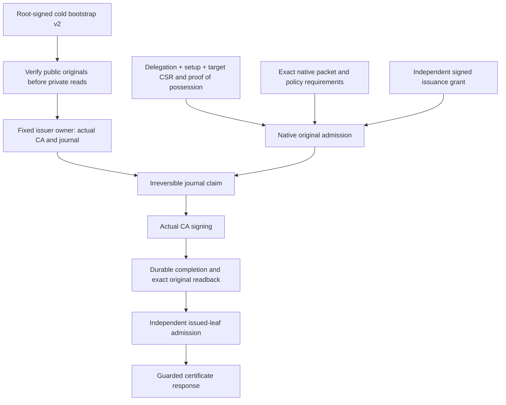

# Native workload issuer cold authority

This source profile connects request-first native enrollment to the existing
local certificate issuer. It is not a running deployment or completed enrollment
workflow. The independently operated release, custody and production-acceptance
services remain required.

## Authority decision

A native packet or successful bootstrap diagnostic is not permission to issue
a client certificate. Native issuance therefore has two distinct authorities:
the root-signed cold bootstrap admits the issuer process and its fixed scope;
a separate issuance authorizer signs a short-lived grant for exact originals.
The grant directly authorizes issuance. It does not claim measured Nitro custody
from the packet or accept a caller-supplied verification result.

The native packet input is the seven-field packet v2, not the eight-field public
evidence capture. Role-3/role-5 evidence and local diagnostic output neither
select the issuer profile nor replace its independent grant.

## Closed cold profile

[`workload-identity-issuer-bootstrap.v2.schema.json`](../schemas/workload-identity-issuer-bootstrap.v2.schema.json)
describes the public envelope. The exact canonical payload is signed under the
`catchplate.workloadIdentityIssuerBootstrap/v2` domain followed by NUL. Actual
verification also checks signatures, source revision, byte counts and digests,
key separation, live intervals and fixed launch/resource commitments.

Native v2 keeps the same issuer configuration, policy, CA, journal and launch
fields, but replaces the legacy `packetSigningKey` and `runtimeManifestDigest`
with a closed `nativeEnrollment` scope. That scope pins the release record,
native runtime configuration, runtime interception CA certificate and SPKI, and
separate delegation and setup Ed25519 public-key originals. The root,
issuance-authorizer, issuer CA, delegation-authorizer and setup-authorizer keys
must have distinct SPKIs. No dummy legacy manifest or packet key is constructed.

The issuer-service `configurationDigest` is not the native runtime configuration.
The workload issuer CA is not the runtime interception CA. Exact issuer PEM bytes
retain their existing digest meaning for the CA builder and journal; the native
issuer DER commitment has its own separately named field in the issuance grant.

The actual entrypoint selects only the closed v1 or v2 verifier from bounded
public envelope decoding. Full root authentication follows before CA-private-key
or journal acquisition. The resulting immutable cold owner chooses the worker's
grant verifier; an uploaded packet flag cannot change that choice. Legacy v1
continues to use its strict original verifier and unchanged issuance contract.

## Preserved custody and processing limits

Both profiles use service UID/GID 65492, peer UID/GID 65532, the same fixed socket
and inherited descriptors 198–202. Public cold input remains bounded to 128 KiB;
native key originals are charged at their actual sizes. No extra work allowance,
clock reset, descriptor capability or private-key accessor is introduced.

The same worker reserves bounded input, authenticates originals, makes the
irreversible journal claim, signs with its actual CA, reads back durable completed
originals, independently admits the resulting leaf and guards the response.
Unknown/incomplete outcomes do not authorize signing again. Journal principal
storage can represent the full request-first 1024-byte UTF-8 identity without
changing legacy grant admission, record framing or hashed slot addressing.

These are trusted-host-local controls. Local durable state does not establish
off-host rollback protection; software keys and process checks do not establish
Nitro/KMS/HSM custody or a hostile-host boundary.

## Remaining integration

See the [original admission guide](native-workload-identity-originals.md),
[native issuance grant](native-workload-identity-issuance-authorization.md) and
[common issuer pipeline](workload-identity-issuer.md). Certificate compatibility
enforces the actual target mTLS selectors, not hidden header/token values, source
CIDRs or complete request/provider policy. First-issuance certificate-digest
selectors are rejected because the leaf does not exist yet.

Actual native caller delivery and retained-key SDK leaf admission, protected
installation reservation/token possession and observed namespace ownership,
scoped CA installation, egress/canaries, lifecycle and explicit recovery remain
open. Source integration is unbuilt and unexecuted until the consolidated freeze;
it closes neither N05 nor any independent production-acceptance gate.
