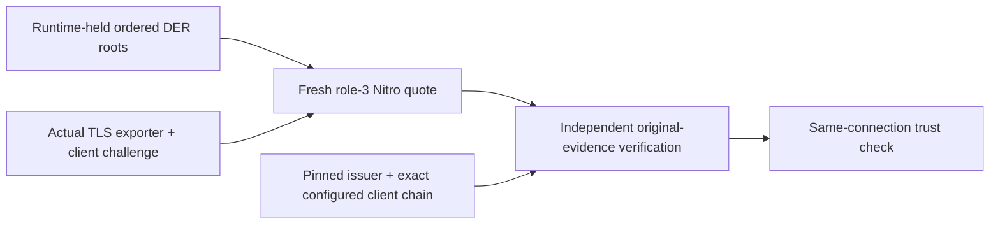

# Native workload trust verification

Status: source-only, unbuilt and unexecuted. This is partial N04 integration,
not a provisioned identity, tested pilot or production enrollment receipt.

A workload needs to know both **which proxy it reached** and **which credential
issuers that proxy actually trusts**. An operator-supplied manifest or a matching
hash alone cannot establish the latter. The native session profile exports the
runtime's retained public trust certificates and authenticates their commitment
through a genuine fresh Nitro quote bound to the actual client TLS connection.
The client separately pins its chosen issuer; it never adopts one from the response.



## Explicit versions, no silent upgrades

| Surface | Existing profile | Opt-in profile |
| --- | --- | --- |
| Startup public evidence | `nativeIngressPublicEvidence/v1` | Unchanged |
| Session request | No evidence selector | `x-serverware-ingress-evidence: client-trust-v2` |
| Session outer/nested evidence | `nativeIngressSessionEvidence/v1` / `nativeIngressPublicEvidence/v1` | Both `/v2`; mixed versions fail |
| Standalone native client | `nativeIngressClient/v1` and `/v2` | [`nativeIngressClient/v3`](../schemas/native-ingress-client.v3.schema.json) |
| Proof-client pre-CONNECT admission | `nativeProxyIngress/v1` | [`nativeProxyIngress/v2`](../schemas/native-proxy-ingress.v2.schema.json) |

The v3 client configuration is exactly the existing nonce-free v2 configuration
plus a required `workloadIssuer` artifact with an independently admitted absolute
path and exact SHA-256 pin. The artifact is one canonical public certificate PEM,
at most 64 KiB, with DER at most 16 KiB. It remains held and rechecked alongside
the original startup evidence, scope, Nitro roots, client chain and private key.
Existing configurations retain their meanings and never fall back after a v3
verification failure. No private key is added to public evidence or output.

The proof-client v2 configuration likewise adds only `workloadIssuer` to its
existing pinned ingress configuration. Its transport retains the exact public
chain selected by the existing client-certificate resolver for the actual full
TLS handshake; it does not reopen a certificate path or trust a submitted chain
claim. The resolver still delegates signing/key selection to its original owner.
Genuine selected-issuer/path/session verification must finish before CONNECT on
that same socket. A missing or inconsistent selected-chain capture rejects v2.
The standalone client instead publishes a bounded local-only capture after
authenticated TLS close; it never sends CONNECT or an application operation.

The separate [principal preflight](native-principal-preflight.md) adds explicit
`nativeProxyIngress/v3` to the proof client. It uses the target's actual issued
identity and authentication headers, joins current runtime principal policy to
a new statement-bound role-3 nonce, and retains the independent result through
the same transport. It does not change the v1/v2 evidence contracts below or
the standalone client. Normal CONNECT and provider authorization still run.

## What is actually verified

The runtime encoder uses the exact ordered DER root vector held by its generated
mTLS configuration, not desired configuration, a new filesystem read or the
standard-ingress diagnostic projection. The nested v2 `ingress` adds only:

- `clientTrustProfile: "native-framed-der-v1"`;
- `clientTrustCertificatesDerBase64url`, an array of those original DERs.

The existing role-3 user data already commits to the root-set digest. Its recipe
is unchanged, including order and framing:

```text
SHA256("serverware/mutual-tls-client-trust/v1\0"
       || root_count:u32BE
       || each (root_length:u64BE || original_root_DER))
```

The independent verifier recomputes that digest and joins it to the independently
pinned session scope and authenticated original Nitro COSE/PKI/PCR/nonce binding.
The role-3 binding also includes the actual ingress leaf and CA/key identities.
The caller's challenge and actual retained TLS exporter's derived nonce, plus
the presented server chain, must match. Public echoes and local result JSON are
never accepted as substitute authority.

The selected issuer must be an exact DER member of the authenticated inventory;
its SPKI identity is derived from that same certificate. Only that independently
pinned issuer is installed in the workload-chain verifier's private trust store.
The exact configured client chain remains 1–8 certificates (64 KiB PEM total,
16 KiB DER each), including intermediate-chain support. The selected anchor may
be omitted or occur once at the tail, but cannot be the leaf. Repeated
certificates fail. Genuine WebPKI verification checks the current clientAuth path
under that selected anchor; the fixed TLS client configuration uses the same
certificate-chain original and retained key. The successful mTLS handshake
provides possession proof for that connection, not permission to perform an API
operation. Normal principal, route and request-policy checks remain separate.

## Bounds and failure behavior

The runtime root inventory retains its existing limits: 1–32 roots, 64 KiB per
root and 1 MiB aggregate. Those are **not larger public-output allowances**.
The nested evidence remains at most 64 KiB including LF; the outer response
remains at most 96 KiB. The producer checks the encoded-size budget before
allocating the exported inventory and refuses oversized output. Some otherwise
valid native root sets therefore cannot use this bounded v2 export. There is no
automatic fallback or truncation.

Unknown or repeated evidence selectors fail closed. Actual originals, process
and original deadlines are retained; there is no retry, challenge redraw or
lifetime renewal. Startup evidence must still be fresh under its pinned
1–300-second age limit. This is an initial bootstrap/session check, not a
long-running renewal protocol. The [session guide](native-ingress-session.md)
describes the retained transport, quote and continuation deadlines.

## Independently authorized cold native startup

The explicit `--native-workload-trust-startup-v22` mode selects
[`nativeStartupConfiguration/v22`](../schemas/native-startup-configuration.v22.schema.json).
Its unchanged v21 fields are joined to an independently provisioned
`workloadTrustAuthorizer` containing canonical public-key PEM and its exact-byte
SHA-256 pin. The key must differ from every client CA, the policy and control-plane
response keys, enrollment/setup authorizers, and actual generated proof/TLS keys.
No private key or signed authorization is embedded in that configuration.

Pass the separate original using `--workload-trust-authorization PATH` and
`--workload-trust-authorization-sha256 SHA256`. These flags are required only by
v22 and refused by older modes. The actual original is bounded to 128 KiB,
canonical ASCII without LF, read through the existing retained no-follow input
owner, and independently signature-verified. The
[producer guide](native-workload-trust-authorization.md) describes the separate
authorizer operation; local file hashes do not approve keys or deployment.

The [native grant](../schemas/native-workload-identity-trust-authorization.v1.schema.json)
binds the exact configuration and launch originals, release record, deployment
and instance, signed policy hash/sequence/rollback epoch, original BOOTTIME
deadline, ordered root certificate/SPKI inventory, framed DER commitment and
complete normalized mTLS principal inventory. Each of the 1–32 actual CA roots
must satisfy the restricted CA/key profile and the same authorization interval.
The interval is at most 24 hours, lies inside every issuer and the native
CA/ingress validity intervals, and is never renewed. The grant is absent from
both originals it hashes, so this does not create a self-referential config pin.

Admission completes against the actual generated TLS owner and genuinely loaded
signed snapshot before binding the external listener. The serving owner retains
those exact objects and original process/lifetime; handshakes, request/dispatch
freshness, publication windows, policy refresh and fresh session quotation check
it. A changed policy or root set requires new independent authorization and a
restart, not a hot reload. Existing role-3 session formats stay unchanged: they
already bind the actual config/release/policy and exact ordered roots to the
client challenge and that same TLS connection. A session proof remains distinct
from the native grant and never becomes a generic trust-install permission.

## Scope still open

The [standard single-issuer trust publisher](workload-identity-trust-distribution.md)
and this native path have different hash contracts. A canonical PEM artifact
digest, native ordered framed-DER digest and `.233` diagnostic projection are
not interchangeable. The native grant never imports or weakens the standard
signed trust authorization; native trust rotation/retirement remains unsupported.

Native acquisition, retained enrollment-signer/runtime-policy association and
exact capture-to-issuer/SDK submission are source-connected. They have not been
credited as an accepted deployment or production enrollment. The legacy Python
enrollment route's development-only attestation helper stays separate; native
fields are not flattened into its packet. Ordinary workload/sidecar deployment,
issuer lifecycle, latest
revocation/witness state and independent release admission remain separate.

Before the consolidated verification freeze, cover unchanged v1/v2 behavior,
v3 intermediate and direct chains, wrong issuer/path/key, reordered or changed
roots, paired-version rejection, duplicate selectors, output limits, stale
startup, expired identity/deadline, actual-session mismatch, selected-chain
capture and refusal before CONNECT; include v22 wrong authorizer, changed launch,
ordered multi-root inventory, changed policy, original deadline and restart-only
refusals. These are
required future checks, not reported test results. Production remains **0/6**.
