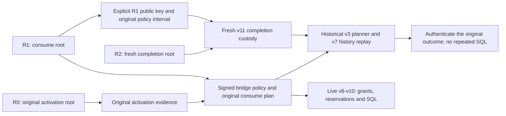

# Purpose-specific historical consume authority

The `.225` source connects separate signed history purposes to the actual grant,
reservation, SQL and completion workers. Planning authority is not execution
authority. Each legacy profile remains strict; no unknown version falls back
to another role, root or current configuration.

| Role | Legacy history | Bridged history | Interval rule |
| --- | --- | --- | --- |
| Planning | v2 | v7 | Exact original interval derived from the consume policy and planner age limit |
| Grant | v3 | v8 | Fresh interval contained in the original consume policy |
| Reservation | v4 | v9 | Fresh interval contained in the original consume policy |
| SQL | v5 | v10 | Fresh interval contained in the original consume policy |
| Completion | v6 | v11 | Fresh outer interval; separately pinned original consume-policy interval |

These are versions of `serverware.signedOidcSessionActivationHistoryCustody`.
The bridge profiles retain their role's existing process identity and UID/GID.
The version locator only chooses within that source-fixed role pair; genuine
signature and closed-payload admission must follow before authority is used.

## Three authorities, not a key fallback

The roots may differ. R1 signs the policy that independently authenticates R0;
R2 signs fresh completion authority that explicitly names R1. Neither a retained
record nor a schema label enrolls a key. Complete same-generation state payload
compatibility is still required. Arbitrary database/state migration and older
source implementations are outside this connection.

Live v8-v10 custody verifies the R1 policy as live. Its role/receiver is separately
root-authorized, not copied from the v7 planning receiver. Completion instead
authenticates expired R1 originals as historical evidence under an explicit
original interval. Actual processing keeps the current clock, inherited work
and deadline; it never samples an old issue time as the present or extends an
old grant. R1 enrollment still authenticates original state, caller, grant and
completion-signing evidence; R2 authorizes the fresh completion process.

## Actual worker connections

- [Live execution custody](oidc-session-activation-bridged-consume-execution-custody.md)
  binds the exact old planner and issuer policy across planning and receiving
  originals. Old activation provenance and current consume state remain separate.
- [Historical policy and planner admission](oidc-session-activation-consume-bridge-history.md)
  uses distinct historical-only APIs and result types, with no live launch renewal.
- [Completion](oidc-session-activation-delivery-completion-bridge.md) connects
  fresh custody, original-root enrollments, private replay and response processing.

All cold originals and request captures must fit the unchanged whole-call
capacity before body intake; a valid individual original can still be too large
in combination. The same work and deadlines survive each stage. Private plan
commitments cover the exact bridge policy and old state, not a role-specific
custody envelope that another independently authorized worker cannot share.

This is source integration, not execution evidence. At `.225`, public historical
consume remained disabled pending independently selected original R1 consume
authority for interrupted recovery. The `.226`
[consume-history selection](control-plane-consume-completion-history-selection.md)
connects that lookup before fresh actor binding, genuine full-control replay and
receiving. Fresh consume now uses its explicit signed bridge; retained records
never enroll authority. Historical intent, proof and release remain gated.
No completion result establishes
token release or a current browser session. H05 and all production acceptance
gates remain open; the current source has not been built or executed.
